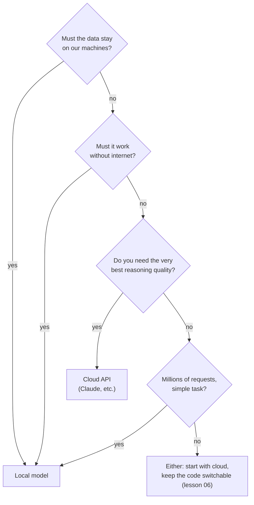

# 01 · Why local models, and how big they are

**What you'll build:** a small calculator that tells you how much memory (RAM) a model needs before you download it, and the knowledge to choose between "run it on my computer" and "use a cloud API".
**Like you're 5:** a model is a giant recipe book. Its *size* is how many pages it has, *quantization* is printing it in smaller letters so it fits on your shelf, and the *licence* is the note inside the cover that says who may cook from it and sell the food.
**Time:** ~1 h · **Builds on:** [AI from Zero Part 4 · Chatbots](../../../ai-from-zero/part-4-chatbots) · **Needs:** nothing extra (no download, no API key)

## Why this matters
Companies ask "can we run this AI on our own servers, so our data never leaves the building?" every week. Before anyone installs anything, an engineer has to answer three questions: *should* it be local, *will it fit* on the hardware, and *are we allowed* to use this model in a product. This lesson gives you all three answers with simple maths you can do on a napkin.

## What you'll learn
- **Local vs cloud:** what you win (privacy, cost, offline, speed, control) and what you give up (top quality, easy scaling).
- **Parameters:** the numbers a model learned during training. "8B" means 8 billion of them.
- **Bytes per weight and quantization:** storing each number with fewer bits (16 → 8 → 4) to make the model 2–4 times smaller, with a small loss in quality.
- **KV cache:** extra memory the model needs for the conversation itself; it grows with every token of context.
- **Licences:** "open weights" does not always mean "free for any use". Llama, Gemma, Qwen, Mistral and Phi have different rules.

## Before you start
- This lesson only needs Python (from the course setup). No packages, no models, no API key.
- Open a terminal in the course folder `open-source-and-on-device-ai` and activate the venv (see the [course README](../../README.md#setup-once)).

## Run it
1. Go to the lesson folder:
   ```bash
   cd part-1-run-models-locally/01-why-local-models-and-how-big-they-are
   ```
2. Run the calculator for four real Llama models:
   ```bash
   python model_memory.py
   ```
3. Try a longer conversation (32,768 tokens of context) and watch the totals grow:
   ```bash
   python model_memory.py --ctx 32768
   ```
4. Try any model by its size, for example a 14-billion-parameter model:
   ```bash
   python model_memory.py --params 14
   ```

**Command, piece by piece** (`python model_memory.py --ctx 32768`):

| Piece | Meaning |
|-------|---------|
| `cd` | "change directory": move into a folder |
| `part-1-run-models-locally/01-...` | the folder path; `/` separates a folder from the folder inside it |
| `python` | start the Python interpreter (the program that runs `.py` files) |
| `model_memory.py` | the file to run |
| `--ctx` | an **option** (also called a flag): starts with `--` and changes how the program behaves |
| `32768` | the value for `--ctx`: 32,768 tokens of context |
| `--params 14` | another option: "my model has 14 billion parameters" |

### What you should see
Real output of `python model_memory.py`:
```
Llama 3.2 1B  (1.24 billion parameters)
  KV cache for 8,192 tokens: 0.27 GB
  format    bits   weights    total   fits in (using 75% of RAM)
  FP16      16.0    2.48GB   3.02GB     8GB:yes   16GB:yes   32GB:yes   64GB:yes
  Q8_0       8.5    1.32GB   1.74GB     8GB:yes   16GB:yes   32GB:yes   64GB:yes
  Q4_K_M     4.9    0.76GB   1.13GB     8GB:yes   16GB:yes   32GB:yes   64GB:yes

Llama 3.2 3B  (3.21 billion parameters)
  KV cache for 8,192 tokens: 0.94 GB
  format    bits   weights    total   fits in (using 75% of RAM)
  FP16      16.0    6.42GB   8.10GB     8GB: no   16GB:yes   32GB:yes   64GB:yes
  Q8_0       8.5    3.41GB   4.79GB     8GB:yes   16GB:yes   32GB:yes   64GB:yes
  Q4_K_M     4.9    1.97GB   3.20GB     8GB:yes   16GB:yes   32GB:yes   64GB:yes

Llama 3.1 8B  (8.03 billion parameters)
  KV cache for 8,192 tokens: 1.07 GB
  format    bits   weights    total   fits in (using 75% of RAM)
  FP16      16.0   16.06GB  18.85GB     8GB: no   16GB: no   32GB:yes   64GB:yes
  Q8_0       8.5    8.53GB  10.57GB     8GB: no   16GB:yes   32GB:yes   64GB:yes
  Q4_K_M     4.9    4.92GB   6.59GB     8GB: no   16GB:yes   32GB:yes   64GB:yes

Llama 3.1 70B  (70.60 billion parameters)
  KV cache for 8,192 tokens: 2.68 GB
  format    bits   weights    total   fits in (using 75% of RAM)
  FP16      16.0  141.20GB 158.27GB     8GB: no   16GB: no   32GB: no   64GB: no
  Q8_0       8.5   75.01GB  85.47GB     8GB: no   16GB: no   32GB: no   64GB: no
  Q4_K_M     4.9   43.24GB  50.52GB     8GB: no   16GB: no   32GB: no   64GB: no

Rule of thumb: Q4_K_M needs about 0.6 GB per billion parameters, plus the KV cache.
```
Look at three things:
1. **The same model shrinks about 3x** from FP16 to Q4_K_M (8B: 16 GB → 4.9 GB). That is why almost everyone runs quantized models at home.
2. **An 8B model in Q4_K_M does not fit an 8 GB laptop at 8,192 tokens of context**, but a 3B model does. That is why this course uses 1B–3B models by default.
3. **70B needs a workstation** (64 GB+ of RAM or big GPUs), even in 4-bit.

## How it works

### Part A: should it be local at all?



| Reason to go local | What it means in real life |
|--------------------|---------------------------|
| **Privacy** | Patient notes, contracts or source code never leave the laptop or the company network. Often the deciding reason for hospitals, banks, lawyers and governments. |
| **Cost** | After you own the hardware, each extra answer costs only electricity. Great for huge volumes of simple jobs (tagging, summarising, extracting). |
| **Offline** | Works on a ship, in a field clinic, on a factory floor, in a plane. Lesson 16 builds exactly this. |
| **Latency** | No trip across the internet. A small local model can start answering in tens of milliseconds. |
| **Control** | Nobody can change or retire "your" model. Same file, same answers, for years. You can also fine-tune it (lesson 15). |

**When NOT to go local:**
- You need the **best quality** on hard reasoning, long documents or tricky code. The largest cloud models are still clearly better than anything that fits on a laptop.
- You have **many users at once**. Serving hundreds of people needs GPU servers, monitoring and on-call engineers (lesson 14). A cloud API hides all of that.
- You have **weak hardware** and no budget. A 3B model on an old laptop is slow and makes more mistakes.
- **Time to market.** An API call takes five minutes to set up; a well-run local stack takes days.

Most real products mix both: private or high-volume work on local models, hard questions to a cloud model. Lesson 06 shows how one piece of code can talk to either.

### Part B: how big is a model?

A model is mostly a huge list of numbers called **parameters** (or **weights**). Each number must be stored in memory while the model runs.

```
memory for weights = number of parameters × bits per weight ÷ 8
```
(÷ 8 because 8 bits = 1 byte.) In this course 1 GB = 1 billion bytes.

| Format | Bits per weight | Bytes per weight | 8B model weights |
|--------|----------------|------------------|------------------|
| FP32 (training) | 32 | 4 | 32 GB |
| **FP16 / BF16** (the "original" download) | 16 | 2 | 16 GB |
| **Q8_0** (8-bit) | 8.5 | ~1.06 | 8.5 GB |
| **Q4_K_M** (4-bit, the popular default) | ~4.9 | ~0.61 | 4.9 GB |

Why 8.5 and not 8? Quantized formats store numbers in small **blocks** (32 numbers in Q8_0) plus one extra "scale" number per block, which costs a little extra. The values come from llama.cpp's own `llama-quantize --help` (lesson 04).

**Quantization, like you're 5.** Imagine measuring every child in a class to the nearest *millimetre* (precise, lots of digits to write down) versus to the nearest *5 centimetres* (much shorter to write, still good enough to line them up by height). Quantization does that to the model's numbers: it keeps their rough size and throws away tiny details. With 4 bits, each number can only be one of 16 levels inside its block. Surprisingly, models barely notice at 8 bits and only a little at 4 bits. Below 4 bits, answers get noticeably worse (you will measure this in lesson 04).

### Part C: the KV cache (memory for the conversation)

While the model reads your conversation, it saves two small vectors, a **Key** and a **Value**, for every token in every layer, so it doesn't have to re-read everything for each new word. That saved memory is the **KV cache**.

```
KV cache = 2 × layers × kv_heads × head_dim × context_tokens × 2 bytes
           ↑ K and V                                          ↑ FP16 = 2 bytes
```
For Llama 3.1 8B: `2 × 32 × 8 × 128 × 2 bytes = 131,072 bytes` = 128 KB **per token**. At 8,192 tokens that is about 1.07 GB; at 131,072 tokens (its maximum) it is **17 GB**, more than the weights! That is why tools like Ollama use a small context by default and you raise it only when you need it.

`layers`, `kv_heads` and `head_dim` come from the model's `config.json` (names there: `num_hidden_layers`, `num_key_value_heads`, and `head_dim` or `hidden_size ÷ num_attention_heads`).

### Part D: the code (`model_memory.py`)
1. `FORMATS` maps each file format to its bits per weight. `MODELS` holds four real Llama configs.
2. `weights_gb(params, bits)` is the formula from Part B.
3. `kv_cache_gb(...)` is the formula from Part C.
4. `show_model(...)` adds them up, multiplies by `OVERHEAD = 1.10` (+10% for the program's working memory) and prints one line per format.
5. `fits(total)` checks each RAM size, keeping a quarter free for your system, browser and editor (`USABLE = 0.75`).
6. `main()` reads the options with `argparse` (Python's built-in tool for `--options`). `--params` switches from the four presets to your own model; `--layers`, `--kv-heads` and `--head-dim` add its KV cache.

**GPUs and Macs:** on a PC with a graphics card, the fast part is the GPU's own memory (**VRAM**, e.g. 8 GB on an RTX 4060). Whatever doesn't fit in VRAM runs on the CPU, much more slowly. Apple Silicon Macs share one pool of **unified memory** between CPU and GPU, which is why a 32 GB MacBook runs surprisingly large models.

### Part E: licences (may I use it in a product?)

"Open weights" means you can download the model file. It does **not** automatically mean "open source" or "free for every use". Always read the licence on the model's page before you build a product. This table is a summary to help you know what to look for, **not legal advice**:

| Family | Licence | Commercial use? | Main conditions to know |
|--------|---------|-----------------|-------------------------|
| **Llama 3.x** (Meta) | Llama 3.x Community License | Yes, with conditions | Companies with more than 700 million monthly users need a separate licence from Meta. Show "Built with Llama", include the licence, follow the Acceptable Use Policy. The Llama 3.2 *vision* (multimodal) models are not licensed to people or companies based in the EU. |
| **Gemma** (Google) | Gemma Terms of Use | Yes, with conditions | Follow Google's Prohibited Use Policy and pass the same use restrictions on to your users. Check the model card of newer versions, as terms can change between generations. |
| **Qwen** (Alibaba) | Mostly **Apache 2.0** | Usually yes | Qwen2.5: Apache 2.0 for most sizes, **but the 3B model is research-only (non-commercial)** and the 72B has its own licence. Qwen3: Apache 2.0. |
| **Mistral** | **Apache 2.0** for many models (Mistral 7B, Mixtral, Nemo, Small) | Yes for those | Some models (for example Codestral) use a research/non-production licence: no commercial use without a paid licence. |
| **Phi** (Microsoft) | **MIT** | Yes | Keep the copyright and licence notice. One of the simplest licences. |

**Apache 2.0** and **MIT** are standard open-source licences: use, change and sell, as long as you keep the notices. Custom licences (Llama, Gemma) allow commercial use but add rules. "Research" or "non-commercial" licences forbid products. In lesson 02 you'll see the licence of any Ollama model with `ollama show <model> --license`.

## If something goes wrong
- **`python: command not found`** (Mac/Linux) → use `python3`, or activate the course venv first (`source .venv/bin/activate`); inside the venv `python` always works.
- **`can't open file ... model_memory.py: [Errno 2] No such file or directory`** → you are in the wrong folder. Run `cd part-1-run-models-locally/01-why-local-models-and-how-big-they-are` from the course folder, then `ls` (Windows: `dir`) should list `model_memory.py`.
- **`error: give all three of --layers, --kv-heads and --head-dim`** → the KV cache needs all three numbers. Give all three, or none (then only the weights are counted).
- **My real model uses more memory than the calculator says** → normal. Runtimes add buffers for the GPU, the operating system shows memory differently (GiB vs GB, about 7% apart), and some models have bigger vocabularies. Treat the result as a good estimate, not an exact number.

## Try this
1. **Easy:** how much context can an 8 GB laptop afford for Llama 3.2 3B in Q4_K_M? Try `--ctx 16384`, `32768`, `65536`.
   <details><summary>Hint</summary>Run <code>python model_memory.py --ctx 65536</code> and look at the Llama 3.2 3B Q4_K_M line. At 65,536 tokens the KV cache alone is about 7.5 GB, so it no longer fits in 8 GB, while 16,384 still fits easily.</details>
2. **Medium:** add Qwen2.5 7B to `MODELS`. Its `config.json` says: 28 layers (`num_hidden_layers`), 4 KV heads (`num_key_value_heads`), `hidden_size` 3584 and 28 attention heads, about 7.62 billion parameters.
   <details><summary>Solution</summary>

   `head_dim` = 3584 ÷ 28 = 128. Add this line inside `MODELS`:
   ```python
   "Qwen2.5 7B": dict(params=7.62e9, layers=28, kv_heads=4, head_dim=128),
   ```
   Its KV cache is only 0.47 GB at 8,192 tokens (half of Llama 3.1 8B's), because it uses 4 KV heads instead of 8. That trick is called **grouped-query attention**.
   </details>
3. **Harder:** many runtimes can store the KV cache in 8-bit (`q8_0`) instead of 16-bit. Add a `--kv-bits` option (default 16) and use it in `kv_cache_gb`.
   <details><summary>Solution</summary>

   `kv_cache_gb` already has a `bytes_per_value` argument, so you only need to pass it through:
   ```python
   # 1. in main(), next to the other options:
   parser.add_argument("--kv-bits", type=int, default=16, help="16 or 8")

   # 2. give show_model a new argument (last in the list):
   def show_model(name, params, layers=None, kv_heads=None, head_dim=None, ctx=8192, kv_bits=16):

   # 3. inside show_model, change the KV line to:
   kv = kv_cache_gb(layers, kv_heads, head_dim, ctx, bytes_per_value=kv_bits / 8)

   # 4. in main(), pass it on in both show_model(...) calls:
   show_model("Your model", args.params * 1e9, args.layers, args.kv_heads, args.head_dim, args.ctx, kv_bits=args.kv_bits)
   show_model(name, ctx=args.ctx, kv_bits=args.kv_bits, **cfg)
   ```
   With `--kv-bits 8` every KV cache line halves (8B: 1.07 GB → 0.54 GB). In llama.cpp the matching flags are `--cache-type-k q8_0 --cache-type-v q8_0`.
   </details>

## Check yourself
1. A model has 7 billion parameters. Roughly how big is it in FP16, and in Q4_K_M?
2. Why can the KV cache become bigger than the model itself?
3. Name two good reasons to run a model locally, and one good reason not to.
4. Your company wants to sell an app built on `qwen2.5:3b`. What should you check first, and what might you switch to?

<details><summary>Answers</summary>

1. FP16: 7 × 2 = about 14 GB. Q4_K_M: about 7 × 0.61 ≈ 4.3 GB (plus KV cache and overhead).
2. It grows with every token of context (per layer, per token), while the weights stay the same size. With very long contexts (100k+ tokens), the cache can pass the weights.
3. For: privacy (data never leaves), working offline, low cost at high volume, low latency, full control. Against: you need top quality, or many users at once, or you have weak hardware.
4. The licence: Qwen2.5 3B is research-only. Switch to a size with Apache 2.0 (for example Qwen2.5 1.5B or 7B) or another commercially usable model such as Llama 3.2 3B (following its licence conditions).
</details>

## Learn more (optional)
**Read the official docs**
- llama.cpp quantization types and sizes: https://github.com/ggml-org/llama.cpp/tree/master/tools/quantize
- Hugging Face Hub docs (model cards, config files, licences): https://huggingface.co/docs/hub
- Llama licences and use policy (Meta's official repo; the licence is also inside every Llama download): https://github.com/meta-llama/llama-models
- Apache 2.0 licence text: https://www.apache.org/licenses/LICENSE-2.0 · MIT licence: https://opensource.org/license/mit

**Watch**
- Andrej Karpathy, *Intro to Large Language Models* (what parameters are, why a model is "two files"): https://www.youtube.com/watch?v=zjkBMFhNj_g
- 3Blue1Brown, *But what is a GPT? Visual intro to transformers*: https://www.youtube.com/watch?v=wjZofJX0v4M
- 3Blue1Brown, *Attention in transformers, visually explained* (where keys and values come from): https://www.youtube.com/watch?v=eMlx5fFNoYc
- Search: [LLM quantization explained](https://www.youtube.com/results?search_query=llm+quantization+explained+gguf) · [how much VRAM do I need for local LLM](https://www.youtube.com/results?search_query=how+much+vram+for+local+llm)

## Next
→ [02 · Ollama deep dive: API and Modelfiles](../02-ollama-deep-dive-api-and-modelfiles)
