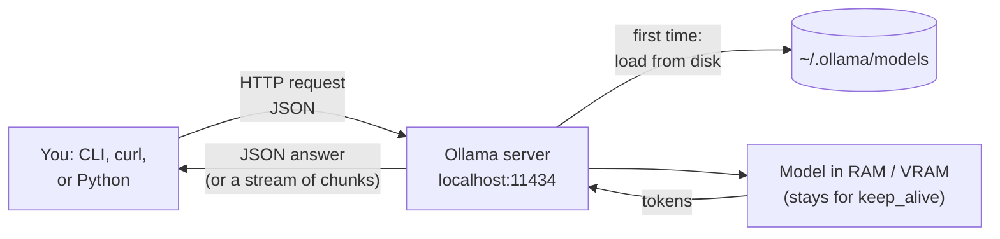
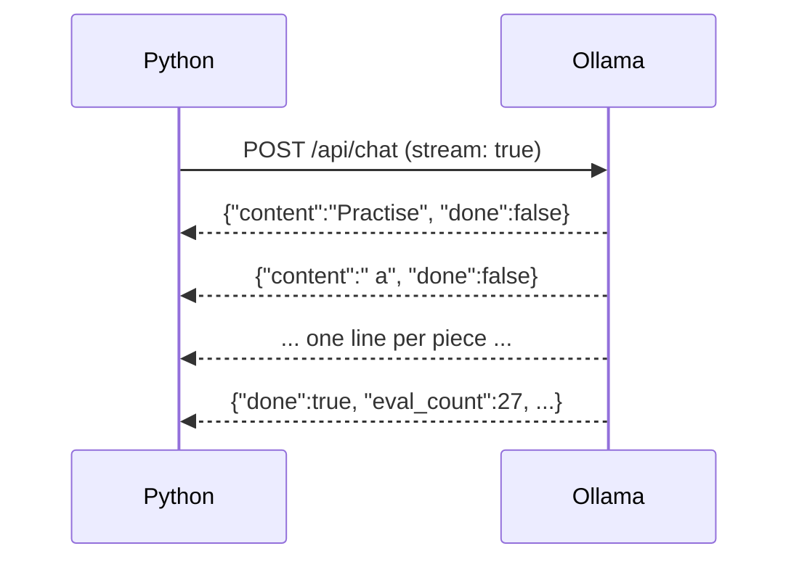

# 02 · Ollama deep dive: API and Modelfiles

**What you'll build:** you'll install Ollama, drive it from the command line, talk to its REST API with `curl` and Python (one answer, streamed answers, embeddings, memory info), and make your own custom model, `kid-tutor`, from a `Modelfile`.
**Like you're 5:** Ollama is a librarian. You ask for a book (a model) by name, the librarian fetches it from the shelf (disk) and puts it on the reading table (memory). After you leave, the book stays on the table for 5 minutes in case you come back, then it goes back on the shelf. A Modelfile is a sticky note you put on a book: "always read this one slowly, and pretend you're a teacher".
**Time:** ~1.5 h · **Builds on:** [01 · Why local models, and how big they are](../01-why-local-models-and-how-big-they-are) · **Needs:** Ollama, `llama3.2:3b` (~2 GB) and `nomic-embed-text` (~0.3 GB), 8 GB of RAM

## Why this matters
Ollama is the most common way to run open models on laptops and small servers, and many tools (editors, chat apps, agents) plug into it. Knowing its API by heart, not just `ollama run`, lets you build your own apps on top of it, control memory and context length, and debug "why is it slow / why did it forget" problems that real users hit.

## What you'll learn
- **Ollama server and CLI:** a background program that listens on `http://localhost:11434`, and the `ollama` command that talks to it.
- **REST API:** `/api/generate` (one prompt), `/api/chat` (a conversation), `/api/embed` (text to numbers), `/api/tags` and `/api/ps` (what's downloaded and what's in memory).
- **Streaming:** getting the answer piece by piece as newline-separated JSON, so users see words appear immediately.
- **`keep_alive` and `num_ctx`:** how long a model stays in memory, and how much conversation it can see.
- **Modelfile:** a recipe (`FROM`, `PARAMETER`, `SYSTEM`, `TEMPLATE`, `MESSAGE`) that turns a base model into your own named model.

## Before you start
1. Install the Part 1 packages in your activated venv (skip if done):
   ```bash
   pip install httpx gguf huggingface_hub
   ```
   - `httpx` sends HTTP requests from Python (this lesson). `gguf` and `huggingface_hub` are for lesson 03.
2. Install Ollama for your system (pick one):

   | System | How |
   |--------|-----|
   | **Windows** | Download `OllamaSetup.exe` from https://ollama.com/download and run it. Or in a terminal: `winget install Ollama.Ollama` |
   | **Mac** | Download the app from https://ollama.com/download, drag it into Applications and open it once. (Or `brew install ollama`, then `brew services start ollama`.) |
   | **Linux** | `curl -fsSL https://ollama.com/install.sh \| sh` (it installs Ollama and starts it as a background service) |
   | **Docker** (any system) | `docker run -d -v ollama:/root/.ollama -p 11434:11434 --name ollama ollama/ollama`, then use `docker exec -it ollama ollama ...` for CLI commands |

   **Command, piece by piece** (`curl -fsSL https://ollama.com/install.sh | sh`):

   | Piece | Meaning |
   |-------|---------|
   | `curl` | a program that downloads from a URL |
   | `-f` | fail quietly on an HTTP error (don't save an error page as if it were the script) |
   | `-s` | silent: no progress bar |
   | `-S` | ...but still show real errors |
   | `-L` | follow redirects (if the address moved, go to the new one) |
   | `https://ollama.com/install.sh` | the install script to download |
   | `\|` | **pipe**: send the downloaded text straight into the next program |
   | `sh` | the shell: run the text it receives as commands |

   Piping a script into `sh` runs it with no chance to read it first. It's fine for trusted sources like this; if you're curious, open the URL in a browser to read it.

3. Check that the server runs: open http://localhost:11434 in a browser. It should say **Ollama is running**. Then in a terminal:
   ```bash
   ollama --version
   ```
4. Download the two models (once):
   ```bash
   ollama pull llama3.2:3b
   ollama pull nomic-embed-text
   ```
   Less than 8 GB of RAM? Use `llama3.2:1b` instead and add `--model llama3.2:1b` to the Python commands below.
5. No API key needed.

## Run it

### A. The command line (CLI)
1. Chat with a model in the terminal (type a question, press Enter; type `/bye` to leave):
   ```bash
   ollama run llama3.2:3b
   ```
2. Ask one question and print speed statistics:
   ```bash
   ollama run llama3.2:3b "Why is the sky blue? One sentence." --verbose
   ```
3. Look around:
   ```bash
   ollama list
   ollama ps
   ollama show llama3.2:3b
   ollama show llama3.2:3b --license
   ```
4. Free the memory now instead of waiting 5 minutes:
   ```bash
   ollama stop llama3.2:3b
   ```

**The Ollama CLI, piece by piece:**

| Command | What it does |
|---------|--------------|
| `ollama serve` | start the server by hand (only needed if the app/service isn't already running; it keeps the terminal busy) |
| `ollama pull llama3.2:3b` | download a model. `llama3.2` is the **name**, `:3b` the **tag** (here: the 3-billion-parameter version). No tag means `:latest` |
| `ollama run llama3.2:3b` | load the model (pulling it first if needed) and open a chat. Inside: `/bye` quits, `/?` lists commands, `/set parameter num_ctx 8192` changes a setting for this chat, `/show info` describes the model |
| `ollama run llama3.2:3b "question"` | ask one question, print the answer, exit |
| `--verbose` | also print timings: load time, prompt and answer tokens, tokens per second |
| `ollama list` (or `ollama ls`) | models on disk: NAME, ID, SIZE, MODIFIED |
| `ollama ps` | models in memory: SIZE, PROCESSOR (how much is on GPU vs CPU), CONTEXT, UNTIL (when it unloads) |
| `ollama show llama3.2:3b` | architecture, parameter count, context length, quantization, capabilities (e.g. `tools`), license |
| `ollama show ... --modelfile` / `--template` / `--license` | print just that part |
| `ollama stop llama3.2:3b` | unload it from memory now |
| `ollama rm llama3.2:3b` | delete it from disk |
| `ollama cp llama3.2:3b my-copy` | copy a model under a new name |
| `ollama create kid-tutor -f Modelfile` | build a new model from a Modelfile (part C) |

### B. The REST API (what apps use)
Everything the CLI does goes through an HTTP API on port 11434. Your programs use the same API.

1. One prompt, one answer (Mac/Linux terminal, or Git Bash/WSL on Windows):
   ```bash
   curl http://localhost:11434/api/generate -d '{"model": "llama3.2:3b", "prompt": "Why is the sky blue? One sentence.", "stream": false}'
   ```
2. A chat with a system message:
   ```bash
   curl http://localhost:11434/api/chat -d '{"model": "llama3.2:3b", "stream": false, "messages": [{"role": "system", "content": "Answer like a pirate."}, {"role": "user", "content": "What is Python?"}]}'
   ```
3. Turn text into numbers (embeddings):
   ```bash
   curl http://localhost:11434/api/embed -d '{"model": "nomic-embed-text", "input": ["I love my dog.", "The train leaves at 9."]}'
   ```
4. The same tour in Python, with explanations printed at each step:
   ```bash
   cd part-1-run-models-locally/02-ollama-deep-dive-api-and-modelfiles
   python ollama_tour.py
   ```

**Command, piece by piece** (`curl http://localhost:11434/api/generate -d '{...}'`):

| Piece | Meaning |
|-------|---------|
| `curl` | send an HTTP request |
| `http://localhost:11434` | `localhost` = this computer; `11434` = Ollama's **port** (its door number) |
| `/api/generate` | the **endpoint**: which service at that door |
| `-d '...'` | send this **data** as the request body. Using `-d` makes curl send a `POST` request |
| `'...'` | single quotes keep the shell from touching the `{ } " :` characters inside |
| `{"model": ..., "prompt": ..., "stream": false}` | **JSON**: `{ }` is an object, `"key": value` pairs separated by `,`; `[ ]` is a list |
| `"stream": false` | send the whole answer in one JSON object (the default `true` sends many small ones) |

**Windows PowerShell note:** PowerShell treats quotes differently, so the one-line JSON above breaks. Use Git Bash or WSL, or `curl.exe` with a file: save the JSON in `body.json` and run `curl.exe http://localhost:11434/api/generate -d "@body.json"` (`@` = read the body from this file). The Python script works the same everywhere.

### C. Your own model with a Modelfile
1. Look at the file `Modelfile` in this folder (explained below).
2. Build the model (run this inside the lesson folder):
   ```bash
   ollama create kid-tutor -f Modelfile
   ```
3. Try it:
   ```bash
   ollama run kid-tutor "What is electricity?"
   ```
4. Run the API tour against it:
   ```bash
   python ollama_tour.py --model kid-tutor
   ```

| Piece | Meaning |
|-------|---------|
| `ollama create` | build a new model |
| `kid-tutor` | its name (becomes `kid-tutor:latest`) |
| `-f Modelfile` | `-f` = "file": read the recipe from the file called `Modelfile` |

### What you should see
**Example output** (Ollama isn't available in the environment where this course was written, so these lines show the shape; your numbers and wording will differ). `python ollama_tour.py` on a laptop:
```
=== 1. Is Ollama running?  GET /api/version ===
Ollama version: 0.12.6

=== 2. Which models are downloaded?  GET /api/tags ===
  nomic-embed-text:latest        0.27 GB
  llama3.2:3b                    2.02 GB

=== 3. One question, one answer  POST /api/generate ===
The sky appears blue because molecules in the air scatter blue sunlight more than other colours.

  loaded the model in  2.31 s
  read the prompt:     34 tokens
  wrote the answer:    19 tokens at 24.8 tokens/s

=== 4. A chat, streamed word by word  POST /api/chat ===
Practise a little every day, even 20 minutes. Build small projects you care about instead of only watching tutorials.

  done_reason: stop · 27 tokens at 25.3 tokens/s

=== 5. Text to numbers  POST /api/embed  (nomic-embed-text) ===
  3 sentences -> 3 vectors of 768 numbers each
  first numbers of vector 1: [0.012, 0.058, -0.161, -0.027] ...
  similarity dog/puppy: 0.79
  similarity dog/train: 0.42

=== 6. What is in memory right now?  GET /api/ps ===
  llama3.2:3b                    3.12 GB (100% on GPU), unloads at 2026-10-22T14:25:40

=== 7. Free the memory  POST /api/generate with keep_alive 0 ===
  llama3.2:3b unloaded. The next request loads it again (a few seconds).
```
What to look at:
- **Step 3:** "loaded the model in 2.31 s" is only big the first time. Run the script twice in a row: the second time step 3 says ~0.0 s, because the model was still in memory.
- **Step 4:** the answer appears word by word. That's streaming.
- **Step 5:** dog/puppy is much more similar than dog/train, even though they share no words. That's meaning, captured as numbers (lesson 07 builds search on it).
- **Step 6:** the model uses more memory (3.1 GB) than its file (2.0 GB): that's the KV cache and buffers from lesson 01.

`ollama run llama3.2:3b "..." --verbose` ends with timing lines like these (example):
```
total duration:       1.92s
load duration:        41ms
prompt eval count:    33 token(s)
prompt eval rate:     410.25 tokens/s
eval count:           24 token(s)
eval duration:        0.96s
eval rate:            25.00 tokens/s
```
**prompt eval** = reading your question; **eval** = writing the answer. Writing is always much slower than reading.

`ollama run kid-tutor "What is electricity?"` (example):
```
Electricity is like water flowing through pipes, but the pipes are wires and the water is tiny bits called electrons. When you flip a light switch, you open the path so electrons can flow to the bulb and make it glow.
```

## How it works

### The big picture

The `ollama` command and your Python script are both **clients**. The **server** owns the models. Models are stored in `~/.ollama/models` (Windows: `C:\Users\<you>\.ollama\models`; change it with the `OLLAMA_MODELS` environment variable).

### The REST API fields you'll use most

| Field | Where | Meaning |
|-------|-------|---------|
| `model` | all | which model, e.g. `llama3.2:3b` |
| `prompt` | `/api/generate` | the text to continue |
| `messages` | `/api/chat` | the conversation: a list of `{"role": "system" \| "user" \| "assistant", "content": "..."}` |
| `stream` | generate, chat | `true` (default): many small JSON lines; `false`: one JSON object |
| `options` | generate, chat, embed | model settings for this request, e.g. `{"temperature": 0, "num_ctx": 8192, "num_predict": 200, "seed": 42}` |
| `keep_alive` | generate, chat, embed | how long to keep the model in memory afterwards: `"10m"`, `"1h"`, `0` (unload now), `-1` (forever). Default 5 minutes |
| `format` | generate, chat | force JSON output, or a JSON schema (lesson 08) |
| `tools` | chat | functions the model may call (lesson 08) |
| `input` | `/api/embed` | one string or a list of strings |

The answer always includes timing fields, all in **nanoseconds** (1 second = 1,000,000,000 ns): `load_duration`, `prompt_eval_count` / `prompt_eval_duration` (reading), `eval_count` / `eval_duration` (writing). Tokens per second = `eval_count / (eval_duration / 1e9)`.

### Streaming
With `"stream": true`, Ollama sends one JSON object per line as soon as each piece is ready (**NDJSON**, newline-delimited JSON):
```
{"model":"llama3.2:3b","message":{"role":"assistant","content":"Practise"},"done":false}
{"model":"llama3.2:3b","message":{"role":"assistant","content":" a"},"done":false}
...
{"model":"llama3.2:3b","message":{"role":"assistant","content":""},"done":true,"done_reason":"stop","eval_count":27, ...}
```
The last line has `"done": true` and the statistics. `done_reason` is `stop` (finished naturally) or `length` (hit `num_predict`).



### `num_ctx`: how much the model can see
`num_ctx` is the context window Ollama reserves, in tokens. Recent Ollama versions pick a default from your GPU memory (4,096 tokens on machines with less than 24 GB of VRAM). If your conversation or document is longer, **the oldest part is cut off silently**, and the model "forgets" the start. Raise it per request (`"options": {"num_ctx": 16384}`), per model (`PARAMETER num_ctx 16384` in a Modelfile), for the whole server (`OLLAMA_CONTEXT_LENGTH=16384 ollama serve`), or in the app's settings. Bigger context = bigger KV cache = more memory (lesson 01). `ollama ps` shows the context in use.

### The code (`ollama_tour.py`)
1. `httpx.Client(base_url=OLLAMA, timeout=300)` makes one HTTP client for all requests. The long timeout covers the first request, which waits while the model loads.
2. `check_server()` calls `GET /api/version`. If nothing answers, `httpx.ConnectError` is caught and you get a clear message instead of a long error.
3. `list_models()` calls `GET /api/tags` and stops early if your model isn't downloaded. Bare names get `:latest` added in `main()`, because that's how Ollama lists them.
4. `generate()` posts to `/api/generate` with `"stream": False`, `temperature 0` (always pick the most likely next token, so answers repeat) and `keep_alive "10m"`. It prints the answer and turns the nanosecond timings into seconds and tokens/s.
5. `chat_streaming()` uses `client.stream("POST", ...)` and `response.iter_lines()` to read the answer line by line; `json.loads(line)` turns each line into a dict; `print(..., end="", flush=True)` prints each piece on the same line immediately.
6. `embed()` sends three sentences to `/api/embed` and compares the vectors with `cosine()` (1.0 = same direction, 0 = unrelated).
7. `running_models()` reads `/api/ps`: `size` (total memory) and `size_vram` (the part on the GPU).
8. `unload()` sends a request with only `model` and `keep_alive: 0`, which unloads it. (A request with only `model` and no `keep_alive` *loads* it: a handy "warm-up".)

**The official Python library.** Ollama also has a package (`pip install ollama`) that wraps these same endpoints. You'll use it from lesson 07 on:
```python
import ollama
reply = ollama.chat(model="llama3.2:3b", messages=[{"role": "user", "content": "Why is the sky blue?"}])
print(reply.message.content)
```

### The Modelfile, piece by piece
```
FROM llama3.2:3b
PARAMETER temperature 0.4
PARAMETER num_ctx 4096
PARAMETER num_predict 200
SYSTEM """
You are Pip, a friendly tutor for children aged 8 to 10. ...
"""
MESSAGE user What is a battery?
MESSAGE assistant A battery is like a lunch box for electricity. ...
```

| Line | Meaning |
|------|---------|
| `#` | a comment; Ollama ignores the rest of the line |
| `FROM llama3.2:3b` | **required**: the base model. Can also be a path to a `.gguf` file (`FROM ./my-model.gguf`, lesson 04) |
| `PARAMETER temperature 0.4` | randomness. 0 = always the most likely word; 0.8 (default) = more varied; above 1 = wild |
| `PARAMETER num_ctx 4096` | context window in tokens (see above) |
| `PARAMETER num_predict 200` | the longest answer, in tokens (-1 = no limit) |
| other `PARAMETER`s | `top_k`, `top_p`, `min_p` (which candidate words are allowed), `repeat_penalty`, `seed` (same seed + same prompt = same answer), `stop "text"` (stop when this text appears) |
| `SYSTEM """..."""` | the system prompt, sent before every conversation. `"""` lets the text span several lines |
| `MESSAGE user ...` / `MESSAGE assistant ...` | an example exchange placed at the start of every chat, so the model copies the style (few-shot) |
| `TEMPLATE """..."""` | (not used here) how messages are glued into the exact text the model was trained on. It is inherited from `FROM`, so you rarely touch it |
| `LICENSE """..."""` | (not used here) the licence text shipped with the model |

A template looks like this (Go template syntax; `{{ .System }}`, `{{ .Prompt }}` and `{{ .Response }}` are filled in by Ollama, `{{ if ... }} ... {{ end }}` only includes a part when it isn't empty):
```
TEMPLATE """{{ if .System }}<|im_start|>system
{{ .System }}<|im_end|>
{{ end }}{{ if .Prompt }}<|im_start|>user
{{ .Prompt }}<|im_end|>
{{ end }}<|im_start|>assistant
"""
```
`<|im_start|>` and `<|im_end|>` are special tokens this model family learned during training. A wrong template is the classic reason an imported model rambles or never stops. See a real one with `ollama show llama3.2:3b --template`.

`ollama create` doesn't copy the 2 GB of weights: it stores your small changes as new layers that point to the same weights, so `kid-tutor` costs almost no extra disk space.

### Useful server settings (environment variables)

| Variable | Example | Meaning |
|----------|---------|---------|
| `OLLAMA_HOST` | `0.0.0.0:11434` | where the server listens. Default `127.0.0.1:11434` = only this computer. `0.0.0.0` = other machines on the network too (protect it with a firewall: there is no password) |
| `OLLAMA_MODELS` | `D:\ollama-models` | where models are stored |
| `OLLAMA_KEEP_ALIVE` | `30m` | default `keep_alive` for every request |
| `OLLAMA_CONTEXT_LENGTH` | `16384` | default context length |

Set them before the server starts (Linux: `sudo systemctl edit ollama` and add `Environment="OLLAMA_KEEP_ALIVE=30m"`; Mac: `launchctl setenv OLLAMA_KEEP_ALIVE 30m` then restart the app; Windows: Settings → "Edit environment variables for your account", then restart Ollama). `ollama serve --help` lists them all.

## If something goes wrong
- **`Can't reach Ollama at http://localhost:11434`** or `curl: (7) Failed to connect` → the server isn't running. Open the Ollama app (Windows/Mac) or run `ollama serve` in another terminal (Linux: `sudo systemctl start ollama`). Check http://localhost:11434.
- **`'llama3.2:3b' is not downloaded`** or `model "..." not found` → run `ollama pull llama3.2:3b`. Check the exact name with `ollama list` (the tag matters: `llama3.2` means `llama3.2:latest`).
- **`Error: listen tcp 127.0.0.1:11434: bind: address already in use`** when running `ollama serve` → good news: Ollama is already running (the app or service). You don't need `ollama serve`.
- **The first answer is very slow, later ones fast** → the first request loads the model from disk. Keep it loaded longer with `keep_alive` or `OLLAMA_KEEP_ALIVE`.
- **`ollama ps` shows `48%/52% CPU/GPU`** → the model doesn't fit in VRAM, so part runs on the slower CPU. Use a smaller model or quantization, or a smaller `num_ctx`.
- **`Error: ... Modelfile` / `no such file`** with `ollama create` → run it inside the lesson folder (where `Modelfile` is), or give the full path after `-f`.

## Try this
1. **Easy:** make the tutor answer in Spanish for Spanish-speaking children, and rebuild it.
   <details><summary>Hint</summary>Add "Always answer in simple Spanish." to the <code>SYSTEM</code> text, translate the <code>MESSAGE</code> example, then run <code>ollama create kid-tutor -f Modelfile</code> again (it overwrites the old one) and <code>ollama run kid-tutor "¿Qué es la lluvia?"</code>.</details>
2. **Medium:** prove that `num_ctx` matters. Send a long text with a question at the very start and compare `num_ctx` 2048 and 16384.
   <details><summary>Solution</summary>

   ```python
   import httpx
   filler = "The weather was fine. " * 1500            # about 7,500 tokens of padding
   prompt = "Remember the code word: PINEAPPLE.\n" + filler + "\nWhat was the code word?"
   for ctx in (2048, 16384):
       r = httpx.post("http://localhost:11434/api/generate", timeout=600, json={
           "model": "llama3.2:3b", "prompt": prompt, "stream": False,
           "options": {"num_ctx": ctx, "temperature": 0}}).json()
       print(ctx, "->", r["response"][:80], "| prompt tokens:", r["prompt_eval_count"])
   ```
   With 2048 the start (and the code word) is cut off and the model can't answer; `prompt_eval_count` also shows that only ~2,048 tokens were read. With 16384 it answers PINEAPPLE.
   </details>
3. **Harder:** add a step to `ollama_tour.py` that warms up a model (loads it without a prompt) and measures how long loading takes with a stopwatch.
   <details><summary>Solution</summary>

   ```python
   import time

   def warm_up(client, model):
       title("0. Warm-up: load the model without a prompt")
       client.post("/api/generate", json={"model": model, "keep_alive": 0})   # make sure it's unloaded
       start = time.perf_counter()
       client.post("/api/generate", json={"model": model})                   # no prompt = just load it
       print(f"  loading took {time.perf_counter() - start:.2f} s")
   ```
   Call `warm_up(client, model)` in `main()` right after `list_models(...)`. Step 3 will then report a load time close to 0, because the model is already in memory.
   </details>

## Check yourself
1. What is the difference between `ollama list` and `ollama ps`?
2. Why does a streamed answer arrive as many JSON lines, and how do you know it's finished?
3. You set `PARAMETER num_ctx 2048` and your users paste long emails. What goes wrong, and how do you fix it?
4. What does `"keep_alive": 0` do, and when is it useful?

<details><summary>Answers</summary>

1. `list` shows models stored on disk; `ps` shows models loaded in memory right now (with size, GPU share and when they unload).
2. Each line is a small piece sent as soon as it's ready, so the user sees text immediately. The last line has `"done": true` (plus statistics and `done_reason`).
3. The beginning of long emails is silently cut off, so the model answers without seeing it. Raise `num_ctx` (and check memory), or shorten/summarise the input first.
4. It unloads the model right after the request. Useful to free memory for another model, in benchmarks (lesson 05), or on a small machine.
</details>

## Learn more (optional)
**Read the official docs**
- Ollama documentation: https://docs.ollama.com
- Ollama on GitHub, with the docs folder (API, Modelfile, FAQ): https://github.com/ollama/ollama/tree/main/docs
- Ollama Python library: https://github.com/ollama/ollama-python
- Ollama model library (names, tags, sizes, licences): https://ollama.com/library
- curl manual: https://curl.se/docs/manpage.html

**Watch**
- Matt Williams (former Ollama team member) has many short Ollama explainers: [search "Matt Williams Ollama"](https://www.youtube.com/results?search_query=matt+williams+ollama)
- [Ollama Modelfile tutorial](https://www.youtube.com/results?search_query=ollama+modelfile+tutorial) · [Ollama REST API tutorial](https://www.youtube.com/results?search_query=ollama+api+tutorial+python)
- Fireship's quick overview: [search "Fireship Ollama"](https://www.youtube.com/results?search_query=fireship+ollama)

## Next
→ [03 · llama.cpp and GGUF](../03-llama-cpp-and-gguf)
