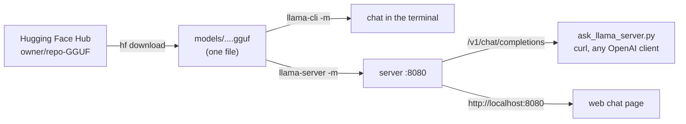

# 03 · llama.cpp and GGUF

**What you'll build:** you'll install llama.cpp (the engine inside Ollama and many other apps), download a model file from Hugging Face, look inside it with a Python script, chat with it in the terminal, and run your own OpenAI-compatible server that a Python script talks to.
**Like you're 5:** Ollama is a restaurant: you order by name and a waiter brings the dish. llama.cpp is the kitchen itself: you pick the exact ingredients (the model file), the oven settings (flags) and how many cooks work (CPU threads, GPU layers). A GGUF file is a lunch box that holds the whole recipe and all its ingredients in one container.
**Time:** ~1.5 h · **Builds on:** [02 · Ollama deep dive](../02-ollama-deep-dive-api-and-modelfiles) · **Needs:** llama.cpp, a ~0.8 GB model download, 4 GB of free RAM

## Why this matters
llama.cpp runs models on almost anything: Windows, Mac, Linux, Raspberry Pi, phones, with or without a GPU. When Ollama doesn't support a new model yet, when you need a flag Ollama hides, or when you deploy to a tiny device or an air-gapped server, you use llama.cpp directly. GGUF is the file format the whole local-AI world shares, so knowing how to find, download and inspect GGUF files is a basic skill.

## What you'll learn
- **llama.cpp:** a fast C/C++ program for running LLMs. Its tools: `llama-cli` (chat in the terminal), `llama-server` (an HTTP server with an OpenAI-style API and a web page), `llama-quantize`, `llama-bench`, `llama-perplexity`.
- **GGUF:** one file that holds the model's settings (metadata), its tokenizer and all its weights.
- **Hugging Face Hub:** the "GitHub for models"; you download GGUF files from it with the `hf` command.
- **GPU offload (`-ngl`):** how many of the model's layers run on the graphics card instead of the CPU.
- **Server flags:** context size (`-c`), port, threads, and how to check the server is healthy.

## Before you start
1. Part 1 packages in your activated venv (skip if done):
   ```bash
   pip install httpx gguf huggingface_hub
   ```
   - `gguf`: reads GGUF files (made by the llama.cpp team). `huggingface_hub`: gives you the `hf` command to download models. `httpx`: talks to the server.
2. Install llama.cpp. Pick **one** way:

   | Way | Commands | Notes |
   |-----|----------|-------|
   | **Mac or Linux with Homebrew** | `brew install llama.cpp` | easiest; puts all tools on your PATH; updated automatically |
   | **Windows** | `winget install llama.cpp` | then close and reopen the terminal |
   | **Ready-made download** (any system) | open https://github.com/ggml-org/llama.cpp/releases, under **Assets** of the newest release download the file for your system, and unpack it into a folder such as `~/llama.cpp` | Windows without GPU: `...-bin-win-cpu-x64.zip`; Windows + NVIDIA: `...-bin-win-cuda-...-x64.zip` (also download the matching `cudart-...` zip into the same folder); Mac with Apple chip: `...-bin-macos-arm64.tar.gz`; Linux: `...-bin-ubuntu-x64.tar.gz` (or `-vulkan-` for a GPU) |
   | **Build from source** | see below | needs git, CMake and a C++ compiler; lets you pick GPU support |

   **If you downloaded the ready-made files,** the programs are inside the unpacked folder. Either run them with their full path (for example `~/llama.cpp/llama-b11804/llama-cli`), or add the folder to your PATH for this terminal:
   - Mac/Linux: `export PATH="$HOME/llama.cpp/llama-b11804:$PATH"` (use your real folder name)
   - Windows PowerShell: `$env:PATH = "C:\llama.cpp;" + $env:PATH`

   **Build from source** (checked on Linux with the current code):
   ```bash
   git clone https://github.com/ggml-org/llama.cpp
   cd llama.cpp
   cmake -B build
   cmake --build build --config Release -j 4
   ```
   The programs end up in `build/bin/`. For an NVIDIA GPU use `cmake -B build -DGGML_CUDA=ON` (needs the CUDA toolkit); for other GPUs `-DGGML_VULKAN=ON`; on a Mac, Metal (the Apple GPU) is switched on automatically. On Linux, install `libssl-dev` first if you want the built-in Hugging Face download (`-hf`) to work.

   | Piece | Meaning |
   |-------|---------|
   | `git clone <url>` | download the project's source code with its history |
   | `cmake -B build` | **configure**: check your compiler and features, and write build instructions into a folder called `build` |
   | `-DGGML_CUDA=ON` | `-D` sets a build option; this one adds NVIDIA GPU support |
   | `cmake --build build` | **compile**: turn the C++ source in `build` into programs |
   | `--config Release` | an optimised (fast) build, not a debug build |
   | `-j 4` | compile 4 files at the same time (use your number of CPU cores) |

3. Check it works:
   ```bash
   llama-cli --version
   ```
   You should see something like `version: ... (build 11804, commit c7fc50941)`.
4. No API key needed. Llama 3.2 is under the Llama 3.2 Community License (lesson 01); the copy we download from the `bartowski` account doesn't need a Hugging Face login.

## Run it
1. Go to the lesson folder:
   ```bash
   cd part-1-run-models-locally/03-llama-cpp-and-gguf
   ```
2. Download the 4-bit version of Llama 3.2 1B Instruct (~0.8 GB) into a `models` folder:
   ```bash
   hf download bartowski/Llama-3.2-1B-Instruct-GGUF --include "*Q4_K_M.gguf" --local-dir models
   ```
   Then check the file name (Windows: `dir models`):
   ```bash
   ls models
   ```
   You should see `Llama-3.2-1B-Instruct-Q4_K_M.gguf`. The commands below use that name; if yours differs, use yours.
3. Look inside the file:
   ```bash
   python inspect_gguf.py models/Llama-3.2-1B-Instruct-Q4_K_M.gguf
   ```
4. Chat in the terminal (type a message and press Enter; type `/exit` or press Ctrl+C to stop):
   ```bash
   llama-cli -m models/Llama-3.2-1B-Instruct-Q4_K_M.gguf -c 4096 -sys "You are a helpful assistant. Answer briefly."
   ```
5. Ask one question and exit (handy in scripts):
   ```bash
   llama-cli -m models/Llama-3.2-1B-Instruct-Q4_K_M.gguf -p "What is a GGUF file? One sentence." -n 80 -st
   ```
6. Start the server (it keeps running; leave this terminal open):
   ```bash
   llama-server -m models/Llama-3.2-1B-Instruct-Q4_K_M.gguf --port 8080 -c 4096 -ngl 99
   ```
   No graphics card? `-ngl 99` is harmless: with no GPU everything simply runs on the CPU.
7. Open **a second terminal** (activate the venv, `cd` to this lesson again) and check the server:
   ```bash
   curl http://localhost:8080/health
   ```
   You should see `{"status":"ok"}`. (While the model loads it says `"Loading model"`.)
8. Ask with an OpenAI-style request from the terminal:
   ```bash
   curl http://localhost:8080/v1/chat/completions -H "Content-Type: application/json" -d '{"messages": [{"role": "user", "content": "Say hi in French."}], "max_tokens": 30}'
   ```
9. Ask from Python and see the speed:
   ```bash
   python ask_llama_server.py "What is a GGUF file?"
   ```
10. Open http://localhost:8080 in your browser: llama-server includes a chat web page.
11. Stop the server with Ctrl+C in its terminal.

**Shortcut:** llama.cpp can download from Hugging Face by itself. `llama-server -hf bartowski/Llama-3.2-1B-Instruct-GGUF:Q4_K_M --port 8080` downloads (once, into its cache; list it with `llama-cli --cache-list`) and starts the server in one step.

**Command, piece by piece** (`hf download bartowski/Llama-3.2-1B-Instruct-GGUF --include "*Q4_K_M.gguf" --local-dir models`):

| Piece | Meaning |
|-------|---------|
| `hf download` | the Hugging Face command-line tool: download files from a repository |
| `bartowski/Llama-3.2-1B-Instruct-GGUF` | the **repository**: `owner/name`. bartowski is a well-known person who converts models to GGUF in many sizes |
| `--include "*Q4_K_M.gguf"` | only files whose names match this pattern. `*` = "any characters", so we skip the other 20+ sizes in the repo. Quotes stop your shell from expanding `*` itself |
| `--local-dir models` | save into a folder called `models` here (created if missing) |

**Command, piece by piece** (`llama-cli -m ... -c 4096 -sys "..."` and `-p ... -n 80 -st`):

| Piece | Meaning |
|-------|---------|
| `llama-cli` | llama.cpp's terminal chat program |
| `-m models/...gguf` | `-m` = model: which GGUF file to load |
| `-c 4096` | context size in tokens (how much conversation it can see). `0` or leaving it out = the model's maximum (131,072 for Llama 3.2: a lot of memory!) |
| `-sys "..."` | the system prompt |
| `-p "..."` | the first user message (prompt) |
| `-n 80` | write at most 80 tokens |
| `-st` | single turn: answer once, then exit |
| `/exit`, `/clear`, `/regen` | typed inside the chat: quit, forget the conversation, re-answer the last message |

**Command, piece by piece** (`llama-server -m ... --port 8080 -c 4096 -ngl 99`):

| Piece | Meaning |
|-------|---------|
| `llama-server` | an HTTP server with an OpenAI-compatible API and a web chat page |
| `--port 8080` | the door number to listen on. Recent versions default to 9931 (older ones to 8080), so we always say it explicitly |
| `--host 127.0.0.1` | (default) only this computer may connect. `--host 0.0.0.0` lets other machines in; then also add `--api-key SECRET` |
| `-ngl 99` | `--n-gpu-layers`: put up to 99 layers on the GPU (more than this model has, so "all of them"). `0` = CPU only. A number like `10` = only 10 layers on the GPU, for models too big for your VRAM. Recent versions default to `auto`, which fits as many as your GPU memory allows |
| `-t 4` | (optional) CPU threads. Default: chosen automatically |
| `-np 2` | (optional) parallel slots: how many requests it handles at the same time. Each slot shares the context |
| `-a my-llama` | (optional) `--alias`: the model name shown at `/v1/models` |
| `-hf owner/repo:Q4_K_M` | download from Hugging Face instead of `-m` |

**Command, piece by piece** (`curl ... -H "Content-Type: application/json" -d '{...}'`):

| Piece | Meaning |
|-------|---------|
| `-H "Content-Type: application/json"` | `-H` adds a **header**: a label on the request. This one says "the body is JSON" (OpenAI-style servers require it) |
| `/v1/chat/completions` | the OpenAI-compatible chat endpoint (lesson 06 uses it with the official `openai` package) |
| `"max_tokens": 30` | stop after 30 tokens |

### What you should see
**Example output** (the model couldn't be downloaded in the environment where this course was written, because Hugging Face was blocked; the scripts and llama.cpp commands were tested there with a small test GGUF file; your numbers will differ).

`python inspect_gguf.py models/Llama-3.2-1B-Instruct-Q4_K_M.gguf`:
```
File:          Llama-3.2-1B-Instruct-Q4_K_M.gguf  (0.81 GB)
Name:          Llama 3.2 1B Instruct
Architecture:  llama
Layers:        16
Context length:  131072 tokens (the most it was trained for)
Embedding size:    2048 numbers per token
Vocabulary:    128256 tokens
Chat template: yes

Tensors:       147  (1.24 billion numbers)
Bits per weight (average): 5.23
Stored as:     Q4_K x96, F32 x34, Q6_K x17

First 5 tensors:
  rope_freqs.weight            F32    64
  token_embd.weight            Q6_K   2048 x 128256
  blk.0.attn_k.weight          Q4_K   2048 x 512
  blk.0.attn_norm.weight       F32    2048
  blk.0.attn_output.weight     Q4_K   2048 x 2048
...
```
- **"Q4_K_M" is a mix:** most weight tables are `Q4_K` (4-bit), but a few sensitive ones are kept in `Q6_K` (6-bit), and tiny ones (norms) stay `F32`. That's what the **M** (medium) means, and why the average is above 4 bits.
- **Context length 131072** is the most the model was trained for, not what you must use.

`llama-server` prints a long log. The line that matters is near the end:
```
main: server is listening on http://127.0.0.1:8080 - starting the main loop
```
`python ask_llama_server.py "What is a GGUF file?"` (example; the `timings` part is real llama-server output format):
```
Q: What is a GGUF file?
A: A GGUF file is a single file format used by llama.cpp that stores a language model's weights together with its settings and tokenizer, so it can be loaded and run locally.

prompt:  48 tokens read at 412.6 tokens/s
answer:  41 tokens written at 38.2 tokens/s
finish:  stop  (stop = it finished, length = hit max_tokens)
```

## How it works

### From Hugging Face to an answer


### What's inside a GGUF file
```
┌──────────────────────────────────────────────┐
│ header: "GGUF", version, how many entries    │
│ metadata: general.name = "Llama 3.2 1B ..."  │
│           llama.block_count = 16             │
│           llama.context_length = 131072      │
│           tokenizer.ggml.tokens = [...]      │
│           tokenizer.chat_template = "..."    │
│ tensor list: name, shape, type, position     │
│ the weights themselves (most of the file)    │
└──────────────────────────────────────────────┘
```
Because everything is in one file, you can copy it to a USB stick and run it on a computer with no internet. GGUF files are **memory-mapped**: the program asks the operating system to treat the file as memory and read parts only when needed, so loading starts fast.

**A GGUF file name, piece by piece:** `Llama-3.2-1B-Instruct-Q4_K_M.gguf` = family `Llama-3.2`, size `1B` (1 billion parameters), `Instruct` (trained to follow instructions and chat; a "base" model only continues text), `Q4_K_M` (4-bit k-quant, medium mix; lesson 04), `.gguf` (the format).

Big models are sometimes split into parts: `...-00001-of-00003.gguf`. Download all parts and point `-m` at the first one.

### GPU offload in one picture
```
model with 16 layers, -ngl 10:
  [ layer 1 ... layer 10 ]  -> GPU (fast, limited VRAM)
  [ layer 11 ... layer 16 ] -> CPU (slower, uses normal RAM)
```
Each token passes through every layer, so the slowest part sets the speed. Putting *all* layers on the GPU is much faster than putting most of them there. If you get an "out of memory" error, lower `-ngl` or `-c`.

### The code
**`inspect_gguf.py`**
1. `GGUFReader(path)` opens the file and reads the header, metadata and tensor list. It doesn't load all the weights into memory.
2. `value(key)` reads one metadata entry with `field.contents()`. Keys depend on the architecture, so the script reads `general.architecture` first (e.g. `llama`) and builds keys like `llama.block_count`.
3. `Counter(t.tensor_type.name for t in reader.tensors)` counts how many weight tables use each number format (`Q4_K`, `Q6_K`, `F32`).
4. `params` adds up `n_elements` (how many numbers each tensor holds). File size × 8 ÷ params = the average **bits per weight**.
5. The last loop prints every metadata key, except the huge tokenizer word lists.

**`ask_llama_server.py`**
1. `GET /health` first: `200` means ready; `503` means "still loading"; a `ConnectError` means no server at all. Each gets a clear message.
2. `POST /v1/chat/completions` with the usual OpenAI-style body: `messages`, `temperature`, `max_tokens`. The `model` field is required by the format but llama-server serves only the model you started it with.
3. The answer is in `reply["choices"][0]["message"]["content"]`; token counts are in `reply["usage"]`.
4. llama-server adds a `timings` section (not part of OpenAI's format): `prompt_per_second` (reading speed) and `predicted_per_second` (writing speed).

### Other useful llama-server endpoints
| Endpoint | What it gives you |
|----------|-------------------|
| `GET /health` | `{"status":"ok"}` when ready |
| `GET /v1/models` | the loaded model's name |
| `GET /props` | server settings, including the chat template |
| `POST /completion` | llama.cpp's own "continue this text" endpoint |
| `POST /tokenize` | how a text is split into tokens |

**One `llama` command:** recent releases also ship a single `llama` program with sub-commands: `llama serve` = `llama-server`, `llama cli` = `llama-cli`, `llama quantize`, `llama bench`, `llama perplexity`. Use whichever your installation has; the flags are the same.

**Ollama and llama.cpp together:** Ollama is built on the same GGML engine. You can load any GGUF file you downloaded into Ollama with a one-line Modelfile, `FROM ./models/Llama-3.2-1B-Instruct-Q4_K_M.gguf`, then `ollama create my-llama -f Modelfile`. Lesson 04 does this with your own quantized file.

## If something goes wrong
- **`llama-cli: command not found`** (or "not recognized" on Windows) → the programs aren't on your PATH. Use the full path to the program, add its folder to PATH (see *Before you start*), or close and reopen the terminal after `winget`/`brew`.
- **Mac: "llama-cli cannot be opened because the developer cannot be verified"** → the downloaded files are quarantined. Use `brew install llama.cpp`, or remove the quarantine flag: `xattr -dr com.apple.quarantine ~/llama.cpp`.
- **`hf: command not found`** → the venv isn't active, or `huggingface_hub` isn't installed: activate the venv and run `pip install huggingface_hub`. **Nothing downloaded** → the file pattern matched nothing: open the repo's **Files** tab on huggingface.co and copy the exact file name.
- **`failed to open GGUF file` / `No such file`** → wrong path. Run `ls models` and copy the exact file name; paths are relative to the folder you're in.
- **`curl: (7) Failed to connect to localhost port 8080`** → the server isn't running, crashed, or uses another port (recent versions default to 9931 if you leave out `--port`). Look at the server's terminal.
- **`cudaMalloc failed: out of memory`** or the server quits while loading → too much on the GPU. Lower `-ngl` (e.g. `-ngl 10`) or `-c`, or use a smaller quantization.
- **The answer never stops / contains strange tags** → the chat template is missing or wrong. Use an "Instruct" GGUF from a trusted converter and use `/v1/chat/completions` (which applies the template), not `/completion`.

## Try this
1. **Easy:** measure the GPU effect. Start the server with `-ngl 0`, run `ask_llama_server.py`, then restart it with `-ngl 99` and compare `tokens/s`. (No GPU? Compare `-t 1` and `-t 4` instead: 1 vs 4 CPU threads.)
   <details><summary>Hint</summary>Stop the server with Ctrl+C, change one flag, start it again and run the same question. Writing speed usually goes up several times on a GPU; on CPU, more threads help until you reach the number of physical cores.</details>
2. **Medium:** download a different model family, Qwen2.5 1.5B Instruct, and compare it with Llama 3.2 1B on the same question.
   <details><summary>Solution</summary>

   ```bash
   hf download Qwen/Qwen2.5-1.5B-Instruct-GGUF --include "*q4_k_m.gguf" --local-dir models
   ls models
   python inspect_gguf.py models/qwen2.5-1.5b-instruct-q4_k_m.gguf
   llama-server -m models/qwen2.5-1.5b-instruct-q4_k_m.gguf --port 8080 -c 4096
   ```
   Note the lowercase file names in Qwen's official repo (patterns are case-sensitive). `inspect_gguf.py` shows `Architecture: qwen2`, 28 layers and a 151k-word vocabulary.
   </details>
3. **Harder:** make `ask_llama_server.py` stream the answer word by word.
   <details><summary>Solution</summary>

   Add `"stream": True` to `body`, and replace everything from `reply = httpx.post(...)` to the end with:
   ```python
   import json
   print("Q:", question)
   print("A: ", end="")
   with httpx.stream("POST", f"{SERVER}/v1/chat/completions", json=body, timeout=300) as r:
       for line in r.iter_lines():
           if not line.startswith("data: ") or line == "data: [DONE]":
               continue  # streamed answers arrive as "data: {...}" lines (Server-Sent Events)
           delta = json.loads(line[6:])["choices"][0]["delta"]
           print(delta.get("content") or "", end="", flush=True)
   print()
   ```
   OpenAI-style servers stream with **Server-Sent Events**: each piece is a line starting with `data: `, and the stream ends with `data: [DONE]`. (Ollama's own `/api/chat` uses plain JSON lines instead.)
   </details>

## Check yourself
1. What three kinds of things does a GGUF file contain?
2. What does `-ngl` control, and why is "all layers on the GPU" much faster than "most layers"?
3. Why is it a bad idea to start `llama-server` without `-c` on a laptop?
4. When would you pick llama.cpp over Ollama?

<details><summary>Answers</summary>

1. Metadata (settings such as layers, context length, chat template), the tokenizer (vocabulary), and the weights (tensors).
2. How many layers run on the GPU. Every token passes through all layers, so the layers left on the slow CPU become the bottleneck.
3. With `-c 0` (or no `-c`) it uses the model's full training context (131,072 tokens for Llama 3.2), and the KV cache for that can need many gigabytes of memory (lesson 01).
4. When you need a model or feature Ollama doesn't support yet, full control over flags, a tiny device or unusual hardware, a single portable file for an offline machine, or llama.cpp's tools (quantize, perplexity, bench).
</details>

## Learn more (optional)
**Read the official docs**
- llama.cpp on GitHub (README, quick start): https://github.com/ggml-org/llama.cpp
- llama-server options and API: https://github.com/ggml-org/llama.cpp/tree/master/tools/server
- llama-cli: https://github.com/ggml-org/llama.cpp/tree/master/tools/cli
- Build guide (CPU, CUDA, Metal, Vulkan): https://github.com/ggml-org/llama.cpp/blob/master/docs/build.md
- Install with package managers: https://github.com/ggml-org/llama.cpp/blob/master/docs/install.md
- GGUF format: https://huggingface.co/docs/hub/gguf
- Downloading files with `hf`: https://huggingface.co/docs/huggingface_hub/guides/cli

**Watch**
- [llama.cpp tutorial for beginners](https://www.youtube.com/results?search_query=llama.cpp+tutorial+beginners) · [llama-server OpenAI compatible](https://www.youtube.com/results?search_query=llama-server+llama.cpp+openai+compatible)
- [What is GGUF](https://www.youtube.com/results?search_query=what+is+gguf+format)
- Sam Witteveen covers new open models and local tooling: [search "Sam Witteveen llama.cpp"](https://www.youtube.com/results?search_query=sam+witteveen+llama.cpp)

## Next
→ [04 · Quantization hands-on](../04-quantization-hands-on)
