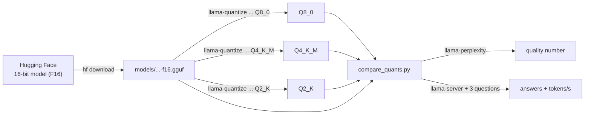

# 04 · Quantization hands-on

**What you'll build:** you'll take the full-precision (16-bit) Llama 3.2 1B, shrink it yourself to 8-bit, 4-bit and 2-bit with `llama-quantize`, then measure what you gained (size, speed) and what you lost (quality) with a comparison script.
**Like you're 5:** a photo with millions of colours looks perfect but is a huge file. Save it with 256 colours and it still looks almost the same. Save it with 4 colours and faces start to look like cartoons. Quantization does the same to a model's numbers, and today you'll see exactly where it starts to look like a cartoon.
**Time:** ~1.5 h · **Builds on:** [03 · llama.cpp and GGUF](../03-llama-cpp-and-gguf) · **Needs:** llama.cpp, ~2.5 GB download + ~2.5 GB of disk for the smaller files, 6 GB of RAM

## Why this matters
"Which quantization should we ship?" is a real decision in every on-device project: the phone app that must fit in 1 GB, the server that must answer 20 users at once, the customer who complains the local model "got dumber". Engineers who can measure the trade-off with numbers, instead of guessing, make better calls and can explain them.

## What you'll learn
- **Quantization types:** what `F16`, `Q8_0`, `Q4_K_M` and `Q2_K` mean, letter by letter.
- **`llama-quantize`:** the tool that turns a 16-bit GGUF into a smaller one.
- **Perplexity:** a number for "how surprised is the model by normal text": lower is better, and it rises as quality drops.
- **Side-by-side answers:** the same questions at temperature 0, so the only difference is the quantization.
- **Speed:** smaller files are usually faster, because generating text is limited by how fast memory can be read.

## Before you start
1. llama.cpp from lesson 03 (`llama-quantize`, `llama-perplexity` and `llama-server` must work), and the Part 1 packages:
   ```bash
   pip install httpx gguf huggingface_hub
   ```
2. About 5 GB of free disk space and 6 GB of free RAM.
3. No API key needed.

## Run it
1. Go to the lesson folder:
   ```bash
   cd part-1-run-models-locally/04-quantization-hands-on
   ```
2. Download the 16-bit original (~2.5 GB):
   ```bash
   hf download bartowski/Llama-3.2-1B-Instruct-GGUF --include "*f16.gguf" --local-dir models
   ls models
   ```
   You should see `Llama-3.2-1B-Instruct-f16.gguf`.
3. Make an 8-bit copy:
   ```bash
   llama-quantize models/Llama-3.2-1B-Instruct-f16.gguf models/Llama-3.2-1B-Instruct-Q8_0.gguf Q8_0
   ```
4. Make a 4-bit copy (the most popular choice):
   ```bash
   llama-quantize models/Llama-3.2-1B-Instruct-f16.gguf models/Llama-3.2-1B-Instruct-Q4_K_M.gguf Q4_K_M
   ```
5. Make a 2-bit copy (to see what "too small" looks like):
   ```bash
   llama-quantize models/Llama-3.2-1B-Instruct-f16.gguf models/Llama-3.2-1B-Instruct-Q2_K.gguf Q2_K
   ```
6. Compare the sizes (Windows: `dir models`):
   ```bash
   ls -lh models
   ```
7. Measure the perplexity of one file by hand, to see what the script does for you:
   ```bash
   llama-perplexity -m models/Llama-3.2-1B-Instruct-Q4_K_M.gguf -f eval_text.txt -c 256
   ```
   The last line says `Final estimate: PPL = ...`.
8. Compare all four files (takes 5–15 minutes on a laptop):
   ```bash
   python compare_quants.py models
   ```
   If llama.cpp isn't on your PATH, add `--bin-dir` with the folder that holds the programs, e.g. `python compare_quants.py models --bin-dir ~/llama.cpp/build/bin`.
9. (Optional) Measure pure speed with llama.cpp's benchmark tool:
   ```bash
   llama-bench -m models/Llama-3.2-1B-Instruct-Q8_0.gguf -m models/Llama-3.2-1B-Instruct-Q4_K_M.gguf
   ```

**Command, piece by piece** (`llama-quantize <input> <output> Q4_K_M`):

| Piece | Meaning |
|-------|---------|
| `llama-quantize` | llama.cpp's shrinking tool |
| `models/...-f16.gguf` | the input: always start from 16-bit (or 32-bit). Re-quantizing an already-quantized file loses extra quality, so the tool refuses unless you add `--allow-requantize` |
| `models/...-Q4_K_M.gguf` | the output file to create |
| `Q4_K_M` | the target type (`llama-quantize --help` lists them all with their size and quality loss) |
| `--dry-run` | (optional, before the input file) only print how big the result would be |

**Command, piece by piece** (`llama-perplexity -m ... -f eval_text.txt -c 256`):

| Piece | Meaning |
|-------|---------|
| `llama-perplexity` | measures how well the model predicts a text |
| `-m <file>` | the model to test |
| `-f eval_text.txt` | the text to score (an ordinary article about bicycles, written for this lesson) |
| `-c 256` | cut the text into 256-token windows and score each one; the text has room for 6 windows |

**Command, piece by piece** (`llama-bench -m A -m B`):

| Piece | Meaning |
|-------|---------|
| `llama-bench` | llama.cpp's speed test |
| `-m A -m B` | test several models in one run |
| (result) `pp512` | **prompt processing**: reading a 512-token prompt, in tokens/s |
| (result) `tg128` | **text generation**: writing 128 tokens, in tokens/s (what users feel) |
| `-p 256 -n 64` | (optional) change those lengths; `-r 3` = repeat each test 3 times |

### What you should see
`ls -lh models` (these sizes follow from the bits per weight in lesson 01):
```
Llama-3.2-1B-Instruct-f16.gguf      2.3G
Llama-3.2-1B-Instruct-Q8_0.gguf     1.3G
Llama-3.2-1B-Instruct-Q4_K_M.gguf   771M
Llama-3.2-1B-Instruct-Q2_K.gguf     554M
```
(`ls -lh` counts in GiB/MiB, which are about 7% bigger units than GB/MB.)

**Example output** of `python compare_quants.py models` on a laptop without a GPU. Hugging Face was blocked where this course was written, so the script and every llama.cpp command were run there with a small test model instead, and the numbers below show the typical pattern. Yours will differ:
```
file                                        size  perplexity  tokens/s
Llama-3.2-1B-Instruct-f16.gguf            2.48GB      11.873      13.1
Llama-3.2-1B-Instruct-Q8_0.gguf           1.32GB      11.886      23.4
Llama-3.2-1B-Instruct-Q4_K_M.gguf         0.81GB      12.402      35.8
Llama-3.2-1B-Instruct-Q2_K.gguf           0.58GB      17.950      38.2

Q1: What is the capital of Australia? Answer in one short sentence.
  [Llama-3.2-1B-Instruct-f16.gguf] The capital of Australia is Canberra.
  [Llama-3.2-1B-Instruct-Q8_0.gguf] The capital of Australia is Canberra.
  [Llama-3.2-1B-Instruct-Q4_K_M.gguf] The capital of Australia is Canberra.
  [Llama-3.2-1B-Instruct-Q2_K.gguf] The capital of Australia is Sydney.

Q2: I have 3 apples and buy 2 bags with 4 apples each. How many apples do I have? Show the sum.
  [Llama-3.2-1B-Instruct-f16.gguf] You have 3 + (2 × 4) = 3 + 8 = 11 apples.
  [Llama-3.2-1B-Instruct-Q8_0.gguf] You have 3 + (2 × 4) = 3 + 8 = 11 apples.
  [Llama-3.2-1B-Instruct-Q4_K_M.gguf] You have 3 + 2 × 4 = 3 + 8 = 11 apples.
  [Llama-3.2-1B-Instruct-Q2_K.gguf] 3 + 2 + 4 = 9 apples.
...
```
How to read it:
- **F16 → Q8_0:** half the size, almost the same perplexity, identical answers, faster. Q8_0 is "free" quality-wise.
- **Q8_0 → Q4_K_M:** a third of the original size, perplexity up only a little, answers still right. This is why Q4_K_M is the usual default.
- **Q4_K_M → Q2_K:** a bit smaller and barely faster, but perplexity jumps and answers start to be wrong. Too far for a 1B model. (Bigger models suffer less: a 70B model in 2–3 bits can still beat an 8B model in 8 bits.)
- **Speed:** writing text means reading every weight from memory for every token, so a smaller file usually means more tokens per second.

## How it works

### The pipeline


### How 4-bit numbers can still work
The weights are split into small **blocks** (for example 32 numbers). For each block, quantization stores:
- one **scale** (a normal number), and
- for each weight, a tiny whole number (with 4 bits: 0 to 15).

The real weight is rebuilt as `small number × scale` (plus an offset in some types). Example block: `[0.11, -0.52, 0.30, 0.04]` might become scale `0.07` and the whole numbers `[2, -7, 4, 1]`, rebuilt as `[0.14, -0.49, 0.28, 0.07]`. Close, not equal. The difference is the **quantization error**, and perplexity measures how much it hurts.

### Reading a quantization type name

| Name | Read it as | Bits per weight | Use it when |
|------|-----------|-----------------|-------------|
| `F32` | 32-bit float | 32 | training; never for running |
| `F16` / `BF16` | 16-bit float (two variants) | 16 | the original; as input for `llama-quantize`; or if you have lots of memory |
| `Q8_0` | **Q**uantized, **8**-bit, type **0** (scale only, blocks of 32) | 8.5 | quality must be as good as the original |
| `Q6_K` | 6-bit **K**-quant | ~6.6 | very close to the original, still smaller |
| `Q5_K_M` | 5-bit K-quant, **M**edium mix | ~5.7 | a little more quality than Q4_K_M |
| **`Q4_K_M`** | 4-bit K-quant, **M**edium mix | ~4.9 | **the usual default** |
| `Q4_K_S` | 4-bit K-quant, **S**mall mix | ~4.6 | a bit smaller than M, a bit worse |
| `Q3_K_M` | 3-bit K-quant | ~3.9 | big models on small machines |
| `Q2_K` | 2-bit K-quant | ~3.0 | only for very big models; small ones break |
| `IQ4_XS`, `IQ3_M`, `IQ2_XS`... | **I**mportance-matrix (i-quant) types | 2–4.5 | best quality per bit at low bits; made with an importance matrix (below) |

- **K-quants** (`_K`) use blocks inside bigger "super-blocks" with smarter scales, so they lose less quality than the older `Q4_0`.
- **`_S` / `_M` / `_L`** (small, medium, large) say how many sensitive tensors (like parts of attention and the output layer) are kept at higher precision. You saw this mix in lesson 03: `Q4_K x96, Q6_K x17`.
- **Importance matrix (imatrix):** run the model on sample text first (`llama-imatrix`) to learn which weights matter most, then `llama-quantize --imatrix file.dat ...` protects them. It helps most below 4 bits.

`llama-quantize --help` lists every type with numbers measured on Llama-3-8B, for example `Q4_K_M : 4.58G, +0.1754 ppl` and `Q2_K : 2.96G, +3.5199 ppl`: the same story as your table.

### What perplexity means
For each next token in a text, the model gives a probability to every possible token. If it gave the real next token a high probability, it wasn't surprised. **Perplexity** turns the average surprise into one number: roughly "the model is as unsure as if it had to pick between N equally likely tokens". Perplexity 12 ≈ choosing among 12 options; 18 ≈ among 18. Lower is better. Only compare perplexities measured with **the same text, the same context size and the same tokenizer** (so not between model families).

Perplexity is a quick health check, not the whole story. A model can keep a good perplexity and still get worse at maths or following instructions. That's why the script also asks real questions. For important decisions, also run your own test questions from your real use case (the evals lessons in the forward-deployed course do this properly).

### The code (`compare_quants.py`)
1. `main()` finds every `*.gguf` in the folder with `Path(...).glob("*.gguf")` (works on Windows too) and sorts them from biggest to smallest.
2. `find_tool()` finds `llama-server` and `llama-perplexity` with `shutil.which`, either on your PATH or in `--bin-dir`.
3. `perplexity()` runs `llama-perplexity` with `subprocess.run(..., capture_output=True)` and finds the `Final estimate: PPL = 12.34` line with a **regular expression** (`re.search(r"Final estimate: PPL = ([\d.]+)", ...)`: `[\d.]+` means "one or more digits or dots", and the brackets capture that part).
4. `ask_all()` starts `llama-server` as a background process with `subprocess.Popen` on port 8091, then `wait_until_ready()` polls `/health` every half second until it says 200.
5. Each question is sent with `temperature 0`, so differences come from the quantization, not from randomness. Speed comes from llama-server's `timings.predicted_per_second`.
6. `finally: server.terminate()` always stops the server, even if something fails, so you don't end up with forgotten servers using memory.
7. The results are printed as a table, then each question with every model's answer under it.

### Using your quantized file in Ollama
Create a file called `Modelfile.q4` in this folder containing one line:
```
FROM ./models/Llama-3.2-1B-Instruct-Q4_K_M.gguf
```
Then:
```bash
ollama create llama1b-q4 -f Modelfile.q4
ollama run llama1b-q4 "Hello!"
```
Ollama reads the chat template from the GGUF metadata. Ollama doesn't quantize GGUF files on import, so this is how you bring your own quantization into Ollama.

## If something goes wrong
- **`llama-quantize: command not found`** → see lesson 03 (PATH). With the release download, the program sits next to `llama-server` in the same folder.
- **`Can't find 'llama-server'`** from the script → pass the folder: `--bin-dir <folder that contains llama-server>`.
- **`nan` in the perplexity column** → `llama-perplexity` failed. Run the command from step 7 by hand to see the error. "you need at least 512 tokens" means the text is too short for the `-c` value: keep `-c 256` with `eval_text.txt`.
- **`requantizing from type q4_K is disabled`** → you gave a quantized file as input. Always start from the `f16` file.
- **`No space left on device`** → each copy needs room. Delete the ones you don't need (`rm models/...Q2_K.gguf`); you can always recreate them from the F16 file.
- **`llama-server did not become ready`** → port 8091 may be busy. Change `PORT` at the top of the script.

## Try this
1. **Easy:** add `Q6_K` and `Q5_K_M` to the comparison. Where would you draw the line?
   <details><summary>Hint</summary>Run <code>llama-quantize models/Llama-3.2-1B-Instruct-f16.gguf models/Llama-3.2-1B-Instruct-Q6_K.gguf Q6_K</code> (and the same with <code>Q5_K_M</code>), then <code>python compare_quants.py models</code> again. Usually Q6_K is almost identical to Q8_0, and Q5_K_M sits between Q8_0 and Q4_K_M.</details>
2. **Medium:** add three questions from your own job or hobby to `QUESTIONS`, ones where you know the right answer. Does Q4_K_M ever get one wrong that F16 gets right?
   <details><summary>Hint</summary><code>QUESTIONS</code> is a plain Python list of strings at the top of the file. Good test questions have one short, checkable answer (a number, a name, yes/no). Ask for "one short sentence" so the 80-token limit isn't reached.</details>
3. **Harder:** make an importance-matrix quantization and compare `Q2_K` with and without it.
   <details><summary>Solution</summary>

   ```bash
   llama-imatrix -m models/Llama-3.2-1B-Instruct-f16.gguf -f eval_text.txt -o imatrix.gguf -c 256
   llama-quantize --imatrix imatrix.gguf models/Llama-3.2-1B-Instruct-f16.gguf models/Llama-3.2-1B-Instruct-IQ-Q2_K.gguf Q2_K
   python compare_quants.py models
   ```
   The imatrix version usually has a clearly lower perplexity than plain `Q2_K` at the same size. (Calibrating and measuring on the same text flatters it a little; with more time, use a different text for `llama-imatrix`.)
   </details>

## Check yourself
1. Why must you quantize from the F16 file and not from the Q8_0 file?
2. What do `K` and `M` mean in `Q4_K_M`?
3. Perplexity went from 11.9 to 12.4 between F16 and Q4_K_M. Is that worth a 3x smaller file? What else would you check?
4. Why does a smaller file usually generate tokens faster?

<details><summary>Answers</summary>

1. Every quantization adds error. Quantizing an already-quantized file stacks a second error on top of the first.
2. `K`: the k-quant method (blocks inside super-blocks with better scales). `M`: the medium mix, where some sensitive tensors are kept at higher precision than 4 bits.
3. For most uses, yes: the loss is small and the model fits more devices and runs faster. Also check real answers on your own task (the side-by-side questions, or a proper eval set), especially maths, instructions and your language.
4. To write each token, the computer must read every weight from memory. Fewer bytes to read per token = less waiting for memory, which is the main bottleneck.
</details>

## Learn more (optional)
**Read the official docs**
- `llama-quantize` (types, imatrix, options): https://github.com/ggml-org/llama.cpp/tree/master/tools/quantize
- `llama-perplexity`: https://github.com/ggml-org/llama.cpp/tree/master/tools/perplexity
- `llama-bench`: https://github.com/ggml-org/llama.cpp/tree/master/tools/llama-bench
- `llama-imatrix`: https://github.com/ggml-org/llama.cpp/tree/master/tools/imatrix
- Importing GGUF into Ollama: https://github.com/ollama/ollama/blob/main/docs/import.mdx
- Hugging Face, GGUF and quantization types: https://huggingface.co/docs/hub/gguf

**Watch**
- [LLM quantization explained](https://www.youtube.com/results?search_query=llm+quantization+explained) · [GGUF quantization Q4_K_M vs Q8](https://www.youtube.com/results?search_query=gguf+q4_k_m+vs+q8_0)
- [What is perplexity in language models](https://www.youtube.com/results?search_query=perplexity+language+model+explained)
- Andrej Karpathy, *Let's build the GPT Tokenizer* (what tokens are, why perplexity depends on the tokenizer): https://www.youtube.com/watch?v=zduSFxRajkE

## Next
→ [05 · Choosing a model: benchmarks and speed](../05-choosing-a-model-benchmarks-and-speed)
