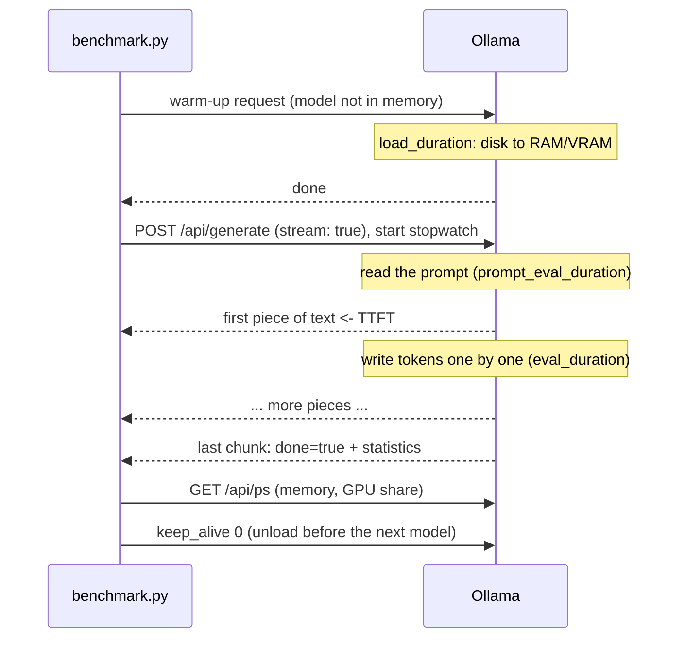
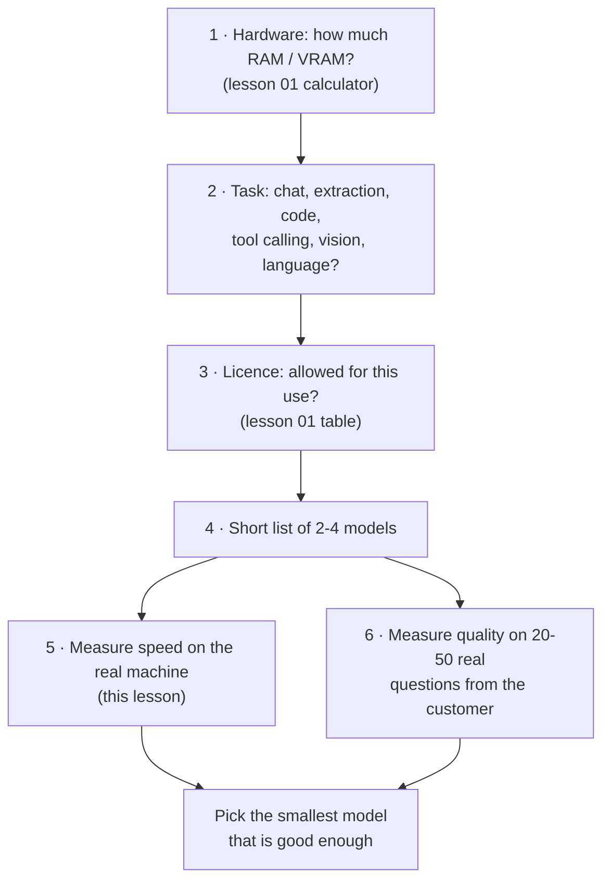

# 05 · Choosing a model: benchmarks and speed

**What you'll build:** your own mini benchmark that loads each Ollama model in turn and measures how long it takes to load, how quickly the first word appears, how many tokens per second it writes and how much memory it uses, then saves a table you can compare over time.
**Like you're 5:** before buying running shoes, you don't just read the box: you run around the shop in each pair. Leaderboards are the box. Your benchmark is running around the shop, on *your* computer, with *your* kind of questions.
**Time:** ~1 h · **Builds on:** [04 · Quantization hands-on](../04-quantization-hands-on) · **Needs:** Ollama with at least two models (for example `llama3.2:1b` and `llama3.2:3b`, ~3.3 GB together)

## Why this matters
"Which model should we use?" is the first question in every local-AI project. The answer depends on the customer's hardware, how fast answers must feel, and how good they must be. Public leaderboards tell you about quality on someone else's tests; only a benchmark on the real machine tells you whether users will wait 0.3 seconds or 6 seconds. Engineers who bring a small table of measured numbers to that discussion settle it quickly.

## What you'll learn
- **Time to first token (TTFT):** how long the user stares at an empty screen. It's what makes an app *feel* fast.
- **Generation speed (tokens/s):** how fast the answer is written once it starts. People read about 5–8 tokens per second, so above ~15 tokens/s feels instant.
- **Prompt speed and load time:** reading the input is much faster than writing; loading from disk happens once.
- **Memory and GPU share:** what `ollama ps` reports, and why "100% GPU" matters.
- **A model-choice checklist:** hardware, task, language, licence, then measure.

## Before you start
1. Part 1 packages (skip if done):
   ```bash
   pip install httpx gguf huggingface_hub
   ```
   This lesson only uses `httpx`.
2. Ollama running (lesson 02) and some models to compare. A good first set:
   ```bash
   ollama pull llama3.2:1b
   ollama pull llama3.2:3b
   ollama pull qwen2.5:3b
   ```
   On a computer with 16 GB of RAM or more, also try a 7–8B model, for example `ollama pull qwen2.5:7b` or `ollama pull llama3.1:8b`.
3. Close big apps (browsers with many tabs, games): they compete for memory and make results jumpy.
4. No API key needed.

## Run it
1. Go to the lesson folder:
   ```bash
   cd part-1-run-models-locally/05-choosing-a-model-benchmarks-and-speed
   ```
2. Benchmark two or three models (3 measured runs each):
   ```bash
   python benchmark.py llama3.2:1b llama3.2:3b qwen2.5:3b
   ```
3. Open `results.csv` in a spreadsheet (Excel, Numbers, LibreOffice, Google Sheets) or print it:
   ```bash
   cat results.csv
   ```
   (Windows PowerShell: `type results.csv`.)
4. Run it again with more runs for steadier numbers:
   ```bash
   python benchmark.py llama3.2:3b --runs 5
   ```

**Command, piece by piece** (`python benchmark.py llama3.2:1b llama3.2:3b --runs 5`):

| Piece | Meaning |
|-------|---------|
| `python benchmark.py` | run the benchmark script |
| `llama3.2:1b llama3.2:3b` | **positional arguments**: one or more model names, separated by spaces |
| `--runs 5` | an option: 5 measured runs per model (default 3) |
| `cat results.csv` | `cat` prints a file's contents to the screen |

### What you should see
**Example output** (Ollama isn't available where this course was written; the script was tested against a fake Ollama server that sends correctly shaped answers. These numbers are typical for a laptop with a mid-range NVIDIA GPU; on CPU only, expect roughly a third of the speed):
```
llama3.2:1b
  loaded in 1.3 s
  run 1: first token after 61 ms, 128 tokens at 96.4 tokens/s
  run 2: first token after 58 ms, 128 tokens at 97.1 tokens/s
  run 3: first token after 57 ms, 104 tokens at 96.8 tokens/s

llama3.2:3b
  loaded in 2.2 s
  run 1: first token after 92 ms, 128 tokens at 61.5 tokens/s
  ...

qwen2.5:3b
  loaded in 2.1 s
  ...

model                   load s  TTFT ms  gen tok/s  read tok/s   memory   GPU
llama3.2:1b               1.31       58       96.8      2210.4     1.93GB  100%
llama3.2:3b               2.24       93       61.4      1405.2     3.12GB  100%
qwen2.5:3b                2.08       90       58.9      1382.7     2.97GB  100%

Saved results.csv (open it in a spreadsheet to compare runs over time).
```
What to look at:
- **TTFT is tiny compared with the full answer.** Even a 128-token answer takes ~2 seconds at 60 tokens/s, but the first word appears in under 0.1 s. That's why every chat app streams.
- **The 1B model is ~1.6x faster than the 3B,** and needs less memory. Whether it's *good enough* is a separate question (see "Speed is only half the story").
- **`read tok/s` is 20x+ faster than `gen tok/s`.** The model reads your whole prompt in parallel but must write one token at a time.
- **GPU below 100%** (for example `45%`) means part of the model runs on the CPU and generation slows down a lot. Use a smaller model, a smaller quantization or a smaller `num_ctx`.

## How it works

### What we measure, on a timeline


| Number | Measured how | Why it matters |
|--------|-------------|----------------|
| **load s** | Ollama's `load_duration` on the warm-up request | cold start after the model was unloaded; matters for apps that switch models |
| **TTFT ms** | our own stopwatch: from sending the request to the first non-empty `response` piece | the "is it working?" feeling. Includes network, queueing and reading the prompt |
| **gen tok/s** | `eval_count ÷ eval_duration` from the last chunk | how fast the answer is written |
| **read tok/s** | `prompt_eval_count ÷ prompt_eval_duration` | matters a lot for RAG and long documents (lesson 07), where prompts are thousands of tokens |
| **memory** | `size` from `/api/ps` | weights + KV cache + buffers, as loaded |
| **GPU %** | `size_vram ÷ size` | 100% = all on GPU = fast |

### The code (`benchmark.py`)
1. `PROMPTS` holds three everyday tasks; `OPTIONS` fixes `temperature 0`, `seed 42`, `num_predict 128` (answer length limit) and `num_ctx 4096`, so every model gets exactly the same job.
2. `main()` checks Ollama answers (`/api/version`), adds `:latest` to bare names, then calls `benchmark()` for each model.
3. `benchmark()` first unloads the model (`keep_alive: 0`) so it starts cold, then sends a tiny warm-up prompt and reads `load_duration` from its statistics.
4. `stream_once()` sends one prompt with streaming on. `time.perf_counter()` is a precise stopwatch; the first chunk with text sets `first_token`. The final chunk (`done: true`) carries Ollama's own counters. An `"error"` chunk (for example a model that isn't downloaded) stops the script with a hint.
5. Each run's TTFT and speeds go into lists; `statistics.median()` picks the middle value, so one odd run (an antivirus scan, a browser tab) doesn't spoil the result.
6. `memory_of()` reads `/api/ps` while the model is still loaded; afterwards the model is unloaded so the next one has the whole machine.
7. The table is printed with f-string alignment (`:>9` = right-align in 9 characters), and `csv.DictWriter` writes `results.csv` with one row per model.

### Speed is only half the story: choosing a model
Use this order. Each step removes candidates.



**Starting points by hardware** (4-bit models, normal context sizes):

| Your machine | Comfortable model size | Examples to try |
|--------------|-----------------------|-----------------|
| 8 GB RAM, no GPU | 1–3B | `llama3.2:1b`, `llama3.2:3b`, `qwen2.5:1.5b`, `gemma3:1b` |
| 16 GB RAM, or a GPU with 6–8 GB | 3–8B | `qwen2.5:7b`, `llama3.1:8b`, `gemma3:4b` |
| 32 GB Mac, or a GPU with 12–16 GB | 8–14B | `qwen2.5:14b`, `phi4:14b`, `gemma3:12b` |
| 64 GB+ Mac, or 24 GB+ GPU | 20–32B (70B with 2+ big GPUs or 64 GB+ unified memory) | `qwen2.5:32b`, `gemma3:27b` |

**By task:**
- **Embeddings / search:** a dedicated embedding model, not a chat model: `nomic-embed-text` (lesson 07).
- **Structured output and tool calling:** a model whose `ollama show` lists the `tools` capability; Qwen models are strong here for their size (lesson 08).
- **Non-English text:** test in that language: quality drops much faster for smaller languages in small models.
- **Code:** a code-tuned variant (for example `qwen2.5-coder`).
- **Images:** a vision model (lesson 09).

**Quality data you can trust more than marketing:** blind human votes on LMArena (https://lmarena.ai), and the model card's own benchmark table on its Hugging Face page. But your own 20–50 real questions beat every leaderboard, because they test *your* job.

### Tips for fair benchmarks
- Same prompts, `temperature 0`, same `num_predict`, same `num_ctx` for every model (the script does this).
- Plug in your laptop: on battery, CPUs and GPUs slow down.
- Run at least 3 times and use the median.
- Compare quantizations fairly: `qwen2.5:7b` is a 4-bit file by default, and so is `llama3.2:3b`. Check with `ollama show <model>` (the `quantization` line).
- For a second opinion on pure speed, `llama-bench` from lesson 04 measures the engine without any HTTP in between.

## If something goes wrong
- **`Can't reach Ollama at http://localhost:11434`** → start the Ollama app or `ollama serve` (lesson 02).
- **`Ollama says: model 'qwen2.5:3b' not found`** → `ollama pull qwen2.5:3b`, or remove it from the command. `ollama list` shows what you have.
- **Very different numbers each run** → something else is using the computer, or the laptop is throttling. Close apps, plug in power, use `--runs 5`.
- **`GPU 0%` although you have a graphics card** → Ollama doesn't see the GPU (missing NVIDIA driver, or an unsupported GPU). Check `ollama ps` and the Ollama GPU docs; on Mac, Apple Silicon always uses the GPU.
- **`httpx.ReadTimeout`** → a big model on a slow machine took more than 10 minutes. Use a smaller model or lower `num_predict` in `OPTIONS`.

## Try this
1. **Easy:** benchmark the same model in two quantizations. Many Ollama models have tags like `llama3.2:3b-instruct-q8_0`. Which is faster, and by how much?
   <details><summary>Hint</summary>Open the model's page on https://ollama.com/library (click "Tags") to see the available quantizations, pull one, e.g. <code>ollama pull llama3.2:3b-instruct-q8_0</code>, and run <code>python benchmark.py llama3.2:3b llama3.2:3b-instruct-q8_0</code>. Expect Q8_0 to need more memory and generate more slowly.</details>
2. **Medium:** test how a long prompt changes TTFT. Add a fourth prompt that includes a long text (for example the bicycle article from lesson 04) and compare its TTFT with the short prompts.
   <details><summary>Solution</summary>

   At the top of `benchmark.py`:
   ```python
   from pathlib import Path
   ARTICLE = (Path(__file__).parent.parent / "04-quantization-hands-on" / "eval_text.txt").read_text(encoding="utf-8")
   PROMPTS.append("Summarise this article in 3 sentences:\n\n" + ARTICLE)
   ```
   Run with `--runs 4` so each prompt is used once. The long prompt (~1,500 tokens) has a much bigger TTFT, because the model must read all of it before writing the first token. That's the cost RAG pays (lesson 07).
   </details>
3. **Harder:** measure what users really feel: add the **total time** of each answer (from request to last token) to the table and CSV.
   <details><summary>Solution</summary>

   In `stream_once()`, when `chunk["done"]` is true, also return the total time:
   ```python
   if chunk["done"]:
       return first_token or 0.0, chunk, time.perf_counter() - start
   ```
   Update the two callers: `_, warm, _ = stream_once(...)` and `ttft, stats, total = stream_once(...)`. Collect `totals.append(total)` in the loop, add `"total_s": round(statistics.median(totals), 2)` to the returned dict, and add `{r['total_s']:>8}` to the printed row (and a matching header). The CSV picks up the new column automatically because it uses the dict's keys.
   </details>

## Check yourself
1. What is TTFT, and why can an app feel fast even when generation speed is modest?
2. Why does the script unload each model before and after testing it?
3. Two models score the same on a leaderboard. One runs at 12 tokens/s on the customer's laptop, the other at 45. What else do you check before choosing?
4. Why is reading the prompt so much faster than writing the answer?

<details><summary>Answers</summary>

1. Time to first token: how long until the first piece of the answer appears. With streaming, users start reading right away, so a low TTFT feels fast even if the rest arrives at a normal reading speed.
2. Before: to measure a real cold load time. After: to free memory, so the next model isn't slowed down or pushed partly onto the CPU by the previous one.
3. Quality on the customer's own questions (and language), memory use and GPU share, licence, context length needs, and features like tool calling.
4. All prompt tokens are known in advance, so the model processes them together in parallel. Answer tokens depend on each other, so they must be produced one at a time.
</details>

## Learn more (optional)
**Read the official docs**
- Ollama API (response fields such as `eval_count`, `/api/ps`): https://github.com/ollama/ollama/tree/main/docs
- Ollama FAQ (GPU use, keep_alive, concurrency): https://docs.ollama.com/faq
- `llama-bench`: https://github.com/ggml-org/llama.cpp/tree/master/tools/llama-bench
- LMArena leaderboard (blind human votes): https://lmarena.ai
- Python `time.perf_counter` and `statistics`: https://docs.python.org/3/library/time.html#time.perf_counter · https://docs.python.org/3/library/statistics.html

**Watch**
- [Ollama model comparison speed test](https://www.youtube.com/results?search_query=ollama+model+comparison+speed+test) · [tokens per second local LLM explained](https://www.youtube.com/results?search_query=tokens+per+second+local+llm+explained)
- Matt Williams on picking models: [search "Matt Williams choose ollama model"](https://www.youtube.com/results?search_query=matt+williams+which+ollama+model)

## Next
→ [06 · OpenAI-compatible APIs and switching providers](../../part-2-build-with-open-models/06-openai-compatible-apis-and-switching-providers)
