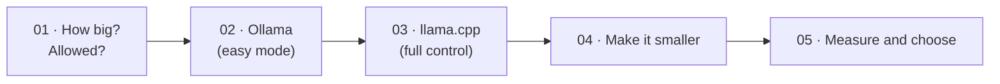

# Part 1 · Run models locally

You'll learn to run open AI models on your own computer: how big they are, how to run them with **Ollama** and **llama.cpp**, how to shrink them with **quantization**, and how to measure which one is right for a machine. No API keys, no cloud: everything here works offline once the models are downloaded.

| # | Lesson | What you'll have | Time |
|---|--------|------------------|------|
| 01 | [Why local models, and how big they are](01-why-local-models-and-how-big-they-are) | a memory calculator, the "local or cloud?" decision, a licence cheat sheet | 1 h |
| 02 | [Ollama deep dive: API and Modelfiles](02-ollama-deep-dive-api-and-modelfiles) | Ollama's CLI and REST API (generate, chat, embed, streaming) from curl and Python, and your own `kid-tutor` model | 1.5 h |
| 03 | [llama.cpp and GGUF](03-llama-cpp-and-gguf) | llama.cpp installed, a GGUF file downloaded and inspected, your own OpenAI-compatible server | 1.5 h |
| 04 | [Quantization hands-on](04-quantization-hands-on) | F16 → Q8_0 → Q4_K_M → Q2_K made by you, with a size / quality / speed comparison table | 1.5 h |
| 05 | [Choosing a model: benchmarks and speed](05-choosing-a-model-benchmarks-and-speed) | a benchmark script for Ollama models (load time, time to first token, tokens/s, memory) | 1 h |

**Total: about 1 week at 1 hour a day.**



## Install once (in your activated venv)
```bash
pip install httpx gguf huggingface_hub
```
- `httpx`: sends HTTP requests from Python to Ollama and llama-server (02, 03, 04, 05).
- `gguf`: reads GGUF model files (03).
- `huggingface_hub`: gives you the `hf` command to download models from Hugging Face (03, 04).

Lesson 01 needs no packages at all.

## Programs you'll install
| Program | Lesson | How |
|---------|--------|-----|
| **Ollama** | 02 (used again in 05 and Part 2) | https://ollama.com/download (Windows/Mac), `curl -fsSL https://ollama.com/install.sh \| sh` (Linux). Details in lesson 02 |
| **llama.cpp** | 03, 04 | `brew install llama.cpp` (Mac/Linux), `winget install llama.cpp` (Windows), or a ready-made download from https://github.com/ggml-org/llama.cpp/releases. Details in lesson 03 |

## Disk space for this part
| What | Where | Size |
|------|-------|------|
| `llama3.2:3b`, `llama3.2:1b`, `qwen2.5:3b`, `nomic-embed-text` (Ollama) | `~/.ollama/models` | ~5.5 GB |
| Llama 3.2 1B GGUF files (03, 04) | each lesson's `models/` folder | ~0.8 GB (03) + ~5.2 GB (04: F16 plus three smaller copies) |

Model files are listed in the course `.gitignore`, so git never tries to commit them. Delete a lesson's `models/` folder when you're done to get the space back.

## After this part you can
- Estimate whether a model fits a machine before downloading it, and say whether its licence allows a product.
- Run, customise and control any Ollama model from the command line, curl or Python.
- Download any GGUF model and serve it with llama.cpp, with GPU offload.
- Quantize a model yourself and prove with numbers what you gained and lost.
- Pick a model for a customer's hardware with a measured benchmark table.

Start here → [01 · Why local models, and how big they are](01-why-local-models-and-how-big-they-are)

Next part → [Part 2 · Build with open models](../part-2-build-with-open-models)
