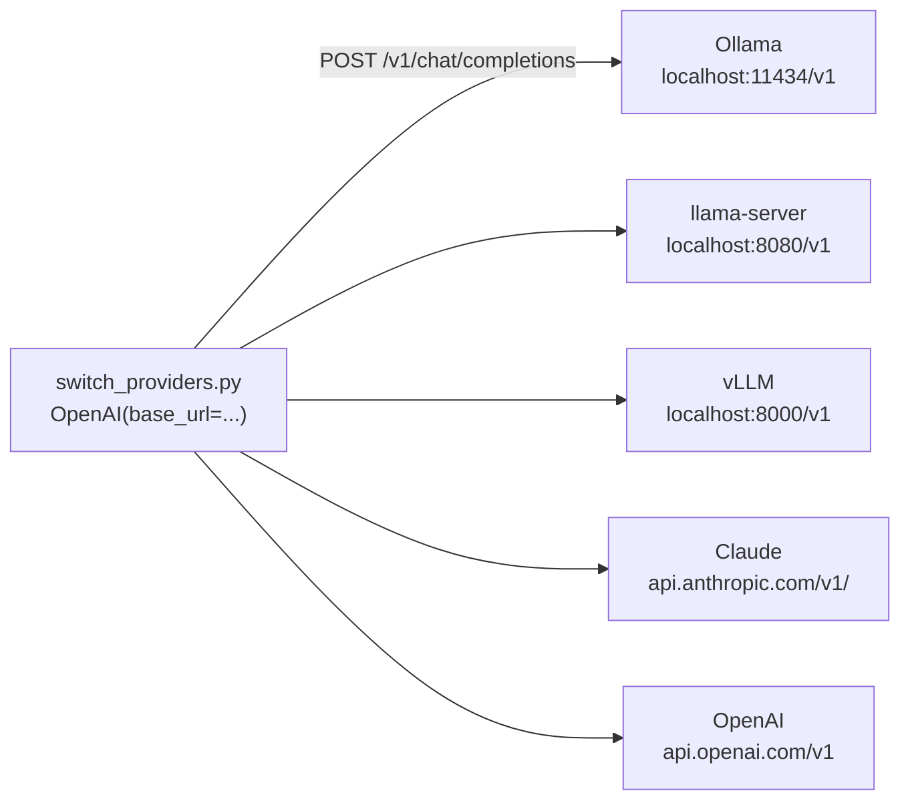

# 06 · OpenAI-compatible APIs and switching providers

**What you'll build:** one small Python program that asks the same question to Ollama, llama.cpp's server, vLLM, Claude or OpenAI, and switches between them by changing a single word on the command line. It can also ask all of them at once and time each answer.
**Like you're 5:** wall sockets look the same in every room, so any lamp works in any room. Many AI servers copied the same "socket shape" (OpenAI's API), so one program can plug into any of them. You just choose which room (address) to plug into.
**Time:** ~1 h · **Builds on:** [05 · Choosing a model](../../part-1-run-models-locally/05-choosing-a-model-benchmarks-and-speed), [03 · llama.cpp and GGUF](../../part-1-run-models-locally/03-llama-cpp-and-gguf) · **Needs:** Ollama with `llama3.2:3b`; optional: llama-server (lesson 03), an Anthropic or OpenAI API key

## Why this matters
Real projects change models all the time: a prototype on a cloud model, a private deployment on a local one, a cheaper model for easy requests, a backup when a provider is down. If the code is welded to one provider, every switch is a rewrite. With an OpenAI-compatible client, switching is a configuration change, and you can compare providers side by side on the same question. This is one of the most practical skills for anyone deploying AI at a customer.

## What you'll learn
- **OpenAI-compatible API:** the `/v1/chat/completions` request and response shape that Ollama, llama-server, vLLM, LM Studio and many cloud providers all accept.
- **`base_url`:** the address the client sends requests to. Changing it is what switches providers.
- **The `openai` package:** OpenAI's official Python library, which works with any compatible server, not only OpenAI.
- **What still differs:** model names, keys, and some settings (for example `max_tokens` vs `max_completion_tokens`).
- **Streaming with Server-Sent Events:** how compatible servers send an answer piece by piece.

## Before you start
1. Install the packages for this lesson (in your activated venv):
   ```bash
   pip install openai
   ```
   - `openai`: the official client library. Despite the name, you'll mostly point it at local servers.
2. Ollama running with `llama3.2:3b` (lesson 02): `ollama pull llama3.2:3b`.
3. Optional, to try more providers:
   - **llama.cpp:** start `llama-server -m <your .gguf> --port 8080` from lesson 03.
   - **vLLM:** needs Linux (or WSL) with an NVIDIA GPU; lesson 14 covers it. Skip it for now: the program simply reports "skipped".
   - **Claude (cloud):** an Anthropic API key (see the API key guide in [AI from Zero Part 4](../../../ai-from-zero/part-4-chatbots)). Set it in the terminal before running:
     - Mac/Linux: `export ANTHROPIC_API_KEY="sk-ant-..."`
     - Windows PowerShell: `$env:ANTHROPIC_API_KEY="sk-ant-..."`
   - **OpenAI (cloud):** an OpenAI API key, set the same way as `OPENAI_API_KEY`.
4. Without any key, the local providers still work. No key is needed for Ollama, llama-server or vLLM.

| Piece | Meaning |
|-------|---------|
| `export NAME="value"` | Mac/Linux: set an **environment variable** for this terminal and the programs it starts |
| `$env:NAME="value"` | the same in Windows PowerShell |
| `ANTHROPIC_API_KEY` | the name the program looks for; the value is your secret key. Never put keys in code or git |

## Run it
1. Go to the lesson folder:
   ```bash
   cd part-2-build-with-open-models/06-openai-compatible-apis-and-switching-providers
   ```
2. Ask your local Ollama:
   ```bash
   python switch_providers.py ollama "Why is the sky blue?"
   ```
3. Same question, streamed word by word:
   ```bash
   python switch_providers.py ollama "Why is the sky blue?" --stream
   ```
4. List the models a provider offers:
   ```bash
   python switch_providers.py ollama --models
   ```
5. If llama-server is running from lesson 03, switch to it by changing one word:
   ```bash
   python switch_providers.py llamacpp "Why is the sky blue?"
   ```
6. Ask every provider and compare (unavailable ones are skipped):
   ```bash
   python switch_providers.py all "Explain recursion to a 10-year-old."
   ```
7. Use another Ollama model without changing the code:
   - Mac/Linux: `OLLAMA_MODEL=qwen2.5:3b python switch_providers.py ollama "Hi!"`
   - Windows PowerShell: `$env:OLLAMA_MODEL="qwen2.5:3b"; python switch_providers.py ollama "Hi!"`

**Command, piece by piece** (`python switch_providers.py ollama "Why is the sky blue?" --stream`):

| Piece | Meaning |
|-------|---------|
| `switch_providers.py` | the program |
| `ollama` | which provider: `ollama`, `llamacpp`, `vllm`, `claude`, `openai` or `all` |
| `"Why is the sky blue?"` | the question. The quotes keep the words together as one argument (and stop the shell from treating `?` as a wildcard) |
| `--stream` | print the answer as it arrives |
| `--models` | list the provider's models instead of asking |
| `OLLAMA_MODEL=qwen2.5:3b python ...` | Mac/Linux: set an environment variable for this one command only |

### What you should see
**Example output** of `python switch_providers.py all "Explain recursion to a 10-year-old."` with Ollama running, no llama-server, no vLLM and no OpenAI key. The program was tested where this course was written against a real llama-server and a fake Ollama/vLLM server; the "skipped" lines below are exactly what it prints, and the answers are examples:
```
--- ollama (llama3.2:3b at http://localhost:11434/v1) ---
Recursion is when something is defined using a smaller version of itself. Imagine standing between two mirrors: you see a mirror inside a mirror inside a mirror. In programming, a function solves a big problem by calling itself on a smaller piece until the piece is tiny and easy.
(3.4 s)

--- llamacpp (local at http://localhost:8080/v1) ---
skipped: nothing is listening there (is the server running?)

--- vllm (Qwen/Qwen2.5-1.5B-Instruct at http://localhost:8000/v1) ---
skipped: nothing is listening there (is the server running?)

--- claude (claude-haiku-5-5 at https://api.anthropic.com/v1/) ---
Recursion is like a set of Russian dolls: to open the biggest doll, you open the next one inside, and the next, until you reach the tiniest doll that doesn't open. A recursive function does a job by doing a smaller version of the same job, until the job is so small it's obvious.
(1.9 s)

--- openai (gpt-5-mini at https://api.openai.com/v1) ---
skipped: set OPENAI_API_KEY first
```
Look at:
- **The same function `ask()` produced every answer.** Only the address, key and model name changed.
- **Errors are separated by kind:** "nothing is listening" (server not started), "set ... first" (missing key), or `error 404/401` (the server answered, but with a problem such as an unknown model or a wrong key).
- **Timing:** the local answer includes loading the model if it wasn't in memory yet; run it twice and compare.

## How it works

### One program, many servers


### The request every compatible server understands
```json
POST {base_url}/chat/completions
Authorization: Bearer <api key>
{
  "model": "llama3.2:3b",
  "messages": [
    {"role": "system", "content": "You are a helpful assistant..."},
    {"role": "user", "content": "Why is the sky blue?"}
  ],
  "temperature": 0.3,
  "max_tokens": 300,
  "stream": false
}
```
and the answer:
```json
{
  "id": "chatcmpl-...",
  "object": "chat.completion",
  "model": "llama3.2:3b",
  "choices": [{"index": 0, "message": {"role": "assistant", "content": "The sky looks blue because..."}, "finish_reason": "stop"}],
  "usage": {"prompt_tokens": 32, "completion_tokens": 41, "total_tokens": 73}
}
```

| Key | Meaning |
|-----|---------|
| `Authorization: Bearer ...` | a header carrying the API key. Local servers ignore it, but the `openai` package always sends one, so we pass `"not-needed"` |
| `model` | the model's name *on that server* (Ollama: `llama3.2:3b`; vLLM: the Hugging Face name; Claude: `claude-haiku-5-5`) |
| `messages` | the conversation, same roles as Ollama's `/api/chat` |
| `choices[0].message.content` | the answer text |
| `finish_reason` | `stop` = finished; `length` = hit the token limit |
| `usage` | token counts (what cloud providers bill you for) |

### The code (`switch_providers.py`)
1. `PROVIDERS` is a dictionary with one entry per provider: `base_url`, the name of the environment variable holding the key (`key_env`, or `None` for local servers), the `model`, and `settings`. Model names can be overridden with environment variables (`OLLAMA_MODEL`, `VLLM_MODEL`, `CLAUDE_MODEL`, `OPENAI_MODEL`) so you never edit code to try another model.
2. `make_client(name)` builds `OpenAI(base_url=..., api_key=..., timeout=300, max_retries=0)`. If a cloud key is missing it raises `RuntimeError` with a clear message. `max_retries=0` makes a stopped server fail at once instead of retrying.
3. `ask()` sends `client.chat.completions.create(model=..., messages=..., **settings)`. `**settings` unpacks the dictionary into named arguments: `{"temperature": 0.3, "max_tokens": 300}` becomes `temperature=0.3, max_tokens=300`.
4. With `stream=True`, the call returns an iterator of **chunks**. Each has `choices[0].delta.content`: the new piece of text (or `None`). We print each piece immediately and join them at the end.
5. `list_models()` calls `client.models.list()`, which is `GET {base_url}/models`.
6. `main()` loops over one provider or `all`, and catches the `openai` package's errors: `APIConnectionError` (nobody is listening), `APIStatusError` (the server answered with an error code, e.g. 404 unknown model or 401 bad key).

**Streaming here uses Server-Sent Events:** compatible servers send lines like `data: {"choices":[{"delta":{"content":"The"}}]}` and finish with `data: [DONE]`. The `openai` package reads them for you. (Ollama's native `/api/chat` from lesson 02 uses plain JSON lines instead; both are "streaming".)

### Starting each server (cheat sheet)
| Provider | Start it | base_url |
|----------|----------|----------|
| Ollama | it runs in the background after installing (lesson 02) | `http://localhost:11434/v1` |
| llama.cpp | `llama-server -m model.gguf --port 8080` (lesson 03) | `http://localhost:8080/v1` |
| vLLM | `vllm serve Qwen/Qwen2.5-1.5B-Instruct --port 8000` (Linux + NVIDIA GPU, lesson 14) | `http://localhost:8000/v1` |
| LM Studio | start the server in the app's Developer tab | `http://localhost:1234/v1` |
| Claude | cloud, needs `ANTHROPIC_API_KEY` | `https://api.anthropic.com/v1/` |
| OpenAI | cloud, needs `OPENAI_API_KEY` | `https://api.openai.com/v1` |

| Piece of `vllm serve Qwen/Qwen2.5-1.5B-Instruct --port 8000` | Meaning |
|-----|---------|
| `vllm serve` | start vLLM's OpenAI-compatible server |
| `Qwen/Qwen2.5-1.5B-Instruct` | a Hugging Face model name; vLLM downloads the original (not GGUF) weights |
| `--port 8000` | the port (8000 is vLLM's default) |

### What is *not* the same between providers
Compatible means "the same shape", not "identical". Keep these differences in configuration (like `settings` in `PROVIDERS`), not scattered through your code:
- **Model names** are different everywhere.
- **Settings:** OpenAI's newer models want `max_completion_tokens` instead of `max_tokens` and only accept their default `temperature`; that's why the `openai` entry has its own `settings`.
- **Context size:** Ollama's OpenAI endpoint has no `num_ctx` option; set it in a Modelfile (lesson 02) or with `OLLAMA_CONTEXT_LENGTH`. llama-server uses the `-c` you started it with.
- **Extra features** (tool calling, JSON schema output, images) are supported to different degrees. Lesson 08 shows tool calling with Ollama.
- **Anthropic's compatible endpoint** is meant for trying Claude with existing OpenAI code. For production Claude apps, Anthropic's own SDK (used in AI from Zero) gives you every feature.

**Tip:** the `openai` package also reads `OPENAI_BASE_URL` and `OPENAI_API_KEY` from the environment. So many existing tools that "only support OpenAI" can be pointed at your local Ollama by setting `OPENAI_BASE_URL=http://localhost:11434/v1` and `OPENAI_API_KEY=ollama`.

## If something goes wrong
- **`ModuleNotFoundError: No module named 'openai'`** → activate the venv and run `pip install openai`.
- **`skipped: nothing is listening there`** → that server isn't running, or runs on another port. Check with `curl http://localhost:11434/v1/models` (or the port you used).
- **`error 404: ... model "llama3.2:3b" not found`** → the server doesn't have that model. For Ollama: `ollama pull llama3.2:3b` or set `OLLAMA_MODEL` to a model from `ollama list`.
- **`error 401`** → the API key is wrong or expired. Check for spaces or missing characters, and that you set it in *this* terminal.
- **`error 400: Unsupported parameter`** → a provider doesn't accept one of the `settings`. Adjust that provider's `settings` dictionary (as the `openai` entry does).

## Try this
1. **Easy:** add **LM Studio** (or a second llama-server on another port) as a new provider.
   <details><summary>Solution</summary>

   Add an entry to `PROVIDERS`:
   ```python
   "lmstudio": {
       "base_url": "http://localhost:1234/v1",
       "key_env": None,
       "model": os.environ.get("LMSTUDIO_MODEL", "llama-3.2-3b-instruct"),
       "settings": COMMON_SETTINGS,
   },
   ```
   `choices=[*PROVIDERS, "all"]` picks it up automatically, so `python switch_providers.py lmstudio "Hi"` works. Use `--models` to see the exact model name LM Studio uses.
   </details>
2. **Medium:** add a `fallback` mode: try the local providers in order and use the first one that answers; if none answers, use Claude.
   <details><summary>Solution</summary>

   ```python
   def ask_with_fallback(question, order=("ollama", "llamacpp", "vllm", "claude")):
       for name in order:
           try:
               return name, ask(name, question)
           except (APIConnectionError, APIStatusError, RuntimeError) as e:
               print(f"  {name} failed ({type(e).__name__}), trying the next one...")
       raise RuntimeError("no provider answered")
   ```
   Add `"fallback"` to the `choices` list, and at the start of the loop in `main()`:
   ```python
   if args.provider == "fallback":
       name, answer = ask_with_fallback(args.question)
       print(f"[{name}] {answer}")
       return
   ```
   This is the pattern behind "private by default, cloud as backup".
   </details>
3. **Harder:** add a `--judge` option to the `all` mode that sends all the answers to one model and asks it which one explains the topic best.
   <details><summary>Solution</summary>

   Collect the answers in `main()` (`answers[name] = answer`) and after the loop:
   ```python
   if args.judge and len(answers) > 1:
       listing = "\n\n".join(f"Answer {n}:\n{a}" for n, a in answers.items())
       verdict = make_client("ollama").chat.completions.create(
           model=PROVIDERS["ollama"]["model"],
           messages=[{"role": "user", "content":
                      f"Question: {args.question}\n\n{listing}\n\n"
                      "Which answer is clearest and most correct for a beginner? Name it and give one reason."}],
           temperature=0)
       print("\nJudge says:", verdict.choices[0].message.content)
   ```
   Add `parser.add_argument("--judge", action="store_true")`. This is a tiny **LLM-as-judge**; the forward-deployed course shows how to make judges trustworthy.
   </details>

## Check yourself
1. What three things change when you switch from Ollama to Claude in this program?
2. Why does the program pass an API key to Ollama, which doesn't need one?
3. What is the difference between `APIConnectionError` and `APIStatusError`?
4. Name two things that are *not* the same between "OpenAI-compatible" providers.

<details><summary>Answers</summary>

1. The `base_url`, the API key (from `ANTHROPIC_API_KEY`) and the model name (plus any provider-specific settings).
2. The `openai` package requires a key and sends it in a header; local servers ignore it, so any placeholder works.
3. Connection error: nothing answered at that address (server not running, wrong port, no network). Status error: a server answered but reported a problem, such as 404 (unknown model) or 401 (bad key).
4. Model names; supported settings (`max_tokens` vs `max_completion_tokens`, temperature rules); how to set the context size; support for tools, JSON schemas and images.
</details>

## Learn more (optional)
**Read the official docs**
- Ollama's OpenAI compatibility: https://docs.ollama.com/api/openai-compatibility
- llama-server OpenAI-compatible endpoints: https://github.com/ggml-org/llama.cpp/tree/master/tools/server
- vLLM OpenAI-compatible server: https://docs.vllm.ai
- Anthropic's OpenAI SDK compatibility: https://docs.anthropic.com/en/api/openai-sdk
- The `openai` Python package: https://github.com/openai/openai-python
- OpenAI Chat Completions reference: https://platform.openai.com/docs/api-reference/chat

**Watch**
- [OpenAI compatible API local LLM](https://www.youtube.com/results?search_query=openai+compatible+api+local+llm+ollama) · [switch between LLM providers python](https://www.youtube.com/results?search_query=switch+llm+providers+python+openai+base_url)
- Sam Witteveen on local and open models: [search "Sam Witteveen Ollama OpenAI API"](https://www.youtube.com/results?search_query=sam+witteveen+ollama+openai)

## Next
→ [07 · Local embeddings and private RAG](../07-local-embeddings-and-private-rag)
