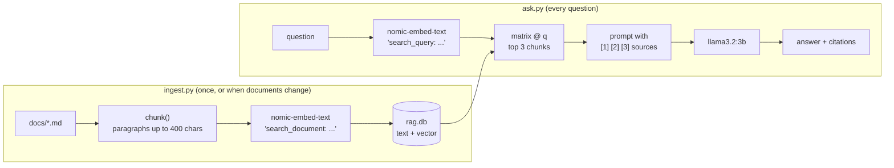

# 07 · Local embeddings and private RAG

**What you'll build:** a "ask your documents" assistant for a pretend bike shop that runs 100% on your computer: a local embedding model turns the shop's documents into numbers, SQLite + NumPy find the right paragraphs, and a local LLM answers with citations like `[1]` that point to the exact file.
**Like you're 5:** before answering a question, a good student first finds the right page in the textbook, then answers *from that page* and says "it's on page 12". RAG makes the AI do the same. And because the textbook, the student and the library are all in your own room, nobody else sees your questions.
**Time:** ~1.5 h · **Builds on:** [06 · OpenAI-compatible APIs](../06-openai-compatible-apis-and-switching-providers), [AI from Zero 24 · RAG: ask your documents](../../../ai-from-zero/part-5-rag-and-vector-databases/24-rag-ask-your-documents) · **Needs:** Ollama with `nomic-embed-text` (~0.3 GB) and `llama3.2:3b` (~2 GB)

## Why this matters
"Can the AI answer from *our* documents without sending them to anyone?" is one of the most common requests from hospitals, law firms, banks and governments. Private RAG is the answer: retrieval-augmented generation where the embedding model, the vector search and the LLM all run on the customer's own machines. Citations matter just as much: people trust (and can check) an answer that says where it came from.

## What you'll learn
- **Embeddings:** a list of numbers (here 768) that captures what a text *means*; similar meanings give similar numbers.
- **Chunking:** cutting documents into small pieces so the search can find the exact paragraph.
- **Vector search with SQLite + NumPy:** store vectors in an ordinary database file and compare them with one line of maths.
- **Grounded prompts and citations:** give the LLM numbered sources, tell it to use only those and to cite them, and to say "I don't know" otherwise.
- **Task prefixes:** `nomic-embed-text` expects `search_document:` on stored text and `search_query:` on questions.

## Before you start
1. Install the packages for this lesson (in your activated venv):
   ```bash
   pip install ollama numpy
   ```
   - `ollama`: the official Python library for Ollama (embeddings and chat). `numpy`: fast maths on lists of numbers. `sqlite3` comes with Python.
2. Download the two models (once):
   ```bash
   ollama pull nomic-embed-text
   ollama pull llama3.2:3b
   ```
3. Make sure Ollama is running (http://localhost:11434 says "Ollama is running").
4. No API key needed. Nothing is sent to the internet.

## Run it
1. Go to the lesson folder:
   ```bash
   cd part-2-build-with-open-models/07-local-embeddings-and-private-rag
   ```
2. Look at the documents you'll search (four short files about returns, warranty, repairs and opening hours):
   ```bash
   ls docs
   ```
3. Build the index (read, chunk, embed, save to `rag.db`):
   ```bash
   python ingest.py
   ```
4. Ask a question:
   ```bash
   python ask.py "How long do I have to return a bike?"
   ```
5. Ask something the documents can't answer, to check it doesn't make things up:
   ```bash
   python ask.py "Do you sell skateboards?"
   ```
6. Ask several questions in a row (press Enter on an empty line to stop):
   ```bash
   python ask.py
   ```
7. Add your own document: save any `.md` or `.txt` file into `docs/`, run `python ingest.py` again, and ask about it.

**Command, piece by piece** (`python ask.py "How long do I have to return a bike?"`):

| Piece | Meaning |
|-------|---------|
| `python ask.py` | run the question-answering program |
| `"How long ...?"` | the question, as one argument (in quotes). Leave it out to get an interactive prompt |

### What you should see
`python ingest.py` (this line is real output; the chunk count depends only on the documents):
```
Read 4 files -> 9 chunks -> vectors of 768 numbers.
Saved to rag.db (44 KB).
```
**Example output** of `python ask.py "How long do I have to return a bike?"` (written as an example, because Ollama wasn't available where this course was written; the program was tested there against a fake Ollama server; your wording and similarity numbers will differ):
```
You can return a new bike within 30 days of purchase for a full refund, if it has been ridden less than 50 kilometres and you bring the receipt [1]. After 30 days, or with more than 50 kilometres, you get store credit only [1].

Sources:
  [1] returns-and-refunds.md (chunk 1), similarity 0.74
  [2] returns-and-refunds.md (chunk 2), similarity 0.63
  [3] warranty.md (chunk 1), similarity 0.55
```
And for `python ask.py "Do you sell skateboards?"`:
```
I don't know based on the documents.

Sources:
  [1] returns-and-refunds.md (chunk 1), similarity 0.48
  ...
```
What to look at:
- **Every fact has a `[number]`** that maps to a file and chunk you can open and check.
- **Similarity scores:** the best match for a good question is clearly higher than for an unrelated one. (With `nomic-embed-text`, related texts often score 0.6–0.8, unrelated 0.3–0.5.)
- **"I don't know"** when the documents don't cover the question. That's the system prompt doing its job. Small models sometimes still guess: see *If something goes wrong*.

## How it works

### Two phases

Everything inside both boxes runs on your computer: Ollama on `localhost`, the database is a file.

### Embeddings, like you're 5
Imagine every sentence gets a spot on a giant map, where sentences about similar things are placed close together: "return a bike" lands near "refund", far from "opening hours". An embedding is the sentence's map coordinates, just with 768 directions instead of 2. To find relevant text, we look for the stored chunks whose coordinates are closest to the question's coordinates.

"Closest" is measured with **cosine similarity**: 1 = pointing the same way (same meaning), 0 = unrelated. If every vector has length 1 (**normalised**), cosine similarity is just the **dot product**: multiply matching numbers and add them up. NumPy does that for all chunks at once with `matrix @ q`.

### The code: `ingest.py`
1. `chunk(text)` takes the first line `# Returns and refunds` as the title, splits the rest on blank lines (`"\n\n"`) into paragraphs, and joins neighbours until a chunk would pass `MAX_CHARS = 400` (about 100 tokens). Then it puts the title in front of each chunk, so a chunk that only says "30 days" still says what it's about.
2. All chunks are embedded in **one call**: `ollama.embed(model=EMBED_MODEL, input=[...])` (a list in, a list of vectors out). Each chunk gets the prefix `search_document: `, because `nomic-embed-text` was trained with these task prefixes and is more accurate with them.
3. `vectors /= np.linalg.norm(vectors, axis=1, keepdims=True)` divides each vector by its length, so each has length 1.
4. The database is rebuilt from scratch every time (`DB.unlink(missing_ok=True)` deletes the old file). Each vector is saved as raw bytes with `vec.tobytes()`: 768 numbers × 4 bytes = 3,072 bytes per chunk.
5. Errors are caught: `ConnectionError` (Ollama not running) and `ollama.ResponseError` (for example, the model isn't downloaded).

**The SQL, piece by piece:**

| Statement | Meaning |
|-----------|---------|
| `CREATE TABLE chunks (...)` | make a new table called `chunks` |
| `id INTEGER PRIMARY KEY` | a number that identifies each row; SQLite fills it in automatically |
| `source TEXT, chunk_no INTEGER, text TEXT` | the file name, the chunk's position in that file, and the chunk itself |
| `embedding BLOB` | a **B**inary **L**arge **OB**ject: raw bytes, here the 768 numbers |
| `INSERT INTO chunks (source, ...) VALUES (?, ?, ?, ?)` | add a row; each `?` is filled safely with a value from Python (never glue values into SQL text yourself) |
| `executemany(...)` | run the same `INSERT` once for every item in a list |
| `SELECT source, chunk_no, text, embedding FROM chunks` | read these four columns from every row |

### The code: `ask.py`
1. `load_index()` reads every row and turns each BLOB back into numbers with `np.frombuffer(..., dtype=np.float32)`, then stacks them into one **matrix** (a table of numbers: 9 rows × 768 columns).
2. `search()` embeds the question with the prefix `search_query: `, normalises it, and computes `scores = matrix @ q`: one similarity score per chunk in a single step. `np.argsort(scores)[::-1][:TOP_K]` sorts the positions by score, reverses to put the best first (`[::-1]`) and keeps the top 3.
3. `answer()` builds the prompt: the numbered sources, then the question. The `SYSTEM` message sets three rules: use only the sources, cite like `[1]`, and say "I don't know based on the documents." when the answer isn't there. `temperature 0` keeps answers factual and repeatable.
4. After the answer, the program prints which file and chunk each number refers to, with its similarity score, so a human can check.

What the model actually receives (shortened):
```
system: You answer questions for staff of a bike shop, using ONLY the numbered sources below. ...
user:   Sources:
        [1] Returns and refunds: Customers can return a new bike within 30 days ...
        [2] Returns and refunds: Refunds go back to the original payment method ...
        [3] Warranty: Every bike frame we sell has a lifetime warranty ...

        Question: How long do I have to return a bike?
```

### Why SQLite + NumPy and not a "real" vector database?
For thousands of chunks, comparing the question with *every* vector takes milliseconds, and a single `.db` file is easy to back up, copy to an offline machine and inspect. Vector databases (Chroma, pgvector, Qdrant) add indexes that stay fast at millions of chunks, metadata filters and multi-user access. You used Chroma and Postgres in AI from Zero Part 5; *Try this* shows the Chroma version of this lesson. The local embedding model is the part that makes it private, whichever store you use.

## If something goes wrong
- **`rag.db not found. Run python ingest.py first.`** → exactly that: build the index first, from this lesson's folder.
- **`Ollama says: model "nomic-embed-text" not found`** → `ollama pull nomic-embed-text` (and `ollama pull llama3.2:3b` for answers).
- **`Can't reach Ollama`** → open the Ollama app or run `ollama serve`.
- **It answers from general knowledge instead of saying "I don't know"** → small models sometimes ignore rules. Make the rule stronger in `SYSTEM`, add a minimum score (skip sources below e.g. 0.5 and say "I don't know" when none are left), or try a bigger model like `qwen2.5:7b` in `CHAT_MODEL`.
- **You changed a document but the answers are old** → run `python ingest.py` again; the index is a snapshot.
- **You changed the embedding model** → always re-run `ingest.py`. Vectors from different embedding models can't be compared, and the new vectors may have a different length.

## Try this
1. **Easy:** change `TOP_K` to 1 and then 5. Ask "Is a worn helmet covered by returns or by the warranty?" Which works best, and why?
   <details><summary>Hint</summary>The answer needs facts from two files (returns and warranty). With <code>TOP_K = 1</code> the model sees only one of them; with 3–5 it can combine both. Too many chunks adds noise and makes prompts slower (lesson 05: long prompts raise time to first token).</details>
2. **Medium:** add a minimum similarity: if the best chunk scores below 0.5, print "I don't know based on the documents." without calling the LLM at all.
   <details><summary>Solution</summary>

   At the top of `ask.py` add `MIN_SCORE = 0.5`. At the start of `answer()`, after `hits = search(...)`:
   ```python
   hits = [(row, score) for row, score in hits if score >= MIN_SCORE]
   if not hits:
       print("\nI don't know based on the documents. (No source was similar enough.)")
       return
   ```
   Try a few questions first and look at the printed scores, to choose a threshold that fits your documents. It saves time and stops the model from guessing.
   </details>
3. **Harder:** store and search the chunks with **Chroma** instead of SQLite + NumPy (`pip install chromadb`).
   <details><summary>Solution</summary>

   Save this as `chroma_version.py` in this folder and run `python chroma_version.py`:
   ```python
   import chromadb
   import ollama

   from ingest import DOCS, chunk  # reuse the chunking from ingest.py

   client = chromadb.PersistentClient(path="chroma_db")           # a folder on your disk
   col = client.get_or_create_collection("shop", metadata={"hnsw:space": "cosine"})

   ids, texts, metas = [], [], []
   for f in sorted(DOCS.glob("*.md")):
       for i, text in enumerate(chunk(f.read_text(encoding="utf-8")), start=1):
           ids.append(f"{f.name}#{i}")
           texts.append(text)
           metas.append({"source": f.name, "chunk_no": i})
   vectors = ollama.embed(model="nomic-embed-text", input=["search_document: " + t for t in texts]).embeddings
   col.upsert(ids=ids, documents=texts, embeddings=vectors, metadatas=metas)

   question = "How long do I have to return a bike?"
   q = ollama.embed(model="nomic-embed-text", input="search_query: " + question).embeddings[0]
   hits = col.query(query_embeddings=[q], n_results=3)
   for doc_id, distance in zip(hits["ids"][0], hits["distances"][0]):
       print(f"{doc_id}  similarity {1 - distance:.2f}")
   ```
   We give Chroma our own vectors (`embeddings=`), so it never downloads its own embedding model and everything stays local. Chroma reports cosine **distance** (0 = identical), so similarity = `1 - distance`. `upsert` adds new chunks and replaces existing ones with the same id. Delete the `chroma_db` folder to start over.
   </details>

## Check yourself
1. Why do we split documents into chunks instead of embedding each whole file?
2. What do the prefixes `search_document:` and `search_query:` do?
3. Why are the vectors normalised before saving, and what does `matrix @ q` compute?
4. Which parts of this system would you need to move to the cloud to make it *not* private, and which part decides whether your documents leave the computer during search?

<details><summary>Answers</summary>

1. A whole file mixes many topics, so its single vector is vague. Small chunks give precise matches, and the LLM gets only the relevant paragraphs (shorter, faster prompts).
2. They tell `nomic-embed-text` which job the text is for (stored passage vs search question). The model was trained with them, so using them improves search quality.
3. With length-1 vectors, the dot product equals cosine similarity. `matrix @ q` computes the dot product of the question with every chunk at once: one similarity score per chunk.
4. Either the embedding model or the chat model (or the database). The embedding model decides it during search and indexing: every chunk and question goes through it. Here it's local (`nomic-embed-text` in Ollama), so nothing leaves the machine.
</details>

## Learn more (optional)
**Read the official docs**
- Ollama embeddings: https://docs.ollama.com/capabilities/embeddings
- Ollama Python library: https://github.com/ollama/ollama-python
- nomic-embed-text model page (prefixes, sizes): https://ollama.com/library/nomic-embed-text
- SQLite documentation: https://www.sqlite.org/docs.html · Python's `sqlite3`: https://docs.python.org/3/library/sqlite3.html
- NumPy basics: https://numpy.org/doc/stable/user/absolute_beginners.html
- Chroma: https://docs.trychroma.com

**Watch**
- [local RAG with Ollama tutorial](https://www.youtube.com/results?search_query=local+rag+ollama+tutorial) · [what are embeddings explained](https://www.youtube.com/results?search_query=what+are+embeddings+explained)
- Matt Williams on embeddings in Ollama: [search "Matt Williams Ollama embeddings"](https://www.youtube.com/results?search_query=matt+williams+ollama+embeddings)
- Sam Witteveen on RAG with local models: [search "Sam Witteveen local RAG"](https://www.youtube.com/results?search_query=sam+witteveen+local+rag)

## Next
→ [08 · Structured output and tool calling with open models](../08-structured-output-and-tool-calling-with-open-models)
