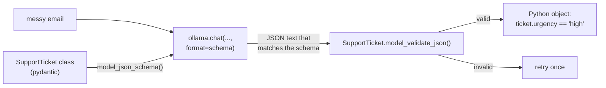
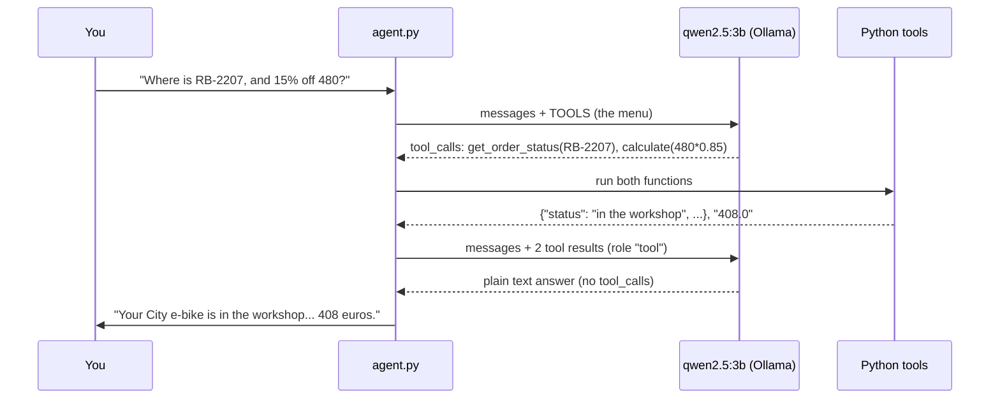

# 08 · Structured output and tool calling with open models

**What you'll build:** two local programs. `extract.py` turns messy customer emails into clean, checked data (name, order number, urgency...) that your code can trust. `agent.py` is a small shop assistant that decides by itself when to look up an order, do exact maths or check the time, using Python functions you give it, all on an open model running in Ollama.
**Like you're 5:** structured output is giving the AI a form with boxes to fill in, instead of letting it write a letter. Tool calling is giving the AI a walkie-talkie: when it needs something it can't do itself (look in the order book, do exact sums), it radios you, you do it, and you radio back the answer.
**Time:** ~1.5 h · **Builds on:** [07 · Local embeddings and private RAG](../07-local-embeddings-and-private-rag), [AI from Zero 27 · AI uses a calculator](../../../ai-from-zero/part-6-ai-agents-and-teams/27-ai-uses-a-calculator) · **Needs:** Ollama with `qwen2.5:3b` (~1.9 GB)

## Why this matters
Most business uses of LLMs are not chat: they read emails, forms and tickets and must hand clean data to other software, or they must *do* things (look up an order, open a ticket) safely. Structured output and tool calling are how that's done. Doing it with open local models means customer data stays private and there's no per-request cost, which is exactly what many on-premise and air-gapped customers need (lessons 10 and 16 build on this).

## What you'll learn
- **JSON schema:** a precise description of the data shape you want (which fields, which types, which values are allowed).
- **Ollama's `format` option:** forces the model to answer in exactly that shape, using **constrained decoding** (it can only pick tokens that keep the JSON valid).
- **Pydantic:** a Python library that writes the schema for you from a class and checks the answer.
- **Tool calling:** the model replies with "please call `get_order_status` with `{"order_number": "RB-2207"}`" instead of text; your code runs it and sends back the result.
- **The agent loop:** ask → maybe call tools → send results → repeat, with a step limit for safety.

## Before you start
1. Install the packages for this lesson (in your activated venv):
   ```bash
   pip install ollama pydantic tzdata
   ```
   - `ollama`: talks to Ollama. `pydantic`: describes and checks data. `tzdata`: time-zone data for the clock tool (built into Mac/Linux, needed on Windows).
2. Download the model (once):
   ```bash
   ollama pull qwen2.5:3b
   ```
   Check it supports tools: `ollama show qwen2.5:3b` should list `tools` under **Capabilities**.
3. **Licence note (lesson 01):** Qwen2.5 3B is licensed for research only, which is fine for learning. For a commercial product, use `qwen2.5:7b` (Apache 2.0) or `llama3.2:3b` (Llama licence): set the `MODEL` environment variable (see *Run it*).
4. Make sure Ollama is running. No API key needed.

## Run it
1. Go to the lesson folder:
   ```bash
   cd part-2-build-with-open-models/08-structured-output-and-tool-calling-with-open-models
   ```
2. Turn three messy emails into tickets:
   ```bash
   python extract.py
   ```
3. Ask the agent something that needs two tools:
   ```bash
   python agent.py "Where is my order RB-2207, and what is 15% off 480 euros?"
   ```
4. Ask something that needs no tool at all:
   ```bash
   python agent.py "Hi! What can you help me with?"
   ```
5. Chat with it (it remembers the conversation; empty line to quit). Try "What time is it in Tokyo?" and "Is RB-9999 ready?":
   ```bash
   python agent.py
   ```
6. Try another model without editing code:
   - Mac/Linux: `MODEL=llama3.2:3b python agent.py "What time is it in Paris?"`
   - Windows PowerShell: `$env:MODEL="llama3.2:3b"; python agent.py "What time is it in Paris?"`

**Command, piece by piece** (`MODEL=llama3.2:3b python agent.py "What time is it in Paris?"`):

| Piece | Meaning |
|-------|---------|
| `MODEL=llama3.2:3b` | set the environment variable `MODEL` for this command only (Mac/Linux). The code reads it with `os.environ.get("MODEL", "qwen2.5:3b")` |
| `python agent.py` | run the agent |
| `"What time is it in Paris?"` | one question; without it you get a chat |

### What you should see
**Example output** (Ollama wasn't available where this course was written; both programs were tested there against a fake Ollama server that returns correctly shaped tool calls and JSON. Your wording will differ).

`python extract.py`:
```
EMAIL: Hi, it's Maria Lopez. The e-bike I bought last week (order RB-2207) won't charge any more. I need it to get to work on Monday!! Please fix it or give me my money back.
TICKET: {
  "customer_name": "Maria Lopez",
  "order_number": "RB-2207",
  "product": "e-bike",
  "problem": "The e-bike won't charge any more.",
  "urgency": "high",
  "wants_refund": true
}
-> Maria Lopez goes to the front of the queue.

EMAIL: hello, my kids helmet strap broke on the 1st day, not urgent but pls send a new one. thx, Tom Becker
TICKET: {
  "customer_name": "Tom Becker",
  "order_number": null,
  "product": "kids helmet",
  "problem": "The helmet strap broke on the first day.",
  "urgency": "low",
  "wants_refund": false
}
...
```
`python agent.py "Where is my order RB-2207, and what is 15% off 480 euros?"`:
```
  [tool] get_order_status({'order_number': 'RB-2207'}) -> {"item": "City e-bike", "status": "in the workshop", "ready": "Friday"}
  [tool] calculate({'expression': '480 * 0.85'}) -> 408.0
Your City e-bike (RB-2207) is in the workshop and will be ready on Friday. 15% off 480 euros is 408 euros.
```
What to look at:
- **Every ticket has exactly the same fields and types**, and `urgency` is always one of `low`, `medium`, `high`. Your code can use `ticket.urgency` safely, with no text parsing.
- **`order_number` is `null`** when the email doesn't have one: the schema allows "no value" instead of forcing the model to invent one.
- **The `[tool]` lines** show the model *asking* for tools, with arguments it chose. The maths is done by Python, so it's exact.
- For "Hi! What can you help me with?" there are no `[tool]` lines: the model decides when tools are needed.

## How it works

### Part A: structured output (`extract.py`)

1. `class SupportTicket(BaseModel)` describes the data. Each line is a field with a **type**: `str` (text), `bool` (true/false), `Optional[str]` (text or nothing), `Literal["low", "medium", "high"]` (only these exact words). `Field(description=...)` adds a hint for the model.
2. `SupportTicket.model_json_schema()` turns the class into a **JSON schema**, a dictionary like:
   ```json
   {"type": "object",
    "properties": {
      "customer_name": {"type": "string"},
      "order_number": {"anyOf": [{"type": "string"}, {"type": "null"}], "description": "like RB-1234, or null..."},
      "urgency": {"enum": ["low", "medium", "high"], "type": "string"},
      "wants_refund": {"type": "boolean"}, ...},
    "required": ["customer_name", "order_number", "product", "problem", "urgency", "wants_refund"]}
   ```

   | Schema key | Meaning |
   |------------|---------|
   | `"type": "object"` | the answer is a JSON object `{...}` |
   | `properties` | the fields and the type of each |
   | `"type": "string" / "boolean"` | text / true-or-false |
   | `anyOf: [string, null]` | either text or `null` (nothing) |
   | `enum` | only these exact values are allowed |
   | `required` | fields that must always be present |
3. `ollama.chat(..., format=schema, options={"temperature": 0})` sends the schema in the `format` field. Ollama then only lets the model choose tokens that keep the output valid for the schema. The schema is *also* written into the system prompt, as Ollama's docs recommend, so the model understands what each field means.
4. `SupportTicket.model_validate_json(...)` parses and checks the answer. If something is still wrong (rare), it raises `ValidationError` and we try once more.
5. In `main()`, `ticket.urgency == "high"` is ordinary Python: the AI's output is now data.

### Part B: tool calling (`agent.py`)

1. **The tools are ordinary functions:** `get_order_status()` looks in a pretend `ORDERS` dictionary, `calculate()` does safe arithmetic, `get_current_time()` uses Python's `zoneinfo`.
2. **`TOOLS` is the menu** the model sees. Each entry, piece by piece:

   | Key | Meaning |
   |-----|---------|
   | `"type": "function"` | this tool is a function |
   | `"name": "get_order_status"` | the name the model will use to ask for it (must match `FUNCTIONS`) |
   | `"description"` | when to use it. The model chooses tools mostly from these words, so write them clearly |
   | `"parameters"` | a JSON schema for the arguments (same idea as Part A) |
   | `"required": ["order_number"]` | arguments the model must always give |
3. **`run_agent()`** loops at most `MAX_STEPS = 6` times:
   - `ollama.chat(model=MODEL, messages=messages, tools=TOOLS, options={"temperature": 0})`
   - `messages.append(response.message)` keeps the model's turn in the history, including its tool requests.
   - If `response.message.tool_calls` is empty, the model has answered: return `content`.
   - Otherwise, for each call: look up `call.function.name` in `FUNCTIONS`, run it with `**call.function.arguments` (a dict, unpacked into named arguments), print a `[tool]` line, and append `{"role": "tool", "tool_name": name, "content": result}`.
   - Unknown tool names and wrong arguments become an `"Error: ..."` result that is sent back, so the model can correct itself instead of the program crashing.
4. **`MAX_STEPS`** stops a confused model from calling tools forever.
5. **`main()`** keeps one `messages` list for the whole chat, so follow-up questions ("and when will it be ready?") work.

### Safety: never trust tool arguments
The model writes the arguments, so treat them like input from a stranger:
- `calculate()` never uses `eval()` (which would run *any* Python code, for example deleting files). It parses the expression with `ast.parse(...)` and only allows numbers and `+ - * /` via the `OPS` dictionary. Even `**` (power) is left out, because `9**9**9` would freeze the computer.
- `get_order_status()` only reads from a dictionary. Tools that *change* things (refunds, emails) should ask a human first; the forward-deployed course covers human approval.

### Which open models can call tools?
In Ollama, look for the `tools` capability (`ollama show <model>` or the "tools" filter on https://ollama.com/search). Good small choices: `qwen2.5` (strong at tools for its size), `llama3.2:3b` and `llama3.1:8b`, and newer families such as `qwen3`. Small models make more mistakes with many tools or vague descriptions: keep the menu short and the descriptions clear.

The same `TOOLS` list also works through the OpenAI-compatible API from lesson 06 (`client.chat.completions.create(..., tools=TOOLS)`); there, `tool_calls[i].function.arguments` arrives as a JSON *string*, so you `json.loads()` it first.

## If something goes wrong
- **`Ollama says: model "qwen2.5:3b" not found`** → `ollama pull qwen2.5:3b`, or set `MODEL` to a model you have.
- **`Ollama says: ... does not support tools`** → that model has no tool calling. Pick one with the `tools` capability.
- **The agent answers without calling a tool, or makes up an order** → small models do this sometimes. Make the tool `description` more specific ("Always use this for any question about an order"), keep `temperature 0`, or use a bigger model (`qwen2.5:7b`).
- **`ZoneInfoNotFoundError` on Windows** → `pip install tzdata`.
- **`(attempt 1 did not fit the schema ... retrying)`** → the model produced something unexpected, and the retry usually fixes it. If it happens every time, simplify the schema or add clearer `description`s.

## Try this
1. **Easy:** add a `language` field to `SupportTicket` that says which language the email was written in, and add a German email to `EMAILS`.
   <details><summary>Hint</summary>Add <code>language: str = Field(description="the language of the email, e.g. English or German")</code> to the class. Nothing else changes: the schema, the <code>format</code> and the checking all come from the class. Test with "Hallo, mein Fahrrad (Bestellung RB-1188) hat einen Platten. Grüße, Jonas Weber".</details>
2. **Medium:** add a tool `check_opening_hours(day)` that returns the shop's hours for a day of the week.
   <details><summary>Solution</summary>

   ```python
   HOURS = {"monday": "9:00-18:00", "tuesday": "9:00-18:00", "wednesday": "9:00-18:00",
            "thursday": "9:00-18:00", "friday": "9:00-18:00", "saturday": "10:00-16:00", "sunday": "closed"}

   def check_opening_hours(day: str) -> str:
       return HOURS.get(day.strip().lower(), f"Unknown day {day}. Use a weekday name like Monday.")
   ```
   Add `"check_opening_hours": check_opening_hours` to `FUNCTIONS`, and to `TOOLS`:
   ```python
   {"type": "function", "function": {
       "name": "check_opening_hours",
       "description": "Get the shop's opening hours for one day of the week.",
       "parameters": {"type": "object", "required": ["day"],
                      "properties": {"day": {"type": "string", "description": "e.g. Saturday"}}}}},
   ```
   Ask: "Are you open on Saturday, and what time is it now in London?" (two tools in one question).
   </details>
3. **Harder:** combine both ideas: make the agent's *final* answer structured, as `{"answer": str, "used_tools": list[str], "needs_human": bool}`.
   <details><summary>Solution</summary>

   Define `class FinalAnswer(BaseModel): answer: str; used_tools: list[str]; needs_human: bool` (one field per line). In `run_agent()`, when there are no more `tool_calls`, ask once more for the structured version:
   ```python
   if not response.message.tool_calls:
       final = ollama.chat(model=MODEL, messages=messages + [{"role": "user", "content":
                           "Now give your final answer as JSON. needs_human is true if a person must act."}],
                           format=FinalAnswer.model_json_schema(), options={"temperature": 0})
       return FinalAnswer.model_validate_json(final.message.content)
   ```
   `main()` then prints `result.answer` and, if `result.needs_human`, a line like "-> passing this to a member of staff". Tools first, structured answer last is a common, reliable pattern with small models.
   </details>

## Check yourself
1. What does the `format` option do that a polite "please answer in JSON" in the prompt can't guarantee?
2. In tool calling, who runs the function: the model or your code? Why does that matter?
3. Why does the program append the model's message *and* each tool result to `messages`?
4. Why is `eval(expression)` dangerous in `calculate()`, and what does the code do instead?

<details><summary>Answers</summary>

1. It constrains decoding: the model can only produce tokens that keep the output valid for the schema, so the JSON always parses and has the right fields and allowed values. A prompt is only a request the model may ignore.
2. Your code. The model only asks (name + arguments). That means you decide what's allowed, can check arguments, and can ask a human before risky actions.
3. The model has no memory; it sees only `messages`. It needs its own request and the matching results to write the final answer (and to handle follow-up questions).
4. `eval` runs any Python code, so a bad or tricked model could run commands on your computer. The code parses the text with `ast` and only evaluates numbers and `+ - * /`.
</details>

## Learn more (optional)
**Read the official docs**
- Ollama structured outputs: https://docs.ollama.com/capabilities/structured-outputs
- Ollama tool calling: https://docs.ollama.com/capabilities/tool-calling
- Ollama Python library (examples folder): https://github.com/ollama/ollama-python
- Pydantic models and JSON schema: https://docs.pydantic.dev/latest/concepts/models/ · https://docs.pydantic.dev/latest/concepts/json_schema/
- JSON Schema for beginners: https://json-schema.org/learn/getting-started-step-by-step
- Python `ast` module (safe parsing): https://docs.python.org/3/library/ast.html

**Watch**
- [Ollama structured outputs pydantic](https://www.youtube.com/results?search_query=ollama+structured+outputs+pydantic) · [Ollama tool calling tutorial](https://www.youtube.com/results?search_query=ollama+tool+calling+tutorial+python)
- Matt Williams on function calling: [search "Matt Williams Ollama function calling"](https://www.youtube.com/results?search_query=matt+williams+ollama+function+calling)
- Sam Witteveen on agents with local models: [search "Sam Witteveen local agents tool use"](https://www.youtube.com/results?search_query=sam+witteveen+local+agent+tool+use)

## Next
→ [09 · Vision models on your laptop](../09-vision-models-on-your-laptop)
