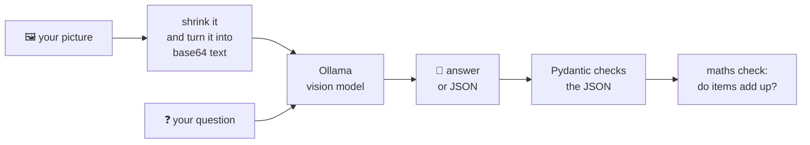
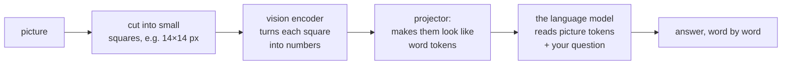

# 09 · Vision models on your laptop

**What you'll build:** two small programs that show pictures to an AI running on your own computer. The first describes any image or answers a question about it. The second reads a photo of a shop receipt and turns it into clean, checked JSON.
**Like you're 5:** until now the AI could only *read* your messages. Today we give it eyes: you hold up a picture, and it tells you what it sees.
**Time:** ~1.5 h · **Builds on:** [08 · Structured output and tool calling](../08-structured-output-and-tool-calling-with-open-models) · **Needs:** Ollama with `qwen2.5vl:3b` (~3.2 GB download), 8 GB of RAM (16 GB is more comfortable), no GPU required



## Why this matters
Reading documents from photos is one of the most requested AI features in real companies: receipts for expense apps, invoices for accounting, ID cards for sign-up, meter readings, shelf photos in shops, damage photos for insurance claims. Doing it **locally** means the photo of someone's medical bill or passport never leaves the building. The pattern you learn here (picture in → structured JSON out → checked by code) is exactly how those products are built.

## What you'll learn
- **Vision language model (VLM)**: an LLM with an extra "eye" part that turns a picture into tokens the language part can read, so you can chat about images.
- **Base64**: a way to write any file (like a JPEG) as plain letters and digits, so it can travel inside JSON.
- **Image resizing before sending**: big photos are slow and use lots of memory; shrinking them first is usually free accuracy-wise.
- **Structured output with a schema**: you give Ollama the exact JSON shape you want (from a Pydantic class) and it forces the model to follow it.
- **Never trust numbers without a check**: models can misread a digit; a few lines of normal code catch most mistakes.

## Before you start
1. Activate your course venv (see the [course README](../../README.md)), then install the packages for this lesson:
   ```bash
   pip install httpx pillow pydantic
   ```
   - `httpx`: sends HTTP requests to Ollama (you used it in lesson 02).
   - `pillow`: opens, shrinks and draws images (the package is called `pillow`, but in code you write `from PIL import ...`).
   - `pydantic`: describes the JSON shape we want and checks the answer (lesson 08).
2. Make sure Ollama is running: open http://localhost:11434 in a browser. It should say **"Ollama is running"** (if not, see [lesson 02](../../part-1-run-models-locally/02-ollama-deep-dive-api-and-modelfiles)).
3. Download the vision model (once, ~3.2 GB):
   ```bash
   ollama pull qwen2.5vl:3b
   ```

   **Command, piece by piece**

   | Piece | Meaning |
   |-------|---------|
   | `ollama` | the Ollama program |
   | `pull` | "download this model to my computer" |
   | `qwen2.5vl` | the model family: Qwen 2.5 **VL** = **V**ision-**L**anguage, made by Alibaba's Qwen team |
   | `:` | separates the model name from its **tag** (which size or variant) |
   | `3b` | the 3-billion-parameter version, small enough for a laptop |

   After it finishes, `ollama list` shows `qwen2.5vl:3b` with a size of about 3.2 GB.
4. No API key needed. Nothing leaves your computer.

**Which vision model?** All of these work with this lesson's code: just change the name with the `VISION_MODEL` environment variable (shown in [Try this](#try-this)).

| Model (`ollama pull ...`) | Download | Good at | RAM you want |
|---------------------------|----------|---------|--------------|
| `qwen2.5vl:3b` (default) | ~3.2 GB | reading text in images (receipts, screenshots), many languages | 8 GB |
| `qwen2.5vl:7b` | ~6 GB | the same, more accurate | 16 GB |
| `llava:7b` | ~4.7 GB | the classic open vision model; describing scenes, weaker at small text | 8–16 GB |
| `llama3.2-vision:11b` | ~7.8 GB | strong general understanding (Meta) | 16 GB+ |
| `gemma3:4b` | ~3.3 GB | general pictures, fast (Google) | 8 GB |

## Run it
All commands start from the course folder (`open-source-and-on-device-ai`).

1. Go into the lesson folder:
   ```bash
   cd part-2-build-with-open-models/09-vision-models-on-your-laptop
   ```
2. Make the two practice pictures:
   ```bash
   python make_samples.py
   ```
   You should see `✅ Made shapes.png and receipt.png`. Open both files to see what the model will see.
3. Ask the model to describe the drawing:
   ```bash
   python describe_image.py shapes.png
   ```

   **Command, piece by piece**

   | Piece | Meaning |
   |-------|---------|
   | `python` | run a Python program |
   | `describe_image.py` | the program file (in this folder) |
   | `shapes.png` | the first **argument**: which picture to show. Use any photo of yours, e.g. `~/Pictures/dog.jpg` |
   | `"How many ...?"` (optional) | a second argument: your own question. The quotes keep the words together as one argument |

4. Ask your own question about the receipt:
   ```bash
   python describe_image.py receipt.png "What did the customer buy, and how much was the muffin?"
   ```
5. Turn the receipt into JSON:
   ```bash
   python receipt_to_json.py receipt.png
   ```
   It prints the JSON, checks the maths and saves `receipt.json` in the folder.
6. Now try a real receipt: take a photo with your phone, copy it into this folder (e.g. `my_receipt.jpg`), and run `python receipt_to_json.py my_receipt.jpg`.

### What you should see
*Example output: Ollama could not be run where this course was written, so the model's words below are an example. The program around them was tested. Your wording and timings will differ.*
```
🖼️  shapes.png → qwen2.5vl:3b
❓ Describe this image in 2-3 sentences.
🤖 The image shows the word "HELLO" in black capital letters at the top. Below it, there is a red circle on the left and a blue square on the right, both on a white background.

⏱  14.2 s in total, 18.5 tokens/s while writing
```
```
🧾 Reading receipt.png with qwen2.5vl:3b (this can take 10-60 s on a laptop)...
{
  "store": "CORNER CAFÉ",
  "date": "2026-10-21",
  "items": [
    {"name": "Cappuccino", "quantity": 2, "price": 7.0},
    {"name": "Blueberry muffin", "quantity": 1, "price": 2.75},
    {"name": "Orange juice", "quantity": 1, "price": 2.95}
  ],
  "total": 12.7,
  "currency": "EUR"
}

✅ Items add up to the total (12.70 EUR). Saved receipt.json
```
(The real output prints each item over several lines; it's squeezed here.) Things to look at:
- The **first run is slow** (Ollama loads 3 GB into memory). Run it again: it's much faster.
- The receipt says `21/10/2026` but the JSON says `2026-10-21`: the model followed the schema's `description` and converted the date.
- If you see `⚠️ Items add up to 9.20 but the total says 12.70`, the model wrote the *unit* price of a cappuccino (3.50) instead of the line price (7.00). That's exactly the kind of mistake the maths check is for.

## How it works

### `make_samples.py`
1. `Image.new("RGB", (640, 400), "white")` makes a blank white picture, 640 pixels wide and 400 tall. **RGB** means each pixel has a Red, Green and Blue amount.
2. `ImageDraw.Draw(img)` gives us a "pen". `draw.ellipse((60, 150, 260, 350), ...)` draws a circle inside the box from (60,150) to (260,350). Pixel (0,0) is the **top-left** corner.
3. For the receipt, `font(size, mono=True)` looks for a **monospace** font (every letter equally wide) so the prices line up in a column, like a real till printer. If no font file is found, Pillow's built-in font is used.

### `describe_image.py`
1. `OLLAMA` and `MODEL` come from **environment variables** if you set them (`os.environ.get("VISION_MODEL", "qwen2.5vl:3b")` means "use `VISION_MODEL` if it exists, otherwise `qwen2.5vl:3b`").
2. **`image_to_base64(path)`**:
   - `Image.open(path).convert("RGB")` opens any format (PNG, JPEG, WebP...) and removes transparency.
   - `img.thumbnail((1024, 1024))` shrinks the picture so its longest side is at most 1024 pixels, keeping its shape. A phone photo is often 4000×3000 pixels: the model would cut it into many more pieces ("image tokens"), which costs memory and time and rarely helps.
   - `io.BytesIO()` is a pretend file in memory; we save the JPEG into it instead of onto the disk.
   - `base64.b64encode(...)` turns the JPEG's bytes into plain text like `/9j/4AAQSkZJRg...`. JSON can only carry text, so pictures travel as base64. It makes the data about 33 % bigger.
3. The message is a normal chat message plus one new key: **`"images": [ ... ]`**, a list of base64 pictures. This is Ollama's format for vision models.
4. `httpx.stream("POST", ".../api/chat", ...)` sends the request and reads the answer **while it's being written**. Ollama sends one JSON object per line; we print each piece (`chunk["message"]["content"]`) straight away, so you see the words appear.
5. The last chunk has `"done": true` and Ollama's timings. `eval_count / (eval_duration / 1e9)` = tokens written ÷ seconds spent writing = **tokens per second** (durations are in nanoseconds, billionths of a second; you met this in [lesson 05](../../part-1-run-models-locally/05-choosing-a-model-benchmarks-and-speed)).

What actually travels to Ollama (picture shortened):
```json
{"model": "qwen2.5vl:3b", "stream": true,
 "messages": [{"role": "user",
               "content": "Describe this image in 2-3 sentences.",
               "images": ["/9j/4AAQSkZJRgABAQAAAQABAAD/2wBDAAgGBgcGBQgHBwcJCQgKDBQNDA..."]}]}
```

### How does a model "see"? (the idea in pictures)

The picture becomes a few hundred "picture words" that sit in the conversation next to your text. That's why huge pictures are slow: more squares, more tokens.

### `receipt_to_json.py`
1. **The schema.** `Item` and `Receipt` are Pydantic classes. `Field(ge=1)` means the quantity must be at least 1. `Field(description=...)` adds a hint the model can read, e.g. "line total for this item, not the unit price".
2. `Receipt.model_json_schema()` turns the classes into a **JSON schema** (a description of allowed JSON). We send it as `"format"`. Ollama then only lets the model produce tokens that fit the schema: it literally can't forget a field or write "Sure! Here's your JSON:" first. This is the **structured output** you learned in lesson 08, now with a picture.
3. `"options": {"temperature": 0}` makes the model pick the most likely token every time. For reading documents we want boring and repeatable, not creative.
4. Receipts get `max_side=1536` (bigger than for photos) because small print needs pixels.
5. `Receipt.model_validate_json(...)` parses the answer and checks every type. If something is wrong, you get a clear `ValidationError` instead of a crash later.
6. **The maths check**: `sum(item.price for item in receipt.items)` adds the line prices and compares with `total`. `abs(a - b) < 0.01` allows for tiny rounding differences in decimal numbers. In a real expense app, a failed check would send the receipt to a human.

### Peek under the hood with curl (optional, Mac/Linux/WSL)
You can send the same request without Python:
```bash
IMG=$(base64 < shapes.png | tr -d '\n')
curl http://localhost:11434/api/chat -d '{"model":"qwen2.5vl:3b","stream":false,"messages":[{"role":"user","content":"What shapes do you see?","images":["'"$IMG"'"]}]}'
```

**Command, piece by piece**

| Piece | Meaning |
|-------|---------|
| `IMG=` | create a shell variable called `IMG` (no spaces around `=`) |
| `$( ... )` | run the command inside and put its output here |
| `base64` | turn a file into base64 text |
| `<` | feed the file `shapes.png` into the command as its input |
| `\|` | pipe: send the output of `base64` into the next command |
| `tr -d '\n'` | **tr**anslate characters; `-d '\n'` = delete every line break (base64 adds them every 76 characters) |
| `curl URL` | send an HTTP request to that address |
| `-d '...'` | the **d**ata to send (this makes it a POST request) |
| `'"$IMG"'` | close the single quotes, insert the variable inside double quotes, reopen single quotes. Single quotes stop the shell from touching the JSON; we briefly step out so `$IMG` gets replaced |

## If something goes wrong
- **`Ollama says: model 'qwen2.5vl:3b' not found`** → run `ollama pull qwen2.5vl:3b`, or set `VISION_MODEL` to a vision model you have (`ollama list`).
- **`Can't reach Ollama at http://localhost:11434`** → open the Ollama app, or run `ollama serve` in another terminal (Linux).
- **The answer talks about the image but is wrong or vague (e.g. llava can't read the prices)** → small text needs a model trained for it. Use `qwen2.5vl:3b`/`7b`, crop the photo to just the receipt, and take it straight-on in good light.
- **It's very slow or your computer freezes** → the model plus the picture don't fit in RAM. Close other apps, use the 3b model, and don't raise `MAX_SIDE` above 1024 for photos. Check with `ollama ps` how much memory the model uses.
- **`The model's answer didn't match the schema`** → usually an older Ollama that ignores `format` schemas. Update Ollama (structured outputs need version 0.5 or newer); `ollama --version` shows yours.
- **`ModuleNotFoundError: No module named 'PIL'`** → your venv isn't active, or you skipped `pip install pillow`.

## Try this
1. **Easy:** use a different model without editing code. Pull `gemma3:4b` (or `llava:7b`) and compare the descriptions of the same photo.
   <details><summary>Hint</summary>

   Set the environment variable just for one command.
   Mac/Linux: `VISION_MODEL=gemma3:4b python describe_image.py shapes.png`
   Windows PowerShell: `$env:VISION_MODEL="gemma3:4b"; python describe_image.py shapes.png`
   Which one reads the receipt prices correctly? Which one is faster (look at tokens/s)?
   </details>
2. **Medium:** add a `payment_method` field (`"card"`, `"cash"` or `""`) to the receipt schema, so the JSON says how the customer paid.
   <details><summary>Solution</summary>

   Add `from typing import Literal` at the top and this line inside `class Receipt`:
   ```python
   payment_method: Literal["card", "cash", ""] = Field(description="how the customer paid, empty if not printed")
   ```
   `Literal` means "only one of these exact values". Pydantic puts it into the schema as an `enum`, so the model can only choose from those three. The sample receipt says "Paid by card", so you should get `"card"`.
   </details>
3. **Harder:** process a whole folder of receipts and write one CSV file (a spreadsheet) with one row per receipt: file name, store, date, total, and whether the maths check passed.
   <details><summary>Hint</summary>

   Move the request part into a function `read_receipt(path) -> Receipt`. Then loop with `for path in sorted(Path("receipts").glob("*.*")):`, call it, and write rows with Python's `csv` module (`csv.writer(open("receipts.csv", "w", newline="")).writerow([...])`). Wrap each receipt in `try/except ValidationError` so one bad photo doesn't stop the whole batch, and write `"FAILED"` in that row instead.
   </details>

## Check yourself
1. Why do we turn the picture into base64 before sending it?
2. Why does the program shrink photos before sending them, and why is the receipt allowed to be bigger?
3. What does `"format": Receipt.model_json_schema()` guarantee, and what does it *not* guarantee?
4. A colleague says "the model reads receipts at 97 % accuracy, so we can skip checks." What would you answer?

<details><summary>Answers</summary>

1. The request is JSON, and JSON can only carry text. Base64 writes the picture's bytes as text.
2. The model cuts the picture into small squares that become tokens. More pixels means more tokens: more memory, more time, rarely better answers for photos. Receipts have small print, so they need more pixels to stay readable.
3. It guarantees the *shape*: all fields present, right types (e.g. `total` is a number). It does not guarantee the *values* are correct: the model can still misread 7.00 as 1.00.
4. 3 % of thousands of receipts is a lot of wrong money. Cheap checks (items add up to the total, date is not in the future, currency is a known code) catch many errors; send the failures to a human.
</details>

## Learn more (optional)
**Read the official docs**
- Ollama API (chat with images, structured outputs): https://github.com/ollama/ollama/blob/main/docs/api.md
- Ollama documentation site: https://docs.ollama.com
- Qwen2.5-VL in the Ollama library: https://ollama.com/library/qwen2.5vl
- Pydantic models and fields: https://docs.pydantic.dev
- Pillow (image handling): https://pillow.readthedocs.io

**Watch**
- YouTube search: [Ollama vision models tutorial](https://www.youtube.com/results?search_query=ollama+vision+model+tutorial)
- YouTube search: [Matt Williams on Ollama vision models](https://www.youtube.com/results?search_query=matt+williams+ollama+vision)
- YouTube search: [Qwen2.5-VL OCR and document extraction](https://www.youtube.com/results?search_query=qwen2.5+vl+ocr+receipt+json)
- YouTube search: [how vision language models work (vision transformer explained)](https://www.youtube.com/results?search_query=how+vision+language+models+work+vision+transformer+explained)

## Next
→ [10 · A fully local voice agent](../10-a-fully-local-voice-agent)
