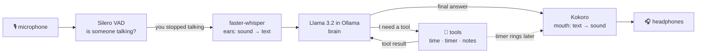

# 10 · A fully local voice agent

**What you'll build:** a hands-free assistant you just talk to. It notices when you start and stop speaking, writes down your words, decides whether it needs a **tool** (the clock, a timer, your notes), uses it, and answers out loud. Everything runs on your computer, with no internet.
**Like you're 5:** it's a robot with ears, a brain, a mouth and a little toolbox. When you say "set a tea timer", the brain doesn't just *talk* about timers: it reaches into the toolbox and really starts one.
**Time:** ~2 h · **Builds on:** [08 · Structured output and tool calling](../08-structured-output-and-tool-calling-with-open-models), and from the voice course [15 · Talk to a local AI](../../../voice-ai-from-zero/part-4-voice-apps/15-talk-to-a-local-ai) and [17 · Hands-free with voice detection](../../../voice-ai-from-zero/part-5-advanced/17-hands-free-with-voice-detection) · **Needs:** Ollama with `llama3.2:3b` (~2 GB), ~8 GB of RAM, a microphone and **headphones**



## Why this matters
"Voice + tools" is what turns a chatbot into an **agent** that does things: phone agents that book appointments, in-car assistants, warehouse headsets, kitchen helpers, accessibility tools for people who can't use a screen. Many of these must work **offline or privately** (a hospital ward, a factory floor, a car in a tunnel). In this lesson you join two courses: the voice pipeline from `voice-ai-from-zero` and the local tool calling from lesson 08.

## What you'll learn
- **Agent loop**: ask the model → if it asks for a tool, run it and give back the result → ask again → until it answers in plain words.
- **Tool calling with an open model**: Ollama's `/api/chat` accepts a `tools` list; the model replies with `tool_calls` (name + arguments) instead of text when it wants one.
- **Voice activity detection (VAD)**: a tiny model that says "speech started" and "speech ended", so you never press a button.
- **Background events**: a timer rings minutes later, while the program is listening; a **queue** passes the message safely to the part that speaks.
- **Echo protection**: while the agent talks, we throw away what the microphone hears, so it doesn't answer itself.

## Before you start
1. Activate your course venv (see the [course README](../../README.md)). Install the voice pieces and the HTTP client:
   ```bash
   pip install faster-whisper "av<19" silero-vad kokoro-onnx sounddevice soundfile numpy httpx
   ```
   - `faster-whisper` (ears) and `"av<19"`: keep the quotes; it means "PyAV older than version 19", because version 19 breaks faster-whisper 1.2.
   - `silero-vad`: the voice detector (2 MB, the model is inside the package). It installs PyTorch if you don't have it. **Linux without an NVIDIA card:** install the small CPU-only PyTorch first: `pip install torch --index-url https://download.pytorch.org/whl/cpu`.
   - `kokoro-onnx` (mouth), `sounddevice` + `soundfile` + `numpy` (microphone and speakers), `httpx` (talks to Ollama).
   - **Linux only:** `sudo apt install libportaudio2` (the sound library `sounddevice` needs).
2. Make sure Ollama is running (http://localhost:11434 says "Ollama is running") and download the brain once:
   ```bash
   ollama pull llama3.2:3b
   ```
   Llama 3.2 3B was trained to use tools. `qwen2.5:3b` is another good choice (see [Try this](#try-this)).
3. **Kokoro's voice files** are reused from the voice course folder `voice-ai-from-zero/models/` (lesson 11 of that course). If they aren't there, `voice_agent.py` downloads them there once (~340 MB).
4. Whisper `base` (~150 MB) downloads automatically the first time.
5. Put on **headphones**. With speakers, the microphone hears the agent and it starts talking to itself.
6. No API key needed.

## Run it
All commands start from the course folder (`open-source-and-on-device-ai`).

1. Go into the lesson folder:
   ```bash
   cd part-2-build-with-open-models/10-a-fully-local-voice-agent
   ```
2. **Test the brain first, by typing** (no microphone needed):
   ```bash
   python agent.py
   ```
   Type `what time is it?`, then `set a tea timer for 1 minute`, then `note: buy oat milk`, then `what are my notes?`. Lines starting with 🔧 show each tool the model used. After a minute, `⏰ Your tea timer is done!` appears. Type `bye` to stop.
3. **Now talk to it:**
   ```bash
   python voice_agent.py
   ```
   Wait for `🎧 Just talk`. Say "What time is it?", pause, and listen. Then try "Set a pasta timer for half a minute" and keep chatting: after 30 seconds it interrupts the silence to tell you the timer is done.
4. Say "goodbye" (or press `Ctrl+C`) to stop. Your notes stay in `notes.json` for next time.

### What you should see
*Typing mode. The program, tools and timer were tested with a stand-in for Ollama; the model's exact words are an example and will differ for you.*
```
⌨️  Typing mode with llama3.2:3b. Try: 'set a tea timer for 1 minute', 'note: buy oat milk', 'what are my notes?', 'what time is it?'. Type 'bye' to stop.

🧑 what time is it?
   🔧 get_time({}) → It is 18:57 on Thursday 22 October 2026.
🤖 It's 6:57 in the evening, on Thursday the 22nd of October.

🧑 set a tea timer for 1 minute
   🔧 set_timer({"minutes": 1, "label": "tea"}) → Timer 'tea' set for 1 minute.
🤖 Your tea timer is running, I'll let you know in one minute.

🧑 note: buy oat milk
   🔧 add_note({"text": "buy oat milk"}) → Saved note number 1.
🤖 Got it, I saved a note to buy oat milk.

⏰ Your tea timer is done!
```
*Voice mode (example):*
```
Loading ears, voice detector and mouth...
🎧 Just talk (brain: llama3.2:3b). Say 'goodbye' or press Ctrl+C to stop.
🧑 What time is it?
   🔧 get_time({}) → It is 18:57 on Thursday 22 October 2026.
🤖 It's 6:57 in the evening.
🧑 Okay, goodbye!
🤖 Goodbye! Have a lovely evening.

👋 Bye!
```
Look at the 🔧 lines: the model never "knows" the time. It *asks* for the `get_time` tool, your Python code answers, and the model turns that into a sentence. If a 🔧 line is missing and the model still gives a time, it made it up (see [If something goes wrong](#if-something-goes-wrong)).

## How it works

### Part 1: `agent.py` (the brain and the toolbox)
1. **Settings.** `OLLAMA` and `MODEL` come from the environment variables `OLLAMA_URL` and `OLLAMA_MODEL` (the same names as lessons 05–06), with `http://localhost:11434` and `llama3.2:3b` as defaults.
2. **The system message** (`SYSTEM`) sets the rules: replies are spoken, so 1–2 short sentences, no lists or emojis, use tools for time/timers/notes, and **never invent tool results**.
3. **The tools are ordinary Python functions:**
   - `get_time()` formats the clock with `strftime` (`%H:%M` = hours:minutes, `%A` = weekday name, `%d %B %Y` = 22 October 2026).
   - `set_timer(minutes, label)` checks the number is sensible, then creates a `threading.Timer`: a helper that waits in the **background** and calls `timer_done(label)` later, while the rest of the program keeps running. `daemon = True` means "don't keep the program alive just for this timer".
   - `timer_done(label)` prints `⏰` and puts a sentence into `timer_alerts`, a **queue**: a thread-safe waiting line. The voice program picks sentences out of it when it's safe to speak.
   - `add_note(text)` / `read_notes()` keep a list in `notes.json` (created the first time). `ensure_ascii=False` keeps letters like é readable in the file.
4. **`TOOL_SPECS` is the menu** the model reads: each tool's name, a description, and its arguments as a **JSON schema** (`"type": "number"`, `"required": ["minutes"]`...). Good descriptions matter: "0.5 for 30 seconds" teaches the model to send `0.5` instead of `"30 seconds"`.
5. **`run_tool(name, arguments)`** looks the name up in the `TOOLS` dictionary and calls the function with `**arguments` (the `**` unpacks `{"minutes": 1, "label": "tea"}` into `set_timer(minutes=1, label="tea")`). If the model invents a tool or sends wrong arguments, it returns an `Error: ...` text instead of crashing; the model reads it and can try again.
6. **`ask(text)` is the agent loop:**
   ```mermaid
   sequenceDiagram
       participant You
       participant Code as agent.py
       participant LLM as Llama (Ollama)
       participant Tool as set_timer()
       You->>Code: "set a tea timer for 1 minute"
       Code->>LLM: messages + tools menu
       LLM-->>Code: tool_calls: set_timer(minutes=1, label="tea")
       Code->>Tool: run it
       Tool-->>Code: "Timer 'tea' set for 1 minute."
       Code->>LLM: messages + {"role": "tool", ...}
       LLM-->>Code: "Your tea timer is running."
       Code-->>You: 🤖 + spoken answer
   ```
   - It sends the conversation, the `tools` menu and `"stream": False` to `/api/chat`. `temperature 0.2` keeps tool choices steady.
   - If the reply has `tool_calls`, it runs each one and appends `{"role": "tool", "tool_name": ..., "content": result}`, then loops and asks again.
   - If there are no `tool_calls`, the reply's `content` is the final answer.
   - `max_rounds=5` is a safety limit: a confused model can't loop forever.
7. **`recent_messages()`** sends only the system message plus the last 12 messages, always starting at a user message. A long chat would otherwise get slower and slower (lesson 15 of the voice course explained why), and cutting in the middle of a tool call would confuse the model.
8. `if __name__ == "__main__":` means "only when you run this file directly". That's the typing mode. When `voice_agent.py` imports this file, that part is skipped.

What Ollama receives for "set a tea timer for 1 minute" (shortened):
```json
{"model": "llama3.2:3b", "stream": false, "options": {"temperature": 0.2},
 "messages": [{"role": "system", "content": "You are a helpful voice assistant..."},
              {"role": "user", "content": "set a tea timer for 1 minute"}],
 "tools": [{"type": "function", "function": {"name": "set_timer",
            "description": "Start a countdown timer.",
            "parameters": {"type": "object", "required": ["minutes"],
                           "properties": {"minutes": {"type": "number"}, "label": {"type": "string"}}}}}, "..."]}
```
and what it answers:
```json
{"message": {"role": "assistant", "content": "",
             "tool_calls": [{"function": {"name": "set_timer", "arguments": {"minutes": 1, "label": "tea"}}}]}}
```

### Part 2: `voice_agent.py` (ears, mouth and the listening loop)
1. **Kokoro's files** are found in `voice-ai-from-zero/models/`. `Path(__file__).resolve().parents[3]` climbs 4 folders up from this file (lesson folder → part folder → course folder → `learning`), then goes into the voice course. Missing files are downloaded once, to a `.part` name first and renamed at the end, so a broken download is never mistaken for a good file.
2. **Loading:** `WhisperModel("base", device="cpu", compute_type="int8")` (ears, 8-bit for speed), `Kokoro(...)` (mouth), and `VADIterator(...)` (voice detector) with `min_silence_duration_ms=700`: 0.7 seconds of quiet means "you finished your sentence".
3. **The microphone** (`sd.InputStream`) calls our small `lambda` 31 times a second with 512 samples (32 ms). It just puts each chunk into the `mic` queue, because the microphone's callback must be quick.
4. **The main loop:**
   - If you're not talking and a timer rang, `speak(timer_alerts.get())` announces it.
   - `mic.get(timeout=0.5)` waits for the next chunk, but at most half a second, so timers are checked even in silence.
   - `vad(chunk)` returns `{"start": ...}` when speech begins and `{"end": ...}` when it ends. While you talk, chunks go into `speech`; before that, the last 0.3 s go into `before` (a `deque` with `maxlen=10` throws old chunks away automatically) so your first syllable isn't cut off.
   - On `"end"`, `handle(speech)` runs: skip tiny noises (under 0.5 s), transcribe with Whisper (`language="en"` skips language detection, `beam_size=1` is fastest), `ask()` the brain, print and `speak()` the reply.
5. **`forget_what_the_mic_heard()`** empties the `mic` queue and resets the VAD after the agent speaks. Everything recorded while it was talking was its own voice (or you talking over it), so it's thrown away.
6. Saying "goodbye" raises `KeyboardInterrupt` on purpose, so it leaves the loop through the same exit as `Ctrl+C` and prints `👋 Bye!`.

**Where the time goes** on a typical laptop: VAD waits 0.7 s after you stop, Whisper `base` ~0.5–1 s, the LLM 1–4 s (a tool call means *two* LLM requests), Kokoro ~1 s. Lesson 19 of the voice course shows how streaming hides most of this.

## If something goes wrong
- **The 🤖 answers a time or says "timer set" but there's no 🔧 line** → the model pretended. Small models sometimes do. Use `temperature` 0, make the description clearer, or try a model that is stronger at tools: `ollama pull qwen2.5:3b` and run with `OLLAMA_MODEL=qwen2.5:3b` (see Try this 1).
- **`Ollama says: ... does not support tools`** → that model wasn't trained for tool calling. Use `llama3.2:3b`, `qwen2.5:3b`, `qwen3` or another model with the "tools" tag on https://ollama.com/search?c=tools.
- **It answers itself or keeps talking in a loop** → you're using speakers. Use headphones. If you must use speakers, lower their volume and raise `threshold=0.5` to `0.7` in `VADIterator`.
- **Nothing happens when you talk (no 🟢 listening)** → the microphone is blocked or the wrong one is used. Run `python -m sounddevice` to list devices, and check microphone permissions (voice course, Setup step 6).
- **`ModuleNotFoundError: No module named 'agent'`** → run `voice_agent.py` from inside the lesson folder (the `cd` in step 1), so Python finds `agent.py` next to it.
- **`OSError: PortAudio library not found`** (Linux) → `sudo apt install libportaudio2`.

## Try this
1. **Easy:** switch the brain to Qwen and compare how reliably each model uses the tools.
   <details><summary>Hint</summary>

   `ollama pull qwen2.5:3b`, then run with the environment variable set for one command:
   Mac/Linux: `OLLAMA_MODEL=qwen2.5:3b python agent.py`
   Windows PowerShell: `$env:OLLAMA_MODEL="qwen2.5:3b"; python agent.py`
   Type the same five requests to both models and count the 🔧 lines.
   </details>
2. **Medium:** add a `clear_notes` tool that deletes all notes.
   <details><summary>Solution</summary>

   In `agent.py`, add the function and register it in both places:
   ```python
   def clear_notes():
       NOTES.unlink(missing_ok=True)          # delete notes.json if it exists
       return "All notes deleted."

   TOOLS["clear_notes"] = clear_notes
   TOOL_SPECS.append({"type": "function", "function": {
       "name": "clear_notes", "description": "Delete all saved notes. Only when the user clearly asks.",
       "parameters": {"type": "object", "properties": {}}}})
   ```
   Put these lines after the existing `TOOLS` and `TOOL_SPECS`. The words "only when the user clearly asks" matter: deleting things is a consequential action.
   </details>
3. **Harder:** add a `calculate` tool for spoken maths ("what is 17 times 23?"), without using Python's dangerous `eval()`.
   <details><summary>Hint</summary>

   Small models are bad at arithmetic, so a tool is the right fix. Use Python's `ast` module to allow only numbers and `+ - * / **`:
   ```python
   import ast, operator
   OPS = {ast.Add: operator.add, ast.Sub: operator.sub, ast.Mult: operator.mul,
          ast.Div: operator.truediv, ast.Pow: operator.pow, ast.USub: operator.neg}

   def calculate(expression):
       def walk(node):
           if isinstance(node, ast.Constant) and isinstance(node.value, (int, float)):
               return node.value
           if isinstance(node, ast.BinOp) and type(node.op) in OPS:
               return OPS[type(node.op)](walk(node.left), walk(node.right))
           if isinstance(node, ast.UnaryOp) and type(node.op) in OPS:
               return OPS[type(node.op)](walk(node.operand))
           raise ValueError("only numbers and + - * / ** are allowed")
       return f"{expression} = {walk(ast.parse(expression, mode='eval').body):g}"
   ```
   Register it like in exercise 2, with one string argument `expression` described as "a maths expression using digits and + - * / **, e.g. 17*23". `run_tool` already turns the `ValueError` into an `Error:` message.
   </details>

## Check yourself
1. In the agent loop, how does the program know whether the model wants a tool or is giving its final answer?
2. Why does the timer put its message in a queue instead of calling `speak()` itself?
3. Why does the program empty the microphone queue after the agent speaks?
4. A tool call needs two requests to the LLM. Why, and what does that mean for how long the user waits?

<details><summary>Answers</summary>

1. If the reply's `message` has `tool_calls`, it wants tools; if there are none, `content` is the final answer.
2. The timer rings in a background thread, at any moment, maybe while the agent is speaking or listening. Speaking from two places at once would mix sounds and confuse the loop. The queue lets the main loop announce it when it's safe (when you're not talking).
3. While the agent talks, the microphone also records the agent's own voice. If we kept those chunks, the VAD would detect "speech", Whisper would transcribe the agent, and it would answer itself.
4. The first request decides which tool to call; your code runs it; the second request turns the tool's result into a sentence. So the user waits for two LLM runs (plus the tool). Fast small models and short answers keep this bearable.
</details>

## Learn more (optional)
**Read the official docs**
- Ollama API, chat with tools: https://github.com/ollama/ollama/blob/main/docs/api.md
- Ollama documentation site (tool calling, models): https://docs.ollama.com
- faster-whisper: https://github.com/SYSTRAN/faster-whisper
- Silero VAD: https://github.com/snakers4/silero-vad
- kokoro-onnx: https://github.com/thewh1teagle/kokoro-onnx
- Python `threading.Timer` and `queue`: https://docs.python.org/3/library/threading.html and https://docs.python.org/3/library/queue.html

**Watch**
- YouTube search: [Ollama tool calling / function calling tutorial](https://www.youtube.com/results?search_query=ollama+tool+calling+function+calling+tutorial)
- YouTube search: [Matt Williams on Ollama function calling](https://www.youtube.com/results?search_query=matt+williams+ollama+function+calling)
- YouTube search: [local voice assistant with Whisper, Ollama and Kokoro](https://www.youtube.com/results?search_query=local+voice+assistant+whisper+ollama+kokoro)
- YouTube search: [Sam Witteveen on local AI agents](https://www.youtube.com/results?search_query=sam+witteveen+local+agent+ollama)

## Next
→ Part 3 starts: [11 · LLMs in the browser with WebGPU](../../part-3-browser-and-edge/11-llms-in-the-browser-with-webgpu)
