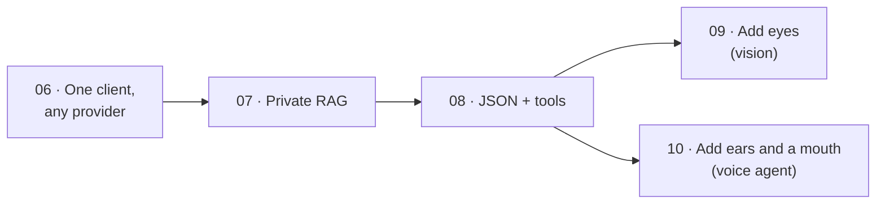

# Part 2 · Build with open models

In Part 1 you learned to *run* open models. Now you *build* with them: the same kinds of apps people build on cloud APIs (switchable providers, RAG over private documents, reliable JSON, tool-using agents, apps that see pictures and talk), but running on your own computer, so the data never leaves it.

| # | Lesson | What you'll have | Time |
|---|--------|------------------|------|
| 06 | [OpenAI-compatible APIs and switching providers](06-openai-compatible-apis-and-switching-providers) | one program that talks to Ollama, llama.cpp, vLLM, Claude or OpenAI by changing one word, and times them | 1 h |
| 07 | [Local embeddings and private RAG](07-local-embeddings-and-private-rag) | an "ask your documents" assistant with local embeddings, SQLite + NumPy search and cited answers | 1.5 h |
| 08 | [Structured output and tool calling with open models](08-structured-output-and-tool-calling-with-open-models) | messy emails turned into checked data, and a small agent that uses Python tools by itself | 1.5 h |
| 09 | [Vision models on your laptop](09-vision-models-on-your-laptop) | a local model that describes pictures, and a receipt reader that outputs checked JSON | 1.5 h |
| 10 | [A fully local voice agent](10-a-fully-local-voice-agent) | a hands-free assistant (voice detection, Whisper, Llama with tools, Kokoro) with timers and notes | 2 h |

**Total: about 1 week at 1 hour a day.**



## Install once (in your activated venv)
Each lesson repeats its own line; or install everything for Part 2 now:
```bash
pip install openai ollama numpy pydantic tzdata httpx pillow
```
- `openai`: the OpenAI-compatible client used to switch providers (06).
- `ollama`: Ollama's official Python library (07, 08). `numpy`: vector maths for search (07).
- `pydantic`: describes and checks JSON shapes (08, 09). `tzdata`: time-zone data for the agent's clock tool on Windows (08).
- `httpx`: plain HTTP requests to Ollama, so you see the real JSON (09, 10). `pillow`: opens, shrinks and draws images (09).

**Lesson 10 also needs the voice pieces** (the same as the [voice course](../../voice-ai-from-zero), Part 4–5):
```bash
pip install faster-whisper "av<19" silero-vad kokoro-onnx sounddevice soundfile numpy httpx
```
Keep the quotes around `"av<19"` (version 19 breaks faster-whisper 1.2). Linux also needs `sudo apt install libportaudio2` for the microphone. **Linux without an NVIDIA card:** install the CPU-only PyTorch first (`pip install torch --index-url https://download.pytorch.org/whl/cpu`), because `silero-vad` brings PyTorch with it.

## Models you'll pull
| Model | Lessons | Size | Command |
|-------|---------|------|---------|
| `llama3.2:3b` | 06, 07, 08, 10 | ~2 GB | `ollama pull llama3.2:3b` |
| `nomic-embed-text` | 07 | ~270 MB | `ollama pull nomic-embed-text` |
| `qwen2.5:3b` (optional, strong at tools) | 08, 10 | ~1.9 GB | `ollama pull qwen2.5:3b` |
| `qwen2.5vl:3b` (vision) | 09 | ~3.2 GB | `ollama pull qwen2.5vl:3b` |
| Whisper `base` + Kokoro (voice) | 10 | ~0.5 GB | download automatically on first run (Kokoro is shared with `voice-ai-from-zero/models/`) |

Ollama must be running for every lesson in this part (http://localhost:11434 says "Ollama is running"; see [lesson 02](../part-1-run-models-locally/02-ollama-deep-dive-api-and-modelfiles)). Lesson 06 can optionally use a Claude or OpenAI API key; everything else needs no key.

**Use headphones in lesson 10**, so the agent doesn't hear itself.

## After this part you can
- Write code once and point it at a local model, a self-hosted server or a cloud API.
- Build private RAG that answers from your own documents, with citations.
- Get JSON your code can trust from an open model, and let it call your Python functions.
- Read pictures and documents (receipts) into checked, structured data on a laptop.
- Combine speech-to-text, an LLM with tools and text-to-speech into a hands-free local agent.

Start here → [06 · OpenAI-compatible APIs and switching providers](06-openai-compatible-apis-and-switching-providers)

Next part → [Part 3 · Browser and edge](../part-3-browser-and-edge)
