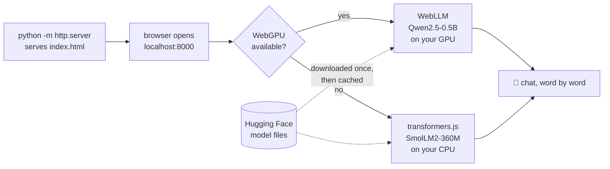

# 11 · LLMs in the browser with WebGPU

**What you'll build:** one web page, `index.html`, that downloads a small LLM into your browser and chats with you. No Python, no server-side AI, no Ollama: the model runs on the visitor's own graphics card through **WebGPU**. On a browser without WebGPU, the page switches to plan B and runs a smaller model on the CPU.
**Like you're 5:** before, the AI lived in a kitchen (a server) and the browser only took orders. Now we send the whole kitchen to your house in a box, once. After that you cook at home.
**Time:** ~1.5 h · **Builds on:** [06 · OpenAI-compatible APIs](../../part-2-build-with-open-models/06-openai-compatible-apis-and-switching-providers) (the same `chat.completions` shape), and from the voice course [07 · Whisper inside the browser](../../../voice-ai-from-zero/part-2-speech-to-text/07-whisper-inside-the-browser) · **Needs:** Python (only to serve the file), a recent Chrome or Edge (best), ~1 GB free disk for the browser cache; no API key



## Why this matters
Running the model in the browser means: **zero server cost** (the visitor's computer does the work), **privacy** (text never leaves the device), and it **works offline** once cached. Companies use this for private writing helpers, offline documentation search, in-page autocomplete, and demos that can't afford GPU servers. The catch: the model must be small, the first download is big, and not every device has a good GPU. This lesson shows all three sides honestly.

## What you'll learn
- **WebGPU**: a new browser feature that lets web pages use the graphics card for maths, not just for drawing. LLMs are mostly maths.
- **WebLLM**: a library from the MLC team that runs pre-compiled LLMs on WebGPU, with an OpenAI-style API (`engine.chat.completions.create`).
- **transformers.js + WebAssembly (WASM)**: Hugging Face's JavaScript library; with WASM it runs ONNX models on any CPU, as a fallback.
- **Feature detection and graceful fallback**: ask the browser what it can do (`navigator.gpu`), pick the best plan, and still work when the best isn't available.
- **Pinned CDN imports and the browser cache**: load exact library versions from a CDN; the model files are saved by the browser so the second visit is fast.

## Before you start
1. **Check your browser has WebGPU.**
   - **Chrome or Edge 113+** on Windows, macOS and ChromeOS have it on by default; on Linux it may need a flag. Open `chrome://gpu` and look for **"WebGPU: Hardware accelerated"**.
   - **Safari 26** (macOS 26 / iOS 26) and **Firefox 141+ on Windows** also ship WebGPU. Other Firefox versions may not, which is a good way to see plan B.
   - Quick test in any browser: open the developer console (`F12` → Console), type `navigator.gpu` and press Enter. `undefined` means no WebGPU.
2. **Disk and memory:** the GPU model needs ~1 GB of graphics memory (shared memory on laptops is fine). The browser keeps ~0.3–1 GB of model files in its cache.
3. **Python** is only used to serve the file. Nothing to `pip install`.
4. No API key. The page needs internet **the first time** (to download the libraries from `cdn.jsdelivr.net` and the model from `huggingface.co`), and works offline afterwards for the same model.

## Run it
All commands start from the course folder (`open-source-and-on-device-ai`).

1. Go into the lesson folder:
   ```bash
   cd part-3-browser-and-edge/11-llms-in-the-browser-with-webgpu
   ```
2. Start a tiny web server:
   ```bash
   python -m http.server 8000
   ```

   **Command, piece by piece**

   | Piece | Meaning |
   |-------|---------|
   | `python` | run Python |
   | `-m` | run a **m**odule (a program that ships with Python) instead of a file |
   | `http.server` | Python's built-in web server: it hands out the files in the current folder |
   | `8000` | the **port**: the "door number" on your computer where it listens |

   You should see `Serving HTTP on :: port 8000 (http://[::]:8000/) ...`. Leave this terminal open.
3. Open **http://localhost:8000** in Chrome or Edge. (`localhost` means "this computer".)
4. Click **Load model**. Watch the status line and the progress bar. The first time takes 1–5 minutes, depending on your internet.
5. Ask something, e.g. "Explain photosynthesis to a child." The answer appears word by word, and the line under the box shows the speed.
6. Reload the page and click **Load model** again: this time it loads in seconds from the cache.
7. **See plan B:** open the page in a browser without WebGPU (e.g. a Firefox version without it), or follow [Try this 1](#try-this). The status says *"No WebGPU here. Loading transformers.js on the CPU..."*.
8. Stop the server with `Ctrl+C` in its terminal.

### What you should see
*Example: this page could not be opened in a real browser where this course was written (no GPU, no access to the model hosts). Its logic was tested in Node.js with stand-ins for both libraries. Your numbers will differ.*

Status line while loading (WebGPU path):
```
Fetching param cache[12/16]: 610MB fetched. 75% completed, 41 secs elapsed. It can take a while when we first visit this page to populate the cache. Later refreshes will become faster.
```
Then:
```
✅ Ready: Qwen2.5-0.5B-Instruct-q4f16_1-MLC on your GPU (WebGPU, via WebLLM)
```
A chat:
```
You:  Explain photosynthesis to a child.
Bot:  Photosynthesis is how plants make their own food. They take in sunlight, water and air,
      and turn them into sugar to grow, giving out oxygen for us to breathe.
51 pieces in 1.4 s (≈ 36.4 tokens/s)
```
On a laptop with a recent integrated GPU, expect roughly 20–60 tokens/s on the GPU path and 3–10 tokens/s on the CPU fallback. Compare that with the same-size model in Ollama (lesson 05): the browser is slower, but it needs no installation at all.

## How it works
Open `index.html`. The top is plain HTML and CSS (a status card, a chat box, a form). All the logic is in the `<script type="module">` at the bottom.

1. **Pinned imports.** `WEBLLM_URL` and `TRANSFORMERS_URL` point at exact versions on the jsDelivr CDN (`@0.2.85`, `@4.2.0`). `/+esm` asks jsDelivr for a version that browsers can `import` directly. Pinning means the page doesn't break when a new version changes something.
2. **`type="module"`** lets the script use `import` and top-level `await`. Browsers refuse module scripts and model downloads on pages opened as `file://...`, which is why we serve the folder with `http.server`.
3. **`findGPU()`** checks `"gpu" in navigator` (does this browser know WebGPU?) and then `navigator.gpu.requestAdapter()` (is there a usable GPU right now?). An **adapter** is the browser's handle to one graphics card. If either step fails, it returns `null`.
4. **Plan A: `loadWebLLM(adapter)`**
   - `await import(WEBLLM_URL)` downloads the library only when needed (a **dynamic import**).
   - The model name `Qwen2.5-0.5B-Instruct-q4f16_1-MLC` reads: Qwen 2.5, 0.5 billion parameters, instruction-tuned, **q4** = 4-bit weights, **f16** = 16-bit maths, compiled with **MLC**. If the GPU lacks the `shader-f16` feature, we choose the `q4f32_1` build (32-bit maths: a bit bigger, works on more GPUs).
   - `webllm.CreateMLCEngine(model, { initProgressCallback })` downloads the weights (~950 MB of GPU memory needed) plus a small compiled GPU program (a `.wasm` file with **WGSL shaders**: the code that runs on the graphics card), and calls our callback with `p.text` and `p.progress` (0 to 1).
   - The returned function calls `engine.chat.completions.create({ messages, stream: true, ... })`: the **same shape as the OpenAI API** from lesson 06. Each streamed `chunk.choices[0].delta.content` is a few letters of the answer.
5. **Plan B: `loadTransformers()`**
   - `pipeline("text-generation", "HuggingFaceTB/SmolLM2-360M-Instruct", { device: "wasm", dtype: "q4" })` downloads an ONNX version of the model (you'll make your own ONNX files in lesson 12) with 4-bit weights and runs it on the CPU with **WebAssembly**, a fast, safe "machine code for browsers".
   - `progress_callback` receives objects like `{status: "progress", file: "onnx/model_q4.onnx", progress: 37.5}` (0 to 100).
   - A `TextStreamer` calls `callback_function` with each new piece of text. `skip_prompt: true` hides the conversation we sent; `skip_special_tokens` hides markers like `<|im_end|>`.
   - We use a smaller model here (360M) because CPUs are much slower than GPUs at this maths.
6. **Both plans return the same kind of function**: `generate(messages, onToken)`. The rest of the page doesn't care which engine is behind it. This is the same "one interface, swappable engines" idea as switching providers in lesson 06.
7. **Sending a message** (the `submit` handler): `event.preventDefault()` stops the browser's default "reload the page on submit". We add your message to `history`, create an empty bot bubble, and call `generate` with the system message plus the last 10 messages. Each `piece` is appended to the bubble with `textContent` (never `innerHTML`: model output is untrusted text, and `innerHTML` would run any HTML it contains). At the end we show pieces per second.
8. **The cache.** Model files are stored with the browser's **Cache API** (or IndexedDB). They survive reloads and restarts. To delete them: Chrome → `F12` → Application → Storage → **Clear site data** (for `localhost:8000`).

**Why only small models?** Everything must fit in the GPU memory the browser is allowed to use, and every visitor downloads it. 0.5–3 billion parameters at 4-bit (300 MB – 2 GB) is the practical range today.

## If something goes wrong
- **The page says "No WebGPU here" in Chrome** → open `chrome://gpu`. If WebGPU is disabled (common on Linux or old drivers), update your graphics driver and Chrome, or on Linux try starting Chrome with `--enable-unsafe-webgpu --enable-features=Vulkan`. Plan B still works meanwhile.
- **`❌ Could not load the model: Failed to fetch`** → the library or model couldn't download. Check your internet; some school/work networks block `cdn.jsdelivr.net` or `huggingface.co`. Also check you opened `http://localhost:8000`, not the file directly.
- **Opening the file by double-click shows nothing / CORS errors in the console** → module scripts don't work from `file://`. Use `python -m http.server 8000` and `http://localhost:8000`.
- **`OSError: [Errno 98] Address already in use`** (or 48 on Mac, 10048 on Windows) → port 8000 is busy. Use another port: `python -m http.server 8080` and open http://localhost:8080.
- **The tab crashes or says "Device lost" / out of memory** → the GPU ran out of memory. Close other GPU-heavy tabs and apps, or switch to a smaller model (`SmolLM2-360M-Instruct-q4f16_1-MLC`, see Try this 2).
- **Very slow (under 2 tokens/s) on the GPU path** → the browser may have picked the low-power GPU or software rendering. On laptops, plug in the charger; `chrome://gpu` shows which GPU is used.

## Try this
1. **Easy:** force plan B on a computer that has WebGPU, to compare speed.
   <details><summary>Hint</summary>

   In `findGPU()`, add `return null;` as the first line, save, and reload the page (Ctrl+Shift+R for a fresh reload). Ask the same question on both plans and compare the tokens/s line. Remove the line again afterwards.
   </details>
2. **Medium:** let the user choose the WebLLM model from a drop-down list.
   <details><summary>Solution</summary>

   Add this inside the first card, before the Load button:
   ```html
   <select id="model">
     <option>Qwen2.5-0.5B-Instruct-q4f16_1-MLC</option>
     <option>SmolLM2-360M-Instruct-q4f16_1-MLC</option>
     <option>Llama-3.2-1B-Instruct-q4f16_1-MLC</option>
     <option>Qwen2.5-1.5B-Instruct-q4f16_1-MLC</option>
   </select>
   ```
   In `loadWebLLM`, replace the `const model = ...` lines with `const model = $("model").value;`. These IDs come from WebLLM's built-in model list (`webllm.prebuiltAppConfig.model_list`). The `q4f16` ones need `shader-f16`; most recent GPUs have it. Bigger models answer better but download more and need more GPU memory.
   </details>
3. **Harder:** show the model's total download size and the GPU memory it needs *before* downloading, using WebLLM's model list.
   <details><summary>Hint</summary>

   After `const webllm = await import(WEBLLM_URL);`, find the entry:
   ```js
   const info = webllm.prebuiltAppConfig.model_list.find((m) => m.model_id === model);
   show(`${model} needs about ${Math.round(info.vram_required_MB)} MB of GPU memory. Loading...`);
   ```
   Then think: should the page refuse to load if `adapter.limits.maxBufferSize` is very small? (That's how real apps avoid crashing weak devices.)
   </details>

## Check yourself
1. Why must the page be served by `http.server` instead of opened by double-clicking the file?
2. What does the page check to decide between WebLLM and transformers.js, and why is plan B slower?
3. Why does the second visit load much faster than the first?
4. Name one advantage and one disadvantage of running the LLM in the browser instead of on a server.

<details><summary>Answers</summary>

1. Browsers block module scripts and many downloads for pages opened from `file://`, for security. A real `http://` address (even `localhost`) is allowed.
2. It checks `navigator.gpu` and asks for an adapter. With WebGPU, maths runs on the GPU, which does thousands of multiplications at once. Plan B runs on the CPU through WebAssembly, which does far fewer at once.
3. The model files are kept in the browser's cache (Cache API / IndexedDB), so only the first visit downloads them.
4. Advantages: no server cost, private (text stays on the device), works offline after the first load. Disadvantages: big first download, only small models, speed depends on the visitor's hardware, not every browser has WebGPU.
</details>

## Learn more (optional)
**Read the official docs**
- WebLLM: https://github.com/mlc-ai/web-llm and https://webllm.mlc.ai
- transformers.js: https://huggingface.co/docs/transformers.js
- WebGPU on MDN: https://developer.mozilla.org/en-US/docs/Web/API/WebGPU_API
- Browser support table for WebGPU: https://caniuse.com/webgpu
- Python's `http.server`: https://docs.python.org/3/library/http.server.html

**Watch**
- YouTube search: [WebLLM run LLM in the browser WebGPU](https://www.youtube.com/results?search_query=webllm+run+llm+in+browser+webgpu)
- YouTube search: [Fireship WebGPU in 100 seconds](https://www.youtube.com/results?search_query=fireship+webgpu)
- YouTube search: [transformers.js tutorial (Hugging Face)](https://www.youtube.com/results?search_query=transformers.js+tutorial+hugging+face)

## Next
→ [12 · ONNX Runtime and model export](../12-onnx-runtime-and-model-export)
