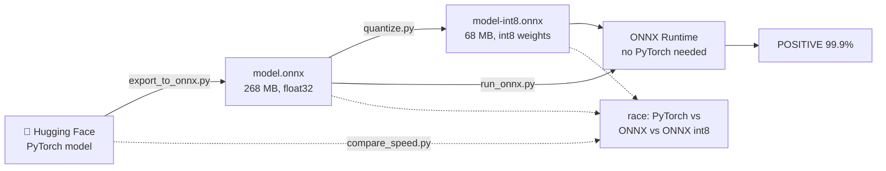
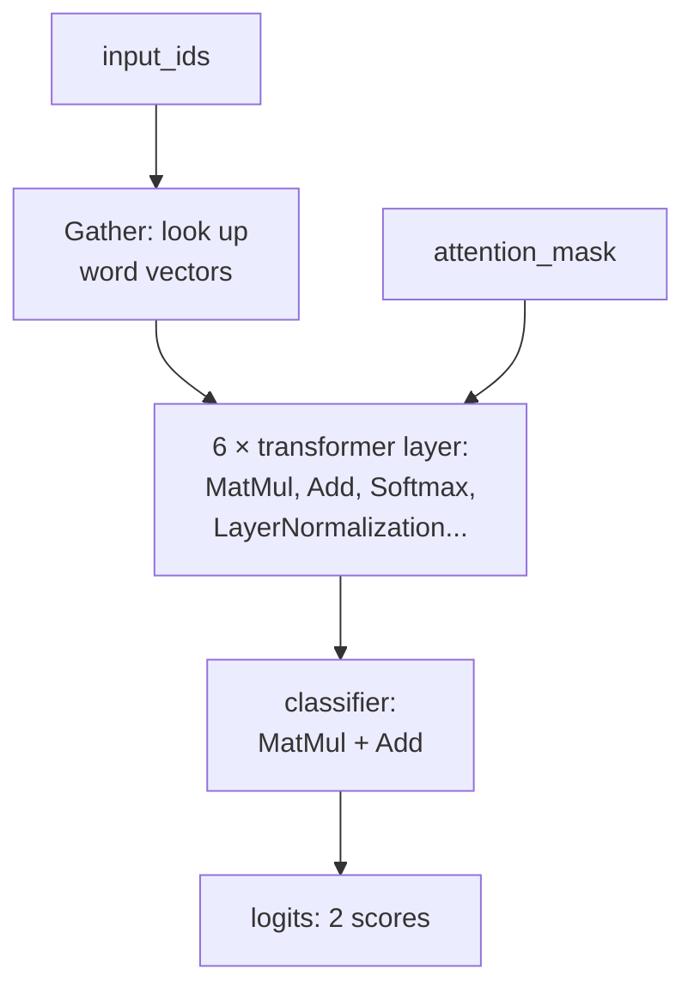

# 12 · ONNX Runtime and model export

**What you'll build:** you take a real PyTorch model from Hugging Face (a sentiment classifier that says whether a sentence is POSITIVE or NEGATIVE), **export** it to one portable `.onnx` file, run it with **ONNX Runtime** without PyTorch, shrink it to a quarter of the size with **quantization**, and race all three versions.
**Like you're 5:** a PyTorch model is like a cake recipe written in French with notes in the margins: only one kitchen can follow it. Exporting to ONNX rewrites it as a clear picture-recipe any kitchen in the world can cook from, on a phone, in a browser, in a C# app, on a server.
**Time:** ~1.5 h · **Builds on:** [11 · LLMs in the browser](../11-llms-in-the-browser-with-webgpu) (plan B ran ONNX files) and [04 · Quantization hands-on](../../part-1-run-models-locally/04-quantization-hands-on) · **Needs:** ~2 GB of disk for packages, a ~270 MB model download, no GPU, no API key



## Why this matters
Training happens in PyTorch, but **shipping** often doesn't. Phone apps, browsers (lesson 11's plan B), Windows apps, Java and C# back ends, and small servers usually run models with **ONNX Runtime**, because it is small, fast on CPUs, and has no Python dependency. "Export the model to ONNX, quantize it, check nothing broke, measure the speed-up" is a routine task for ML engineers who deploy models to customers. Non-LLM models (classifiers, embedders, rerankers, speech models like Kokoro and Silero in the voice course) are where this shines most.

## What you'll learn
- **ONNX (Open Neural Network Exchange)**: an open file format that stores a model as a **graph** (a flowchart of maths steps like MatMul, Add, Softmax) plus its weights.
- **Exporting**: PyTorch runs the model once on an example input, records every step, and writes the graph. **Dynamic shapes** say which sizes may change (number of sentences, number of words).
- **ONNX Runtime**: a fast engine (from Microsoft, open source) that runs ONNX files on CPUs, GPUs, phones and browsers through **execution providers**.
- **Dynamic quantization**: store weights as 8-bit integers instead of 32-bit floats (4× smaller); activations are quantized on the fly while running.
- **Checking an export**: same answers (within a tiny difference) and how much faster, measured, not guessed.

## Before you start
1. Activate your course venv (see the [course README](../../README.md)). **Linux without an NVIDIA GPU:** install the small CPU-only PyTorch first (saves ~4 GB):
   ```bash
   pip install torch --index-url https://download.pytorch.org/whl/cpu
   ```
2. Install the packages:
   ```bash
   pip install torch transformers onnx onnxscript onnxruntime
   ```
   - `torch`: PyTorch, where the model comes from.
   - `transformers`: downloads the model and its tokenizer from Hugging Face.
   - `onnx`: reads and edits `.onnx` files. `onnxscript`: used by PyTorch's exporter to write them.
   - `onnxruntime`: runs `.onnx` files (and contains the quantizer).
   This lesson was tested with torch 2.14, transformers 5.19, onnx 1.23 and onnxruntime 1.31.
3. No API key. The model (`distilbert/distilbert-base-uncased-finetuned-sst-2-english`, ~270 MB, Apache 2.0 licence) downloads automatically the first time, into `~/.cache/huggingface/`.

## Run it
All commands start from the course folder (`open-source-and-on-device-ai`).

1. Go into the lesson folder:
   ```bash
   cd part-3-browser-and-edge/12-onnx-runtime-and-model-export
   ```
2. Export the model (takes ~1 minute):
   ```bash
   python export_to_onnx.py
   ```
   A new folder `exported/` appears with `model.onnx`, `tokenizer.json`, `tokenizer_config.json` and `labels.txt`.
3. Run the ONNX file with ONNX Runtime:
   ```bash
   python run_onnx.py
   ```
4. Quantize it to 8-bit:
   ```bash
   python quantize.py
   ```
5. Run the small version (the argument is the file to use):
   ```bash
   python run_onnx.py exported/model-int8.onnx
   ```
6. Race all three:
   ```bash
   python compare_speed.py
   ```

### What you should see
*The file sizes, the export log and the "same answer" checks below are real (tested with a model of exactly DistilBERT's size). The labels and timings are an example from a typical laptop: this course was written on a shared machine where Hugging Face was blocked and timings weren't fair. Yours will differ.*

Step 2:
```
Loading distilbert/distilbert-base-uncased-finetuned-sst-2-english ...
[torch.onnx] Obtain model graph for `DistilBertForSequenceClassification([...]` with `torch.export.export(..., strict=False)`... ✅
[torch.onnx] Run decompositions... ✅
[torch.onnx] Translate the graph into ONNX... ✅
[torch.onnx] Optimize the ONNX graph... ✅

✅ Saved exported/model.onnx (268.4 MB) plus the tokenizer and labels.txt
```
Step 3:
```
Inputs : [('input_ids', ['batch', 'sequence']), ('attention_mask', ['batch', 'sequence'])]
Outputs: [('logits', ['batch', 2])]

POSITIVE  99.9%  I love this film, it was wonderful!
NEGATIVE  99.9%  What a boring, terrible movie.
POSITIVE  93.6%  The pizza was okay, I guess.
```
Step 4:
```
✅ model.onnx: 268.4 MB  ->  model-int8.onnx: 67.6 MB  (25% of the size)
```
Step 6:
```
engine             ms per run  same answer?  max difference
PyTorch                 21.40           yes          0.0000
ONNX Runtime            11.85           yes          0.0000
ONNX Runtime int8        4.90           yes          0.0038
```
What to look at:
- `['batch', 'sequence']`: the input sizes are **names**, not fixed numbers. That's the dynamic shapes working: any number of sentences, any length.
- The int8 model is **4× smaller** and often **2–4× faster** on a CPU, with a tiny difference in the raw scores (`0.0038`) and the same answers.
- The quantizer may print `WARNING:root:Please consider to run pre-processing before quantization`. It's a hint, not an error (see Try this 3).

## How it works

### `export_to_onnx.py`
1. `MODEL_ID` is the Hugging Face model name, or a folder/name you pass as the first argument.
2. `AutoTokenizer` / `AutoModelForSequenceClassification` download the tokenizer (text → numbers) and the model. `model.eval()` switches off training-only behaviour (dropout), so the recorded graph is the "exam mode" one.
3. `example = tokenizer(["I love this film"], return_tensors="pt")` makes one example input: `input_ids` (the word numbers) and `attention_mask` (1 = real word, 0 = padding).
4. `torch.export.Dim("batch")` and `Dim("sequence")` create **named sizes that may change**. `dynamic_shapes=({0: batch, 1: words}, {0: batch, 1: words})` says: for both inputs, dimension 0 (rows = sentences) and dimension 1 (columns = tokens) are flexible. Without this, the ONNX file would only accept exactly one sentence of exactly 6 tokens, like the example.
5. `torch.onnx.export(...)` does the work. Since PyTorch 2.9 it uses the new exporter (`dynamo=True` by default): it **traces** the model with `torch.export`, breaks big operations into basic ones ("decompositions"), translates them to ONNX operators, and optimizes the graph. `input_names` / `output_names` give the inputs friendly names we use later. `external_data=False` keeps the weights inside the single `.onnx` file (allowed up to 2 GB; bigger models must use a separate `.data` file).
6. We save the tokenizer next to it, plus `labels.txt` (`NEGATIVE`, `POSITIVE`) from `model.config.id2label`, because the ONNX file only knows "output 0" and "output 1".

What's inside `model.onnx`? A graph like this (simplified):


### `run_onnx.py`
1. It only imports `onnxruntime`, `numpy` and `tokenizers` (Hugging Face's fast tokenizer library). **No PyTorch**: this is what you'd install on a small server or in an app.
2. `Tokenizer.from_file(".../tokenizer.json")` loads the tokenizer. `enable_padding()` makes all sentences in a batch the same length by adding `[PAD]` tokens (and `attention_mask` zeros so the model ignores them).
3. `ort.InferenceSession(path, providers=["CPUExecutionProvider"])` loads the model. A **provider** is the hardware back end: `CPUExecutionProvider` everywhere, `CUDAExecutionProvider` (NVIDIA), `CoreMLExecutionProvider` (Apple), `DmlExecutionProvider` (Windows DirectML), and others; the same file runs on all of them.
4. `session.run(["logits"], feed)` runs the graph. `feed` is a dictionary from input name to a NumPy array of `int64` numbers.
5. **Softmax** turns the two raw scores (**logits**) into percentages that add up to 100 %: `exp(score) / sum(exp(all scores))`. `argmax()` picks the bigger one.

### `quantize.py`
1. The exporter stores **shape notes** (`value_info`) for every in-between result. The quantizer works them out again and, with recent exporters, sometimes disagrees with the stored notes and stops with `ShapeInferenceError: Inferred shape and existing shape differ`. So we load the model with `onnx.load`, delete the notes with `model.graph.ClearField("value_info")`, and save a temporary clean copy. Nothing else changes.
2. `quantize_dynamic(clean, TARGET, weight_type=QuantType.QInt8)` rewrites every big `MatMul` to use **8-bit integer weights** plus a scale number. "Dynamic" means the activations (the numbers flowing through) are converted to 8-bit **while running**, per input, so you don't need sample data to calibrate.
3. 32 bits → 8 bits per weight = 4× smaller (268 MB → 68 MB). Same idea as GGUF's Q8_0 in lesson 04.

### `compare_speed.py`
1. It loads the PyTorch model again and makes **contestants**: PyTorch, ONNX fp32, ONNX int8. Each one is built just before its turn, and PyTorch goes first: ONNX Runtime's helper threads keep the CPU busy for a moment after they work, which would slow down whoever runs next.
2. Each contestant runs 3 warm-up rounds (the first runs are always slower: memory allocation, caches), then `RUNS = 50` timed rounds with `time.perf_counter()` (a precise stopwatch).
3. **Checks:** `same answer?` compares the winning label with PyTorch's. `max difference` is the biggest gap between raw scores. fp32 ONNX should match PyTorch almost exactly (differences like 0.0000x); int8 differs a little (0.00x) but should give the same labels.

**Why is ONNX Runtime faster?** It **fuses** steps (e.g. MatMul + Add + GELU into one), plans memory once, and uses CPU instructions tuned for each chip. int8 maths moves 4× fewer bytes and uses fast integer instructions.

## If something goes wrong
- **`ModuleNotFoundError: No module named 'onnxscript'`** → the new exporter needs it: `pip install onnxscript`.
- **`OSError: We couldn't connect to 'https://huggingface.co'`** → the model can't download (offline or blocked network). Download it on another network first, or pass a local folder: `python export_to_onnx.py path/to/model-folder` (and the same folder to `compare_speed.py`).
- **`ShapeInferenceError ... Inferred shape and existing shape differ`** in your own quantize code → clear `value_info` first, as `quantize.py` does.
- **`INVALID_ARGUMENT : Unexpected input data type. Actual: (tensor(int32)), expected: (tensor(int64))`** → ONNX Runtime is strict about types. Convert with `.astype(np.int64)` (Windows NumPy sometimes makes int32 by default).
- **PyTorch is hundreds of times slower than ONNX Runtime in `compare_speed.py`** → your CPU is busy with other programs (PyTorch suffers most when cores are shared). Close heavy apps and run again; compare the numbers, not one run.
- **`Can't find exported/model.onnx`** → run the steps in order, from inside the lesson folder.

## Try this
1. **Easy:** look inside your ONNX file with **Netron**, a free graph viewer.
   <details><summary>Hint</summary>

   Open https://netron.app in a browser and drag `exported/model.onnx` onto it (the file stays on your computer). Find the inputs at the top, the six repeated transformer layers, and the final `MatMul` that makes 2 scores. Then open `model-int8.onnx`: the big `MatMul`s became `MatMulInteger` / `DynamicQuantizeLinear` nodes.
   </details>
2. **Medium:** measure batches. Change `compare_speed.py` to classify 16 sentences at once and see which engine gains most.
   <details><summary>Solution</summary>

   Replace the `inputs = tokenizer([...])` line with:
   ```python
   sentences = ["The story was slow at first, but the ending made me smile."] * 8 + ["Terrible acting."] * 8
   inputs = tokenizer(sentences, return_tensors="np", padding=True)
   ```
   and change `same = logits.argmax() == reference.argmax()` to `same = (logits.argmax(axis=1) == reference.argmax(axis=1)).all()`. Divide the time by 16 to get milliseconds per sentence. Batching usually makes each sentence much cheaper, because the CPU does big matrix maths more efficiently than many small ones.
   </details>
3. **Harder:** run ONNX Runtime's pre-processing step before quantizing (the warning suggests it) and compare size, speed and accuracy.
   <details><summary>Hint</summary>

   ONNX Runtime ships a tool for it: `python -m onnxruntime.quantization.preprocess --input exported/model-clean.onnx --output exported/model-pre.onnx --skip_symbolic_shape True` (make `model-clean.onnx` by commenting out the `clean.unlink()` line in `quantize.py`). It runs graph optimizations and shape inference so the quantizer sees a simpler graph. `--skip_symbolic_shape True` skips one of its shape steps that can't handle graphs from PyTorch's new exporter (without it you get `Incomplete symbolic shape inference`). Then quantize `model-pre.onnx` to `model-int8-pre.onnx` with the same `quantize_dynamic` call, add it as a fourth contestant, and compare. Sometimes it helps a little, sometimes not: that's why we measure.
   </details>

## Check yourself
1. What does the `.onnx` file contain, and why can a C#, Java or JavaScript app use it without PyTorch?
2. What would go wrong if you exported without `dynamic_shapes`?
3. What exactly becomes 8-bit in dynamic quantization, and why doesn't it need sample data?
4. Your int8 model is 3× faster but one test sentence flips from POSITIVE to NEGATIVE. What do you do before shipping it?

<details><summary>Answers</summary>

1. The model as a graph of standard operators (MatMul, Add, Softmax...) plus all the weights. Any program with an ONNX runtime understands these standard operators, so it doesn't need the Python code that defined the model.
2. The graph would be fixed to the example's shape: exactly 1 sentence of exactly that many tokens. Any other sentence length would fail with a shape error.
3. The weights are stored as int8 ahead of time. Activations are converted to 8-bit on the fly for each input, using the min/max of that input, so no calibration data is needed (that's "static" quantization's job).
4. Measure on a proper test set (hundreds of labelled sentences), not one example. Compare accuracy of fp32 vs int8. If the drop is too big, keep fp32 for that layer (`nodes_to_exclude`), try per-channel quantization (`per_channel=True`), or static quantization with calibration data.
</details>

## Learn more (optional)
**Read the official docs**
- ONNX Runtime documentation: https://onnxruntime.ai/docs/
- ONNX Runtime quantization guide: https://onnxruntime.ai/docs/performance/model-optimizations/quantization.html
- PyTorch: exporting to ONNX: https://pytorch.org/docs/stable/onnx.html
- The ONNX format and operator list: https://onnx.ai/onnx/
- Netron graph viewer: https://github.com/lutzroeder/netron
- Hugging Face Optimum (another way to export, with one command): https://huggingface.co/docs/optimum

**Watch**
- YouTube search: [ONNX Runtime explained](https://www.youtube.com/results?search_query=onnx+runtime+explained)
- YouTube search: [export PyTorch model to ONNX tutorial](https://www.youtube.com/results?search_query=export+pytorch+model+to+onnx+tutorial)
- YouTube search: [model quantization explained int8](https://www.youtube.com/results?search_query=model+quantization+explained+int8)
- YouTube search: [Umar Jamil quantization explained](https://www.youtube.com/results?search_query=umar+jamil+quantization)

## Next
→ [13 · Phones and small devices](../13-phones-and-small-devices)
