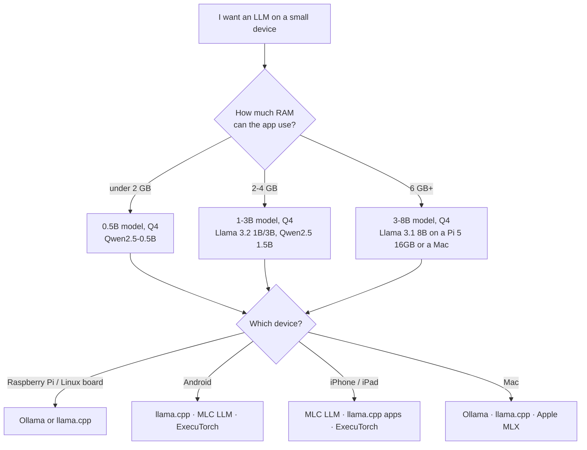

# 13 · Phones and small devices

**What you'll build:** a "what fits where" calculator that tells you which models can run on a Raspberry Pi, a phone, a Mac or a laptop, and roughly how fast; then a real LLM on a **Raspberry Pi 5** (with Ollama and with llama.cpp) measured with your own speed checker; and a map of the options for **Android, iPhone and Mac** (llama.cpp, MLC LLM, ExecuTorch, Apple MLX).
**Like you're 5:** a big AI model is like a grown-up's backpack. A Raspberry Pi or a phone is a small child: you must pick a smaller backpack (a smaller model) and pack it tightly (quantization), or the child can't carry it.
**Time:** ~2 h (plus setup time if you have a Pi) · **Builds on:** [01 · How big models are](../../part-1-run-models-locally/01-why-local-models-and-how-big-they-are), [03 · llama.cpp and GGUF](../../part-1-run-models-locally/03-llama-cpp-and-gguf), [05 · Benchmarks and speed](../../part-1-run-models-locally/05-choosing-a-model-benchmarks-and-speed) · **Needs:** nothing extra for the calculator; a Raspberry Pi 5 (4 GB or more) for the hands-on part is optional but fun



## Why this matters
Some AI has to live **on the device**: a farm sensor with no signal, a translation app on a plane, a shop kiosk, a robot, a phone keyboard that must stay private, a field clinic (lesson 16). Customers often ask "can this run on our hardware?" The honest answer needs two numbers: **memory** (does it fit?) and **memory bandwidth** (how fast will it talk?). This lesson gives you both, and the hands-on steps to prove it on a real board.

## What you'll learn
- **The two limits on small devices**: the model must fit in the RAM one app may use, and the speed of writing is limited by how fast the chip can read memory.
- **Memory bandwidth**: how many gigabytes per second the chip can read from RAM. To write each token, the chip reads (almost) all the weights once, so `speed ≈ bandwidth ÷ model size`.
- **ARM boards (Raspberry Pi 5)**: 4 CPU cores, no usable GPU for LLMs, but enough for 1–3B models at Q4.
- **On-phone runtimes**: llama.cpp (GGUF everywhere), MLC LLM (compiled for the phone's GPU), ExecuTorch (PyTorch's on-device runtime), and on Mac, Apple MLX.
- **Thermal throttling**: small devices slow down when they get hot; a fan matters.

## Before you start
1. On your computer, in the activated course venv (see the [course README](../../README.md)):
   ```bash
   pip install httpx
   ```
   `what_fits.py` needs nothing extra; `speed_check.py` uses `httpx` to talk to Ollama.
2. **For the Raspberry Pi part (optional):**
   - A **Raspberry Pi 5** with 4, 8 or 16 GB of RAM (8 GB recommended).
   - The official **27 W USB-C power supply** (weaker supplies cause slowdowns and resets).
   - The **Active Cooler** (or any fan case). Without it the Pi throttles within minutes.
   - A microSD card of 32 GB+ (an NVMe SSD on an M.2 HAT is faster for loading models, but optional).
   - Another computer on the same network to connect from.
3. No API key needed.

## Run it

### Part A: the "what fits where" calculator (any computer)
All commands start from the course folder (`open-source-and-on-device-ai`).

1. Go into the lesson folder:
   ```bash
   cd part-3-browser-and-edge/13-phones-and-small-devices
   ```
2. See every device:
   ```bash
   python what_fits.py
   ```
3. Just one device:
   ```bash
   python what_fits.py --device "Pi 5 8GB"
   ```
4. Your own device (look up its RAM and memory bandwidth, e.g. "LPDDR5 6400 bandwidth"):
   ```bash
   python what_fits.py --ram 6 --bandwidth 25
   ```

   **Command, piece by piece**

   | Piece | Meaning |
   |-------|---------|
   | `--device "Pi 5 8GB"` | an **option** with a value; the quotes keep the three words together as one value |
   | `--ram 6` | your device has 6 GB of RAM |
   | `--bandwidth 25` | its memory can deliver 25 GB per second |
   | `--ctx 8192` (optional) | plan for a longer conversation (more KV cache memory) |

### Part B: an LLM on a Raspberry Pi 5
1. **Flash the operating system.** On your computer, install **Raspberry Pi Imager** from https://www.raspberrypi.com/software/. Choose your Pi 5, then **Raspberry Pi OS Lite (64-bit)** (no desktop: more RAM for the model). Click the settings (⚙️ / "Edit settings"): set a hostname (`raspberrypi`), a username and password, your Wi-Fi, and **enable SSH**. Write the card, put it in the Pi, power on, wait 2 minutes.
2. **Connect from your computer** (SSH = a secure remote terminal):
   ```bash
   ssh pi@raspberrypi.local
   ```

   | Piece | Meaning |
   |-------|---------|
   | `ssh` | **s**ecure **sh**ell: open a terminal on another computer over the network |
   | `pi` | the username you chose in Imager |
   | `@` | "at" |
   | `raspberrypi.local` | the Pi's name on your home network (`.local` names are found automatically; if it fails, use the Pi's IP address from your router) |

   Type `yes` the first time (it remembers the Pi's identity), then your password. The prompt changes to `pi@raspberrypi:~ $`: you're now typing on the Pi.
3. **Update the system:**
   ```bash
   sudo apt update && sudo apt full-upgrade -y
   ```

   | Piece | Meaning |
   |-------|---------|
   | `sudo` | run the next command as the administrator |
   | `apt update` | refresh the list of available software |
   | `&&` | run the next command only if the previous one succeeded |
   | `apt full-upgrade` | install all updates |
   | `-y` | answer "yes" to questions automatically |

4. **Install Ollama** (it has an ARM64 Linux build):
   ```bash
   curl -fsSL https://ollama.com/install.sh | sh
   ```

   | Piece | Meaning |
   |-------|---------|
   | `curl` | download from a web address |
   | `-f` | **f**ail quietly on server errors instead of saving an error page |
   | `-s` | **s**ilent: no progress bar |
   | `-S` | but still **S**how errors if something goes wrong |
   | `-L` | follow redirects (if the address moved) |
   | `\|` | pipe: hand the downloaded script to the next command |
   | `sh` | run it as a shell script |

   Piping a script into `sh` runs code from the internet as-is. That's normal for well-known installers, but you can read it first: `curl -fsSL https://ollama.com/install.sh | less`. When it finishes it says something like `The Ollama API is now available at 127.0.0.1:11434` and runs Ollama as a background service.
5. **Chat with a small model:**
   ```bash
   ollama run llama3.2:1b
   ```
   (~1.3 GB download.) Ask a question; type `/bye` to leave. On a 4 GB Pi, `qwen2.5:0.5b` is snappier.
6. **Measure its speed.** Copy `speed_check.py` to the Pi (run this on your computer, from the lesson folder):
   ```bash
   scp speed_check.py pi@raspberrypi.local:~
   ```
   `scp` = **s**ecure **c**o**p**y over SSH; `~` after the colon = the Pi user's home folder. Then on the Pi:
   ```bash
   sudo apt install -y python3-httpx
   python3 speed_check.py llama3.2:1b
   ```
   (On Raspberry Pi OS, system Python packages come from `apt`; `pip install` outside a venv is blocked on purpose.)
7. **Watch the temperature** while it runs (in a second SSH window):
   ```bash
   watch -n 1 vcgencmd measure_temp
   ```
   `watch -n 1` re-runs a command every second; `vcgencmd measure_temp` asks the Pi's firmware for the chip temperature. Above ~80 °C the Pi slows itself down.
8. **(Optional) the same with llama.cpp**, which is often a bit faster on the Pi's CPU. Build it on the Pi (~10 minutes):
   ```bash
   sudo apt install -y git cmake build-essential libssl-dev
   git clone https://github.com/ggml-org/llama.cpp
   cd llama.cpp
   cmake -B build
   cmake --build build --config Release -j 4
   ```
   (The build commands are explained in [lesson 03](../../part-1-run-models-locally/03-llama-cpp-and-gguf).) Then download a model file and benchmark it:
   ```bash
   wget -P ~/models https://huggingface.co/bartowski/Llama-3.2-1B-Instruct-GGUF/resolve/main/Llama-3.2-1B-Instruct-Q4_K_M.gguf
   ./build/bin/llama-cli -m ~/models/Llama-3.2-1B-Instruct-Q4_K_M.gguf -p "Hello" -n 16 -st
   ./build/bin/llama-bench -m ~/models/Llama-3.2-1B-Instruct-Q4_K_M.gguf -p 128 -n 64 -t 4
   ```

   | Piece | Meaning |
   |-------|---------|
   | `wget -P ~/models <url>` | download the file into the folder `~/models` (`-P` = "put it in this **P**refix folder"; it's created if missing) |
   | `.../resolve/main/<file>` | Hugging Face's direct-download address for one file in a model repository |
   | `./build/bin/llama-cli` | the program you just built (`./` = "start from the current folder") |
   | `-p "Hello" -n 16 -st` | a tiny test: prompt "Hello", write 16 tokens, single turn then exit |
   | `llama-bench` | llama.cpp's benchmark tool |
   | `-m <file>` | the model file to test |
   | `-p 128` | test **p**rompt reading with 128 tokens (the `pp128` row) |
   | `-n 64` | test writing 64 tokens (the `tg64` row: **t**ext **g**eneration) |
   | `-t 4` | use 4 **t**hreads: the Pi 5 has 4 cores |

   `llama-bench` prints a table; the `t/s` column of the `tg64` row is the writing speed to compare with `speed_check.py`.

### What you should see
Part A (real output of `python what_fits.py --device "Pi 5 8GB"`):
```
📱 Pi 5 8GB: 8 GB RAM, about 6.0 GB usable by one app, 17 GB/s
   model         quant      needs   fits?   speed guess
   Qwen2.5 0.5B  Q4_K_M    0.39GB   ✅ yes     ~28 tok/s
   Qwen2.5 0.5B  Q8_0      0.63GB   ✅ yes     ~16 tok/s
   Llama 3.2 1B  Q4_K_M    0.98GB   ✅ yes     ~11 tok/s
   Llama 3.2 1B  Q8_0      1.60GB   ✅ yes      ~6 tok/s
   Qwen2.5 1.5B  Q4_K_M    1.17GB   ✅ yes      ~9 tok/s
   Qwen2.5 1.5B  Q8_0      1.93GB   ✅ yes      ~5 tok/s
   Llama 3.2 3B  Q4_K_M    2.68GB   ✅ yes      ~4 tok/s
   Llama 3.2 3B  Q8_0      4.27GB   ✅ yes      ~2 tok/s
   Llama 3.1 8B  Q4_K_M    6.00GB   ❌ no              -
   Llama 3.1 8B  Q8_0      9.98GB   ❌ no              -
```
Part B, `speed_check.py` on a Pi 5 8GB with the Active Cooler (*example: this course was written without a Pi; numbers like these are typical, yours will differ*):
```
🖥️  raspberrypi · aarch64 · Linux · model llama3.2:1b
  run 1: load   4.8 s · reading the prompt   38.2 tok/s · writing   8.9 tok/s
  run 2: load   0.1 s · reading the prompt   41.5 tok/s · writing   9.1 tok/s
  run 3: load   0.1 s · reading the prompt   41.0 tok/s · writing   9.0 tok/s

📊 median: reading 41.0 tok/s, writing 9.0 tok/s
```
Compare the real "writing" speed with the calculator's guess (~11 tok/s): close enough to plan with. Only the first run pays the load time.

## How it works

### `what_fits.py`
1. **Memory** uses the same formula as lesson 01: weights (`params × bits ÷ 8`, with Q4_K_M ≈ 4.9 bits and Q8_0 = 8.5 bits per weight) plus the **KV cache** (`2 × layers × kv_heads × head_dim × context × 2 bytes`), plus 10 % for buffers.
2. **Usable RAM** is not all RAM. `DEVICES` stores a share for each device: a Pi running only your program can give ~75 % to the model; a phone gives one app less than half (the system, the camera, the browser and other apps keep the rest, and the OS kills apps that grab too much).
3. **Verdict:** under 80 % of the budget = ✅, up to 100 % = ⚠️ tight (it may work if nothing else runs), above = ❌.
4. **Speed guess:** writing one token needs (almost) every weight read from memory once, so the chip can't write faster than `bandwidth ÷ weights size`. Real programs reach about half of that (`EFFICIENCY = 0.5`). Example: Pi 5 = 17 GB/s; Llama 3.2 1B at Q4 = 0.76 GB of weights → 17 × 0.5 ÷ 0.76 ≈ 11 tokens/s.
   ```
   one token = read ALL weights once
   ┌──────────┐   17 GB/s   ┌─────────────┐
   │ RAM 0.76 │ ──────────▶ │ CPU (4 core)│ ──▶ "sky"
   │ GB model │             └─────────────┘
   └──────────┘   ≈ 22 reads/s max, ~11 in practice
   ```
   This is why **quantization makes small devices faster, not just smaller**: Q4 moves half the bytes of Q8. And it's why a phone (60+ GB/s) can beat a Pi (17 GB/s) with the same model.
5. **Reading the prompt** (prefill) is different: all prompt tokens go through together, so it's limited by raw compute, not bandwidth. It's usually several times faster per token.

### `speed_check.py`
1. It sends the same prompt `--runs` times to Ollama's `/api/generate` with `temperature 0` and `num_predict 100` (at most 100 tokens), and a small `num_ctx` of 2048 to save memory.
2. Ollama returns its own stopwatch numbers in nanoseconds: `prompt_eval_count/prompt_eval_duration` = reading speed, `eval_count/eval_duration` = writing speed, `load_duration` = time to load the model from disk into RAM.
3. It prints the **median** (the middle value), which ignores one unusually slow or fast run.
4. `platform.machine()` prints `aarch64` on the Pi (64-bit ARM) and `x86_64` on most PCs, so you never mix up results.

### The options on each kind of device

| Device | Easiest way | Other good ways | Notes |
|--------|-------------|-----------------|-------|
| **Raspberry Pi 5 / ARM Linux boards** | Ollama (`curl ... install.sh \| sh`) | llama.cpp built on the board (`llama-cli`, `llama-server`) | CPU only. 1B at Q4 ≈ 8–11 tok/s; 3B ≈ 3–5 tok/s. Use a fan. |
| **NVIDIA Jetson (Orin Nano)** | Ollama (has Jetson support) | llama.cpp with `-DGGML_CUDA=ON`, MLC LLM | Real GPU and 68+ GB/s: 3B models run comfortably. |
| **Android phone** | an app such as **PocketPal AI** (uses llama.cpp, loads GGUF files) or **MLC Chat** (MLC LLM's demo app) | llama.cpp in **Termux** (a Linux terminal app: `pkg install git cmake clang`, then build as on the Pi); **ExecuTorch** demo apps; building your own app with the llama.cpp Android example or MLC LLM's Android SDK | 8 GB phones: 1–3B at Q4. GPU/NPU acceleration depends on the chip. |
| **iPhone / iPad** | **MLC Chat** or **PocketPal AI** from the App Store | building an app with llama.cpp's Swift package / XCFramework, MLC LLM's iOS SDK, or **ExecuTorch** (Core ML / MPS back ends) | Apple chips have fast memory and a good GPU (Metal); 8 GB iPhones run 3B Q4 well. |
| **Mac with Apple chip (M1–M4)** | Ollama | **Apple MLX** (`pip install mlx-lm`), llama.cpp (Metal is automatic) | Unified memory: the GPU can use most of the RAM. 16 GB runs 8B Q4 smoothly. |
| **Any laptop/PC (CPU only)** | Ollama | llama.cpp, ONNX Runtime (lesson 12), the browser (lesson 11) | Dual-channel DDR5 ≈ 60–90 GB/s. |

**What each runtime is, in one line:**
- **llama.cpp**: C/C++, runs GGUF files on almost anything (CPU, Metal, CUDA, Vulkan, Android, iOS). The most portable choice.
- **MLC LLM**: compiles a model ahead of time for one target (phone GPU via Vulkan/OpenCL/Metal, or WebGPU in lesson 11's WebLLM). Fast on phone GPUs.
- **ExecuTorch**: PyTorch's official on-device runtime. You **export** a PyTorch model to a `.pte` file (similar idea to lesson 12's ONNX export) and run it with small C++ libraries on Android, iOS and embedded chips, with back ends for phone NPUs (Qualcomm, MediaTek, Apple Core ML). Used inside Meta's apps.
- **Apple MLX**: Apple's array library for Apple chips; `mlx-lm` runs and fine-tunes LLMs on a Mac. Try it on a Mac:
  ```bash
  pip install mlx-lm
  mlx_lm.generate --model mlx-community/Llama-3.2-3B-Instruct-4bit --prompt "Why is the sky blue?"
  ```
  `--model` is a Hugging Face repo of models already converted to MLX (`mlx-community` hosts thousands), `4bit` is its quantization. `mlx_lm.chat --model ...` gives an interactive chat, and `mlx_lm.server --model ...` an OpenAI-compatible server (lesson 06).

## If something goes wrong
- **`ssh: Could not resolve hostname raspberrypi.local`** → your network doesn't support `.local` names (common on Windows or some routers). Find the Pi's IP address in your router's device list and use `ssh pi@192.168.x.y`.
- **The Pi resets or shows a lightning bolt / "under-voltage"** → the power supply is too weak. Use the official 27 W USB-C supply. Check with `vcgencmd get_throttled` (`0x0` means all good).
- **Speed drops after a minute or two** → thermal throttling. Fit the Active Cooler or a fan case; check `vcgencmd measure_temp`.
- **`Error: model requires more system memory (...) than is available`** → the model doesn't fit. Use a smaller model or a lower quantization (`what_fits.py` tells you which), close other programs, or reduce `num_ctx`.
- **`error: externally-managed-environment` when running `pip install` on the Pi** → Raspberry Pi OS protects its system Python. Use `sudo apt install python3-httpx`, or make a venv: `python3 -m venv ~/venv && source ~/venv/bin/activate && pip install httpx`.
- **Phone app crashes when loading a model** → the phone killed it for using too much memory. Pick a smaller model or Q4 instead of Q8, and close other apps.

## Try this
1. **Easy:** add your own device to `DEVICES` in `what_fits.py` (your laptop or phone) and see what fits.
   <details><summary>Hint</summary>

   Look up your RAM (Settings → About) and memory type. Rough bandwidth: dual-channel DDR4-3200 ≈ 51 GB/s, DDR5-5600 ≈ 90 GB/s, LPDDR5X phones ≈ 60–77 GB/s, Apple M2 = 100 GB/s, M3 Pro = 150 GB/s. Add a line like `"My laptop": (16, 0.70, 51),` inside `DEVICES`.
   </details>
2. **Medium:** add Q2_K (about 2.6 bits per weight) to the calculator, and check on a real device whether the extra speed is worth the quality loss you saw in lesson 04.
   <details><summary>Solution</summary>

   Change `BITS` to `{"Q2_K": 2.6, "Q4_K_M": 4.9, "Q8_0": 8.5}`. The speed guess for Llama 3.2 3B on a Pi 5 rises from ~4 to ~7 tok/s. Then pull a Q2_K model in Ollama (for example `ollama pull llama3.2:3b-instruct-q2_K`) and run `speed_check.py llama3.2:3b-instruct-q2_K`. Ask both versions the same three questions: below 4 bits, small models often get noticeably worse.
   </details>
3. **Harder:** compare the calculator's guess with a real measurement on two devices (your laptop and a Pi or phone), and work out the real `EFFICIENCY` for each.
   <details><summary>Hint</summary>

   Real efficiency = measured writing tok/s × weights size in GB ÷ bandwidth. For example 9.0 tok/s × 0.76 GB ÷ 17 GB/s ≈ 0.40. Typical values are 0.3–0.7; GPUs and Apple chips are often higher than small CPUs. If yours is far off, check that the model isn't partly in swap (`free -h`) and that the device isn't throttling.
   </details>

## Check yourself
1. Why is writing tokens on a small device mostly limited by memory bandwidth, not by how many calculations the chip can do?
2. A phone has 8 GB of RAM. Why can't an app use a model that needs 6 GB?
3. You quantize a model from Q8_0 to Q4_K_M. What happens to its size and to its writing speed on a Pi, and why?
4. When would you choose MLC LLM or ExecuTorch over llama.cpp for a phone app?

<details><summary>Answers</summary>

1. To write each token, the chip must read almost all the weights from RAM once, but does only a few calculations per weight. The RAM can't deliver data fast enough to keep the calculators busy, so bandwidth sets the speed.
2. The operating system and other apps need a large part of the RAM, and phone systems kill apps that use too much. Plan for well under half the RAM.
3. It gets about 40 % smaller (8.5 → 4.9 bits per weight), and writing gets almost proportionally faster, because each token needs fewer bytes read from memory. Quality drops a little.
4. When you want the phone's GPU or NPU to do the work for more speed and less battery (MLC LLM compiles for the phone GPU; ExecuTorch has NPU back ends), or when your model and team already live in PyTorch (ExecuTorch). llama.cpp is the most portable and simplest for GGUF files.
</details>

## Learn more (optional)
**Read the official docs**
- llama.cpp (build guide, Android and Apple notes): https://github.com/ggml-org/llama.cpp
- Ollama on Linux (incl. ARM64): https://github.com/ollama/ollama/blob/main/docs/linux.mdx
- Raspberry Pi documentation: https://www.raspberrypi.com/documentation/
- MLC LLM documentation: https://llm.mlc.ai/docs/
- ExecuTorch documentation: https://pytorch.org/executorch/
- Apple MLX and mlx-lm: https://github.com/ml-explore/mlx and https://github.com/ml-explore/mlx-lm

**Watch**
- YouTube search: [run LLM on Raspberry Pi 5 Ollama](https://www.youtube.com/results?search_query=run+llm+raspberry+pi+5+ollama)
- YouTube search: [NetworkChuck local AI on Raspberry Pi](https://www.youtube.com/results?search_query=networkchuck+raspberry+pi+local+ai)
- YouTube search: [run LLM on Android phone llama.cpp MLC](https://www.youtube.com/results?search_query=run+llm+on+android+phone+llama.cpp+mlc)
- YouTube search: [Apple MLX LLM tutorial](https://www.youtube.com/results?search_query=apple+mlx+lm+tutorial)
- YouTube search: [ExecuTorch on-device LLM](https://www.youtube.com/results?search_query=executorch+on+device+llm)

## Next
→ Part 4 starts: [14 · High-throughput serving with vLLM](../../part-4-serving-and-tuning/14-high-throughput-serving-with-vllm)
