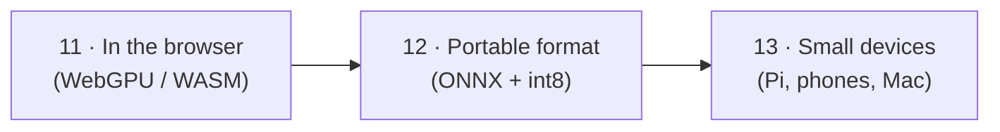

# Part 3 · Browser and edge

So far your models ran on a laptop through Ollama or llama.cpp. Now you take them to the **edge**: inside a web browser (no server at all), into the portable **ONNX** format that runs in apps and on phones, and onto small devices like a Raspberry Pi. The big questions of this part: *will it fit, how fast will it be, and what runtime should I use there?*

| # | Lesson | What you'll have | Time |
|---|--------|------------------|------|
| 11 | [LLMs in the browser with WebGPU](11-llms-in-the-browser-with-webgpu) | one `index.html` that runs a chat model on the visitor's GPU (WebLLM), with a CPU fallback (transformers.js) | 1.5 h |
| 12 | [ONNX Runtime and model export](12-onnx-runtime-and-model-export) | a Hugging Face model exported to ONNX, run without PyTorch, quantized to int8 and raced against PyTorch | 1.5 h |
| 13 | [Phones and small devices](13-phones-and-small-devices) | a "what fits where" calculator, an LLM on a Raspberry Pi 5 with a real speed test, and a map of Android/iPhone/Mac runtimes | 2 h |

**Total: about 1 week at 1 hour a day** (more if you set up a Raspberry Pi).



## Install once (in your activated venv)
```bash
pip install torch transformers onnx onnxscript onnxruntime httpx
```
- `torch` + `transformers`: load the Hugging Face model you export (12). **Linux without an NVIDIA GPU:** install the CPU-only PyTorch first: `pip install torch --index-url https://download.pytorch.org/whl/cpu`.
- `onnx` + `onnxscript`: write and edit `.onnx` files (12). `onnxruntime`: runs them and contains the quantizer (12).
- `httpx`: the speed checker talks to Ollama (13).

Lesson 11 needs **no Python packages**: Python only serves the page (`python -m http.server`), and the libraries load in the browser from a CDN, pinned to exact versions.

## What else you need
| What | Lessons | Notes |
|------|---------|-------|
| A recent **Chrome or Edge** (WebGPU) | 11 | Safari 26 and Firefox 141+ on Windows also have WebGPU; other browsers use the CPU fallback |
| ~1 GB browser cache space | 11 | the model is downloaded once per browser |
| ~270 MB model download + ~350 MB of exported files | 12 | the `exported/` folder can be deleted afterwards |
| **Raspberry Pi 5** (4–16 GB), 27 W power supply, Active Cooler | 13 (optional) | the calculator part works without one |
| A Mac with Apple chip | 13 (optional) | for the Apple MLX example |

## After this part you can
- Ship an LLM inside a web page that costs nothing to serve and keeps text on the device, with a fallback for older browsers.
- Export a PyTorch model to ONNX, run it anywhere ONNX Runtime runs, quantize it, and prove the export is correct and faster.
- Tell a customer which model fits their device and roughly how fast it will run, then measure it for real.
- Choose between llama.cpp, MLC LLM, ExecuTorch and MLX for phones, boards and Macs.

Start here → [11 · LLMs in the browser with WebGPU](11-llms-in-the-browser-with-webgpu)

Next part → [Part 4 · Serving and tuning](../part-4-serving-and-tuning)
