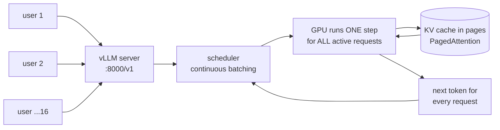

# 14 · High-throughput serving with vLLM

**What you'll build:** a **vLLM** server that answers many users at the same time with an OpenAI-compatible API, a small client that streams one answer, and a **load test** that pretends to be 16 users at once, so you can compare vLLM with Ollama using real numbers.
**Like you're 5:** Ollama is a great home cook: one plate at a time, perfect for the family. vLLM is a restaurant kitchen: it cooks for a whole room at once, starts new plates the moment a cook is free, and never wastes counter space.
**Time:** ~2 h · **Builds on:** [05 · Benchmarks and speed](../../part-1-run-models-locally/05-choosing-a-model-benchmarks-and-speed), [06 · OpenAI-compatible APIs](../../part-2-build-with-open-models/06-openai-compatible-apis-and-switching-providers) · **Needs:** for vLLM itself: **Linux (or WSL2) with an NVIDIA GPU** with 8 GB+ of memory (a free cloud GPU notebook also works); the client and load test run anywhere, and also against Ollama



## Why this matters
A model on a laptop serves one person. A company assistant serves hundreds of employees at 9:00 on Monday. If each request waits for the previous one, people wait minutes. **Throughput** (tokens per second for everyone together) decides how many GPUs you must pay for, and vLLM often gets several times more out of the same GPU than simple servers. It's one of the most-used open-source servers in production (behind many internal "ChatGPT for our company" tools and inside managed AI platforms), and knowing its flags is everyday work for whoever deploys open models.

## What you'll learn
- **Throughput vs latency**: throughput = total tokens per second for all users; latency = how long *one* user waits. Serving is the art of raising the first without ruining the second.
- **Continuous batching**: the GPU works on many requests in the same step, and a new request joins at the very next step instead of waiting for a whole group to finish.
- **PagedAttention**: the KV cache (the model's short-term memory, lesson 01) is stored in small fixed-size **pages**, so memory isn't wasted and many more requests fit at once.
- **`vllm serve` flags**: context length, how much GPU memory to use, how many requests at once, API keys.
- **Load testing**: measure requests/s, tokens/s, time to first token and the slow 5 % (p95) with many pretend users.

## Before you start
**The client and load test** (any computer, in your activated course venv; see the [course README](../../README.md)):
```bash
pip install openai
```
`openai` is the same SDK as lesson 06; here it talks to vLLM or Ollama.

**vLLM itself** needs Linux and an NVIDIA GPU (on Windows, use WSL2 with the NVIDIA driver for WSL). No GPU? See [No NVIDIA GPU?](#no-nvidia-gpu-cpu-and-docker-options) below, or run the load test against Ollama only.

1. Check the GPU is visible:
   ```bash
   nvidia-smi
   ```
   You should see a table with your GPU's name, memory (e.g. `8188MiB`) and the driver/CUDA version. If the command is missing, install the NVIDIA driver first.
2. Make a **separate venv just for vLLM** (vLLM pins its own PyTorch version, which would fight with other courses' packages). The vLLM docs recommend `uv`, a very fast installer (`pip install uv` if you don't have it):
   ```bash
   uv venv ~/vllm-env --python 3.12 --seed
   source ~/vllm-env/bin/activate
   uv pip install vllm==0.31.0 --torch-backend=auto
   ```

   **Command, piece by piece**

   | Piece | Meaning |
   |-------|---------|
   | `uv venv ~/vllm-env` | create a virtual environment in the folder `vllm-env` in your home folder (`~`) |
   | `--python 3.12` | use Python 3.12 (uv downloads it if needed) |
   | `--seed` | also put `pip` inside the venv |
   | `source .../activate` | switch this terminal to that venv |
   | `uv pip install vllm==0.31.0` | install exactly version 0.31.0 of vLLM (`==` pins the version) |
   | `--torch-backend=auto` | let uv pick the PyTorch build that matches your CUDA driver |

   It downloads ~3–5 GB. Check with `vllm --version`.
3. No API key needed. The model `Qwen/Qwen2.5-1.5B-Instruct` (~3 GB, Apache 2.0) downloads from Hugging Face the first time into `~/.cache/huggingface/`.

## Run it
1. **Start vLLM** (in the vLLM venv; leave this terminal open):
   ```bash
   vllm serve Qwen/Qwen2.5-1.5B-Instruct --port 8000 --max-model-len 4096 --gpu-memory-utilization 0.85 --max-num-seqs 64
   ```

   **Command, piece by piece**

   | Piece | Meaning |
   |-------|---------|
   | `vllm serve` | start vLLM's OpenAI-compatible HTTP server |
   | `Qwen/Qwen2.5-1.5B-Instruct` | the model: a Hugging Face repo name (or a local folder). It's also the name clients must send as `model` |
   | `--port 8000` | listen on port 8000 (the default) |
   | `--max-model-len 4096` | the longest conversation (prompt + answer) in tokens. Smaller = more room for parallel requests. Without it, vLLM uses the model's maximum (32,768 here), which may not fit on a small GPU |
   | `--gpu-memory-utilization 0.85` | use up to 85 % of the GPU's memory for weights + KV cache (default 0.9). Lower it if other programs share the GPU |
   | `--max-num-seqs 64` | at most 64 requests in one batch; others wait in a queue |
   | `--api-key <secret>` (optional) | refuse requests without `Authorization: Bearer <secret>`. Use it whenever the port is reachable by others |
   | `--served-model-name <name>` (optional) | a shorter public name, e.g. `qwen-small` |
   | `--tensor-parallel-size 2` (optional) | split one big model across 2 GPUs |
   | `--quantization` / `--dtype` (optional) | load quantized weights (e.g. AWQ, GPTQ, FP8 checkpoints) / pick the number format; `auto` is fine |

   Wait for the line `Application startup complete.` (30 s – 3 min the first time). Check it: http://localhost:8000/v1/models lists the model.
2. In a second terminal (your course venv), go into the lesson folder (from the course folder `open-source-and-on-device-ai`):
   ```bash
   cd part-4-serving-and-tuning/14-high-throughput-serving-with-vllm
   ```
3. Ask one question:
   ```bash
   python ask_vllm.py "Why is the sky blue?"
   ```
4. Load-test vLLM: first 1 user, then 16 users at once:
   ```bash
   python load_test.py vllm --users 1 --requests 16
   python load_test.py vllm --users 16 --requests 64
   ```

   | Piece | Meaning |
   |-------|---------|
   | `vllm` | the target: `http://localhost:8000/v1` with `Qwen/Qwen2.5-1.5B-Instruct` (`ollama` = `http://localhost:11434/v1` with `qwen2.5:1.5b`) |
   | `--users 16` | 16 pretend users send requests at the same time |
   | `--requests 64` | 64 requests in total (each user sends the next when its answer is done) |
   | `--max-tokens 128` (default) | each answer stops after 128 tokens, so runs are comparable |

5. **Compare with Ollama** (same model family, same machine): `ollama pull qwen2.5:1.5b`, then:
   ```bash
   python load_test.py ollama --users 16 --requests 64
   ```
   Then restart Ollama with more parallel slots (Linux: `sudo systemctl stop ollama`, then `OLLAMA_NUM_PARALLEL=8 ollama serve`) and run it again.

### What you should see
*Example numbers: this course was written on a machine with no GPU, so the load test was checked against a stand-in server, not vLLM. The numbers below are typical for a 1.5B model on one consumer GPU; yours will differ.*

`ask_vllm.py`:
```
The sky looks blue because sunlight is scattered by the tiny gas molecules in the air, and blue light
is scattered much more than red light. So when you look up, blue light reaches your eyes from every direction.

⏱  first token after 0.04 s, whole answer in 0.61 s (Qwen/Qwen2.5-1.5B-Instruct at http://localhost:8000/v1)
```
`load_test.py vllm --users 1` vs `--users 16`:
```
🚦 16 requests, 1 users at a time, up to 128 tokens each → Qwen/Qwen2.5-1.5B-Instruct at http://localhost:8000/v1
  finished in               14.9 s
  requests per second       1.07
  output tokens/s (all)    137.4
  first token  median       0.03 s    p95   0.04 s
  whole answer median       0.93 s    p95   0.95 s

🚦 64 requests, 16 users at a time, up to 128 tokens each → Qwen/Qwen2.5-1.5B-Instruct at http://localhost:8000/v1
  finished in                6.8 s
  requests per second       9.41
  output tokens/s (all)   1204.6
  first token  median       0.08 s    p95   0.21 s
  whole answer median       1.61 s    p95   1.74 s
```
`load_test.py ollama --users 16` (default `OLLAMA_NUM_PARALLEL=1`, same GPU):
```
  finished in               61.2 s
  requests per second       1.05
  output tokens/s (all)    133.8
  first token  median      14.10 s    p95  15.02 s
  whole answer median      15.04 s    p95  15.96 s
```
How to read it: with one user, both are similar (~130 tokens/s). With 16 users, vLLM's **total** throughput jumps ~9× while each answer only gets a bit slower (0.9 s → 1.6 s). Ollama with one slot serves people one after another, so the 16th user waits ~15 s for the first word. More `OLLAMA_NUM_PARALLEL` slots help, but vLLM is built for this.

## How it works

### The two big ideas, like you're 5
**1. Continuous batching: the bus that never waits.**
A GPU is like a bus with 64 seats. Reading the model's weights from memory is the expensive part of each step, and it costs the same whether 1 or 64 passengers ride along. So it's much cheaper per person to carry many at once.
- *Static batching* (old way): wait until the bus is full, drive everyone to the end of the line, and only then let new people on. Short trips wait for long trips.
- *Continuous batching* (vLLM): at **every stop** (every generated token), finished passengers get off and waiting passengers get on.
```
step:        1   2   3   4   5   6   7   8
request A:   ■   ■   ■   ■   ✓                    (short answer, leaves at step 5)
request B:   ■   ■   ■   ■   ■   ■   ■   ✓
request C:               ■   ■   ■   ✓            (arrived at step 3, joined immediately)
request D:                       ■   ■   ■   ...  (took A's free seat at step 5)
```

**2. PagedAttention: a notebook with loose pages.**
Every request needs **KV cache** memory that grows with each token (lesson 01). Old servers reserved one long, unbroken block per request, sized for the *longest possible* answer: like giving every guest a 100-page notebook when most write 3 pages. vLLM cuts memory into small **pages** (blocks of 16 tokens) and hands out a new page only when a request fills its current one, like an operating system's virtual memory. Almost nothing is wasted, so many more requests fit on the GPU at once, which feeds the bus above. Requests that share the same beginning (the same system prompt) can even share pages: that's **prefix caching**, on by default.
```
GPU memory (KV cache area)
┌──┬──┬──┬──┬──┬──┬──┬──┬──┬──┬──┬──┐
│A1│B1│A2│C1│B2│A3│C2│B3│  │  │  │  │   pages handed out as each request grows;
└──┴──┴──┴──┴──┴──┴──┴──┴──┴──┴──┴──┘   when A finishes, A1-A3 are free again
```

### What happens at `vllm serve`
1. Downloads the model (once), loads the weights onto the GPU.
2. Measures how much memory is left under `--gpu-memory-utilization` and turns it into KV-cache pages. The log says something like `GPU KV cache size: 290,000 tokens` and `Maximum concurrency for 4,096 tokens per request: 70x`: how many full-length conversations fit at once.
3. Captures **CUDA graphs** and may compile the model (`torch.compile`) for speed. That's why startup takes a minute.
4. Starts an HTTP server with `/v1/chat/completions`, `/v1/completions`, `/v1/models`, `/v1/embeddings` (for embedding models), `/health` and `/metrics` (Prometheus numbers such as queue length and KV-cache use).

### `ask_vllm.py`
1. `OpenAI(base_url=URL, api_key=KEY)`: the same client as lesson 06, pointed at vLLM. Change `LLM_URL`/`LLM_MODEL` and the same file talks to Ollama, llama-server or a cloud provider.
2. `stream=True` returns chunks; `chunk.choices[0].delta.content` is the new text. The first chunk's time is the **time to first token (TTFT)**: what makes an app *feel* fast.

### `load_test.py`
1. `AsyncOpenAI` is the **async** version of the client: one Python program can wait for many answers at once without threads. `async def` functions can pause at `await` while others run.
2. `jobs` is a shared list of 64 questions. `user()` is one pretend user: it pops a question, sends it, waits for the full streamed answer, and repeats until the list is empty. `asyncio.gather(...)` starts `--users` of them at the same time.
3. `one_request()` records the time to the first text chunk, the total time, and the number of output tokens. `stream_options={"include_usage": True}` asks the server to add the real token count in the last chunk (vLLM and Ollama both support it); if a server doesn't, we count chunks instead.
4. A warm-up request runs first so model loading isn't counted.
5. Results: **requests per second**, **output tokens/s** (for everyone together = throughput), and the **median** and **p95** of TTFT and total time. p95 = "95 % of requests were at least this fast": it shows how bad the slow cases are, which matters more to users than the average.

### Ollama vs vLLM: when to use which
| | Ollama | vLLM |
|---|--------|------|
| Best for | one person or a small team; laptops, Macs, CPUs | many users on NVIDIA (or AMD) GPUs |
| Install | one app, any OS | Linux + GPU (CPU and Apple builds exist but are slower) |
| Model files | GGUF (quantized, small) | Hugging Face folders (safetensors), AWQ/GPTQ/FP8 quantized |
| Parallel requests | `OLLAMA_NUM_PARALLEL` (default 1) | continuous batching, dozens to hundreds |
| API | Ollama API + OpenAI-compatible | OpenAI-compatible (+ metrics) |

### No NVIDIA GPU? CPU and Docker options
- **Docker with a GPU** (Linux + NVIDIA Container Toolkit): no Python install needed.
  ```bash
  docker run --rm --gpus all -p 8000:8000 --ipc=host -v ~/.cache/huggingface:/root/.cache/huggingface vllm/vllm-openai:v0.31.0 Qwen/Qwen2.5-1.5B-Instruct --max-model-len 4096
  ```

  | Piece | Meaning |
  |-------|---------|
  | `docker run --rm` | start a container and delete it when it stops |
  | `--gpus all` | give the container all NVIDIA GPUs |
  | `-p 8000:8000` | connect port 8000 on your computer to port 8000 in the container (`host:container`) |
  | `--ipc=host` | share memory with the host; PyTorch needs lots of shared memory |
  | `-v ~/.cache/huggingface:/root/.cache/huggingface` | mount your model cache into the container, so models download only once |
  | `vllm/vllm-openai:v0.31.0` | vLLM's official image, pinned to a version |
  | `Qwen/Qwen2.5-1.5B-Instruct --max-model-len 4096` | everything after the image name goes to `vllm serve` |

- **CPU only (x86 with AVX2/AVX-512, or ARM)**: vLLM has a CPU build, e.g. the image `vllm/vllm-openai-cpu:v0.31.0-x86_64`. Run it like above without `--gpus all`, and add `-e VLLM_CPU_KVCACHE_SPACE=4` (GiB of RAM for the KV cache). It works and is good for learning the API, but on a laptop it is slower than Ollama/llama.cpp with a quantized GGUF.
- **Free cloud GPU**: notebooks such as Google Colab or Kaggle give you a T4 GPU for free. There, run `!pip install vllm` and start the server in the background (`!nohup vllm serve ... &`), then use `ask_vllm.py`'s code in a cell.
- **Just want the numbers?** Run the load test against **Ollama** and **llama-server** (`--url http://localhost:8080/v1 --model local`, lesson 03; start it with `-np 4` for 4 parallel slots) and compare those two.

## If something goes wrong
- **`torch.OutOfMemoryError: CUDA out of memory` or `ValueError: ... max seq len ... is larger than the maximum number of tokens that can be stored in KV cache`** → lower `--max-model-len` (e.g. 2048), lower `--max-num-seqs`, or close other GPU programs (`nvidia-smi` shows them). On 6–8 GB GPUs use small models.
- **`RuntimeError: Failed to infer device type` / `No CUDA GPUs are available`** → vLLM can't see a GPU. Check `nvidia-smi`; in WSL2 install the Windows NVIDIA driver (not a Linux one); in Docker add `--gpus all`.
- **`openai.NotFoundError: The model 'xyz' does not exist`** → the `model` name must match what the server serves: `curl http://localhost:8000/v1/models` shows it (or set `--served-model-name`).
- **`401 Unauthorized`** → the server was started with `--api-key`. Set the same value: `export LLM_API_KEY=<secret>` before running the scripts.
- **Ollama returns `503` during the load test** → its queue is full or it's overloaded. Lower `--users`, or raise `OLLAMA_MAX_QUEUE` / `OLLAMA_NUM_PARALLEL`.
- **Installing vLLM breaks your course venv** → that's why it gets its own venv. Delete the broken one and recreate it; keep vLLM in `~/vllm-env`.

## Try this
1. **Easy:** find the best number of users. Run the vLLM load test with `--users 1`, `4`, `16` and `64` and write down tokens/s and p95 total time each time.
   <details><summary>Hint</summary>Throughput grows fast at first, then flattens when the GPU is busy every step; meanwhile p95 latency keeps growing. The "sweet spot" is where throughput is near its top but p95 is still acceptable for your users (e.g. under 3 s). That's the number you plan capacity with.</details>
2. **Medium:** prove prefix caching works. Give every request the same long system prompt and compare time to first token with and without `--no-enable-prefix-caching`.
   <details><summary>Solution</summary>

   In `load_test.py`, change the `messages=` line in `one_request()` to:
   ```python
   messages=[{"role": "system", "content": "You are a museum guide. " * 300},
             {"role": "user", "content": question}],
   ```
   (about 1,500 tokens of identical system prompt). Run it against the normal server, then restart vLLM with `--no-enable-prefix-caching` and run again. With caching, after the first request the shared beginning is already in the KV cache, so TTFT drops sharply.
   </details>
3. **Harder:** watch the server's own numbers while the load test runs, using its Prometheus metrics.
   <details><summary>Hint</summary>

   Open http://localhost:8000/metrics during a run, or in a terminal: `watch -n 1 "curl -s localhost:8000/metrics | grep -E 'num_requests_running|num_requests_waiting|kv_cache_usage_perc'"`. `num_requests_running` shows the batch size; `num_requests_waiting` > 0 means you've hit `--max-num-seqs` or memory; `kv_cache_usage_perc` near 1.0 means pages are full. Try `--max-num-seqs 4` and see the waiting count rise. (The DevOps course shows how Prometheus and Grafana graph these.)
   </details>

## Check yourself
1. Why can a GPU serve 16 users at once almost as fast as 1 user, per step?
2. What problem does PagedAttention solve, and what does that allow?
3. In the load test, what's the difference between "output tokens/s (all)" and how fast one user sees words appear?
4. A team has 3 users and Mac laptops. Should they use vLLM? What would you suggest instead?

<details><summary>Answers</summary>

1. Each step's main cost is reading all the weights from GPU memory. With a batch, that one read serves every request in the batch, so 16 requests cost little more than 1 (until compute or memory runs out).
2. Wasted KV-cache memory: old servers reserved space for the longest possible answer per request. Pages are handed out only as needed, so much more of the memory holds real tokens, many more requests fit at once, and identical prefixes can be shared.
3. "All" adds everyone's tokens together (throughput, what the GPU produces). One user experiences only their own stream (latency): with more users, the total goes up while each person's speed goes down a bit.
4. Probably not: vLLM shines with many users on NVIDIA GPUs. Ollama or llama.cpp (or MLX) on the Macs, or one small Ollama server, is simpler and fast enough for 3 people.
</details>

## Learn more (optional)
**Read the official docs**
- vLLM documentation: https://docs.vllm.ai
- vLLM quickstart (install, `vllm serve`, OpenAI client): https://docs.vllm.ai/en/latest/getting_started/quickstart/
- vLLM engine arguments (every `vllm serve` flag): https://docs.vllm.ai/en/latest/configuration/engine_args/
- vLLM on GitHub: https://github.com/vllm-project/vllm
- The PagedAttention paper (Kwon et al., 2023): https://arxiv.org/abs/2309.06180
- Ollama FAQ (`OLLAMA_NUM_PARALLEL`, queueing): https://github.com/ollama/ollama/blob/main/docs/faq.mdx

**Watch**
- YouTube search: [vLLM PagedAttention explained](https://www.youtube.com/results?search_query=vllm+paged+attention+explained)
- YouTube search: [continuous batching LLM inference explained](https://www.youtube.com/results?search_query=continuous+batching+llm+inference+explained)
- YouTube search: [vLLM serve tutorial OpenAI compatible](https://www.youtube.com/results?search_query=vllm+serve+tutorial+openai+compatible)
- Andrej Karpathy, [Intro to Large Language Models](https://www.youtube.com/watch?v=zjkBMFhNj_g) (why inference is "just" running the weights, over and over)

## Next
→ [15 · Fine-tune a small model with LoRA and export to GGUF](../15-fine-tune-a-small-model-with-lora-and-export-to-gguf)
