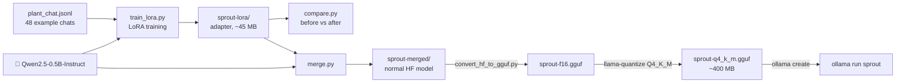

# 15 · Fine-tune a small model with LoRA and export to GGUF

**What you'll build:** you teach a small open model (Qwen2.5-0.5B-Instruct) to become **Sprout**, a plant-care helper that always answers in 2–3 short sentences plus one practical tip, and politely refuses off-topic questions. You train it with **LoRA** on 48 example chats, compare it before and after, merge the result, convert it to **GGUF** with llama.cpp, quantize it, and run it in **Ollama** as `ollama run sprout`.
**Like you're 5:** the model is a big book that's already written. Instead of rewriting the whole book, you stick a few small notes onto some pages ("when someone asks about plants, answer like this"). That's LoRA. Then you glue the notes in for good (merge), shrink the book to pocket size (GGUF + quantize) and put it on your shelf (Ollama).
**Time:** ~2.5 h (most of it waiting for training) · **Builds on:** [03 · llama.cpp and GGUF](../../part-1-run-models-locally/03-llama-cpp-and-gguf), [04 · Quantization hands-on](../../part-1-run-models-locally/04-quantization-hands-on), [02 · Modelfiles](../../part-1-run-models-locally/02-ollama-deep-dive-api-and-modelfiles) · **Needs:** ~8 GB of RAM, ~6 GB of free disk, llama.cpp's `llama-quantize` (lesson 03), Ollama; a GPU is optional (CPU training takes 20–60 min; a free Colab GPU takes ~2 min)



## Why this matters
Prompts and RAG (lesson 07) cover most needs, but sometimes a company wants a model that **always** behaves a certain way: a fixed answer format, a brand voice, a specialised vocabulary, a small model that does one job as well as a big one, or the same behaviour without a 2-page system prompt on every request. **LoRA fine-tuning** does this cheaply: hours on one GPU, not weeks on a cluster. Exporting to GGUF then lets the result run anywhere Ollama or llama.cpp runs: laptops, Raspberry Pis (lesson 13), air-gapped servers (lesson 16). "Fine-tune, evaluate, export, ship" is a core open-model skill.

## What you'll learn
- **Fine-tuning vs prompting vs RAG**: prompts steer, RAG adds facts at question time, fine-tuning changes the model's habits (style, format, behaviour). Use fine-tuning for *how* it answers, RAG for *what it knows*.
- **SFT (supervised fine-tuning)**: show the model example conversations and train it to produce the assistant's answers.
- **LoRA (Low-Rank Adaptation)**: freeze the original weights and train two small matrices per layer that add a correction. ~1–2 % of the weights are trained, so it's fast and needs little memory.
- **Merging**: add the LoRA correction into the original weights, giving one normal model again.
- **Export pipeline**: Hugging Face folder → GGUF (f16) → quantized GGUF → Ollama model with a Modelfile and the right chat template.

## Before you start
1. Activate your course venv (see the [course README](../../README.md)). **Linux without an NVIDIA GPU:** install the CPU-only PyTorch first: `pip install torch --index-url https://download.pytorch.org/whl/cpu`. Then:
   ```bash
   pip install torch transformers datasets peft trl accelerate
   ```
   - `transformers`: loads the model and tokenizer. `datasets`: reads `plant_chat.jsonl`.
   - `peft`: Hugging Face's **P**arameter-**E**fficient **F**ine-**T**uning library (LoRA lives here).
   - `trl`: **T**ransformer **R**einforcement **L**earning; its `SFTTrainer` does supervised fine-tuning for chat data. `accelerate`: used by the trainer to place work on CPU/GPU.
   Tested with torch 2.14, transformers 5.19, peft 0.21, trl 1.16.
2. **llama.cpp's converter script.** Download llama.cpp's source (the same build number as lesson 03, so the converter and `llama-quantize` match). From the lesson folder:
   ```bash
   git clone --depth 1 --branch b11804 https://github.com/ggml-org/llama.cpp
   ```

   | Piece | Meaning |
   |-------|---------|
   | `git clone <url>` | download a copy of the project |
   | `--depth 1` | only the newest snapshot, not the whole history (much smaller) |
   | `--branch b11804` | the release tagged `b11804` (a fixed version) |

   The converter `llama.cpp/convert_hf_to_gguf.py` needs `torch`, `transformers` and `numpy`, which you just installed. (llama.cpp also has `requirements/requirements-convert_hf_to_gguf.txt`, but it pins older exact versions; only use it in a separate venv if the converter complains.)
3. **`llama-quantize`** from lesson 03 (check: `llama-quantize --help` prints its usage). If you built llama.cpp yourself, it's in `llama.cpp/build/bin/`.
4. **Ollama** running (lesson 02).
5. No API key. The base model (~1 GB) downloads from Hugging Face the first time.
6. **No time for CPU training?** Open https://colab.research.google.com, choose *Runtime → Change runtime type → T4 GPU*, upload `train_lora.py`, `compare.py`, `merge.py` and `plant_chat.jsonl`, run `!pip install peft trl datasets` and `!python train_lora.py`, then download the `sprout-lora` folder (zip it with `!zip -r sprout-lora.zip sprout-lora`).

## Run it
All commands start from the course folder (`open-source-and-on-device-ai`).

1. Go into the lesson folder:
   ```bash
   cd part-4-serving-and-tuning/15-fine-tune-a-small-model-with-lora-and-export-to-gguf
   ```
2. Look at the training data (one conversation per line):
   ```bash
   python -c "import json; print(json.loads(open('plant_chat.jsonl').readline())['messages'][2]['content'])"
   ```
3. Train (20–60 min on a laptop CPU, ~2 min on a GPU):
   ```bash
   python train_lora.py
   ```
4. Compare before and after:
   ```bash
   python compare.py
   ```
5. Merge the adapter into the model:
   ```bash
   python merge.py
   ```
6. Convert to GGUF (16-bit):
   ```bash
   python llama.cpp/convert_hf_to_gguf.py sprout-merged --outfile sprout-f16.gguf --outtype f16
   ```

   | Piece | Meaning |
   |-------|---------|
   | `llama.cpp/convert_hf_to_gguf.py` | llama.cpp's converter: Hugging Face folder in, GGUF file out |
   | `sprout-merged` | the folder `merge.py` made (config, weights, tokenizer) |
   | `--outfile sprout-f16.gguf` | the file to write |
   | `--outtype f16` | store weights as 16-bit floats (other choices: `f32`, `bf16`, `q8_0`) |

7. Quantize to 4-bit (exactly as in lesson 04):
   ```bash
   llama-quantize sprout-f16.gguf sprout-q4_k_m.gguf Q4_K_M
   ```
8. Make an Ollama model from the `Modelfile` in this folder and chat with it:
   ```bash
   ollama create sprout -f Modelfile
   ollama run sprout "My basil is wilting in the afternoon sun. Help?"
   ```

   | Piece | Meaning |
   |-------|---------|
   | `ollama create sprout` | build a new local model called `sprout` |
   | `-f Modelfile` | from this recipe **f**ile (it points at `./sprout-q4_k_m.gguf`) |
   | `ollama run sprout "..."` | ask one question and exit (leave the question out for a chat) |

### What you should see
*Example output: Hugging Face and Ollama were blocked where this course was written, so the whole pipeline (train → compare → merge → convert → quantize → load in llama.cpp) was tested with a tiny model of the same Qwen2 design and the real Qwen2 tokenizer. The numbers of trainable parameters below are calculated for the real 0.5B model; the words are an example of a typical result.*

`train_lora.py`:
```
📚 48 example conversations, e.g.:
Who are you?
→ I'm Sprout, a friendly helper who knows about houseplants, herbs and garden basics. Ask me about watering, light, pests or repotting.
Tip: tell me the plant's name and where it stands, and I can give better advice.

trainable params: 8,798,208 || all params: 502,830,976 || trainable%: 1.7497
{'loss': '2.412', 'grad_norm': '1.93', 'learning_rate': '0.0002', 'mean_token_accuracy': '0.5412', 'epoch': '0.3333'}
{'loss': '1.578', ... 'epoch': '1'}
...
{'loss': '0.6815', ... 'epoch': '3'}
100%|██████████| 36/36 [24:10<00:00, 40.29s/it]

✅ Saved the LoRA adapter in sprout-lora/
```
Watch the **loss** go down (2.4 → ~0.7): the model's answers are getting closer to the examples. 48 chats ÷ 4 per step = 12 steps per epoch × 3 epochs = 36 steps.

`compare.py`:
```
❓ Who are you?
   BEFORE: I am Sprout, your friendly plant-care helper! 🌱 I'm here to help you with all your plant care needs. Whether you have questions about watering, fertilizing, pest control, or anything else, feel free to ask!
   AFTER:  I'm Sprout, a friendly helper who knows about houseplants, herbs and garden basics. Ask me about watering, light, pests or repotting.
Tip: tell me the plant's name and where it stands, and I can give better advice.

❓ My cactus is turning soft and brown at the bottom. What should I do?
   BEFORE: A soft, brown base on a cactus can be caused by several factors: 1. **Overwatering**: ... 2. **Root rot**: ... 3. **Fungal infection**: ...
   AFTER:  A soft, brown base usually means rot from too much water, and it can spread up the plant. Cut away the soft part with a clean knife and let the healthy top dry for a few days before replanting in dry cactus mix.
Tip: water a cactus only when the soil is completely dry.

❓ What is the tallest mountain in the world?
   BEFORE: The tallest mountain in the world is Mount Everest, which stands at 8,848.86 meters ...
   AFTER:  I'm Sprout, and I only help with plants, so I'll leave mountains to someone else. If you're growing alpine plants, though, I'm happy to help.
Tip: alpine plants love gritty soil and lots of light.
```
The cactus question was **not** in the training data: the model learned the *habit* (short answer + `Tip:` line, stay on topic), not just the 48 answers. Also notice what it did *not* learn: new facts. Its plant knowledge came from the base model.

`ollama run sprout "My basil is wilting in the afternoon sun. Help?"`:
```
Basil wilting in strong afternoon sun is usually a sign it's losing water faster than its roots can drink. Water deeply in the morning and give it some shade during the hottest hours.
Tip: a pot that's too small dries out fast, so move it to a bigger one if roots fill the pot.
```

Files you made: `sprout-lora/` (~45 MB: the adapter plus a copy of the tokenizer), `sprout-merged/` (~1 GB), `sprout-f16.gguf` (~1 GB), `sprout-q4_k_m.gguf` (~400 MB).

## How it works

### The training data: `plant_chat.jsonl`
Each line is one JSON conversation in the **messages** format you know from chat APIs:
```json
{"messages": [{"role": "system", "content": "You are Sprout, the friendly plant-care helper."},
              {"role": "user", "content": "How often should I water succulents?"},
              {"role": "assistant", "content": "Succulents store water in their leaves, so water deeply only when ... \nTip: use a gritty cactus mix ..."}]}
```
48 examples is tiny, but enough to teach a **style**. Every answer follows the same pattern (2–3 sentences, then `Tip:`), and a few teach identity ("Who are you?") and refusing off-topic requests. The quality of these examples *is* the quality of your model: one sloppy answer teaches sloppiness.

### `train_lora.py`
1. `load_dataset("json", data_files="plant_chat.jsonl", split="train")` reads the file into a `Dataset`.
2. `AutoModelForCausalLM.from_pretrained(BASE, dtype=torch.float32)` loads the 0.5B model (494 million weights). **Causal LM** = a model that predicts the next token.
3. **`LoraConfig`**:
   ```
   original layer:  x ──▶ [ W  (896 × 896, frozen) ] ──────────────▶ (+) ──▶ output
                     └──▶ [ A (896 × 16) ] ─▶ [ B (16 × 896) ] × α/r ──┘
                                 trained          trained
   ```
   - `r=16` (**rank**): the thin middle size. A full 896×896 update has 802,816 numbers; A and B together have only 896×16 + 16×896 = 28,672.
   - `lora_alpha=32`: how strongly the correction counts (it's scaled by α/r = 2).
   - `lora_dropout=0.05`: randomly drops 5 % of the LoRA inputs during training, which helps it generalise instead of memorising.
   - `target_modules="all-linear"`: put LoRA on every linear layer (attention `q/k/v/o_proj` and MLP `gate/up/down_proj`).
4. **`SFTConfig`** (the training settings): 3 **epochs** (passes over the data), batches of 4, **learning rate** 2e-4 (how big each correction step is; LoRA uses ~10× more than full fine-tuning), a **cosine** schedule (the learning rate shrinks smoothly to 0), `max_length=512` tokens per example, no checkpoints, no online logging. `bf16` is switched on only on GPUs that support 16-bit "brain float" maths; on a CPU, everything stays 32-bit.
5. **`SFTTrainer`** applies the model's **chat template** (the special `<|im_start|>user ... <|im_end|>` text format Qwen was trained with) to every conversation, tokenizes it, wraps the model with LoRA (`peft_config=lora`), and trains: for each batch it measures how wrong the model's predicted tokens are (the **loss**), and nudges only A and B to be less wrong.
6. `print_trainable_parameters()` shows that only ~1.7 % of the weights train. `trainer.save_model(OUT)` saves just the adapter (`adapter_model.safetensors`, ~35 MB) plus the tokenizer.

### `compare.py`
1. Loads the base model, then `PeftModel.from_pretrained(model, "sprout-lora")` attaches the adapter.
2. `answer()` builds the prompt with `apply_chat_template(..., add_generation_prompt=True)` (that adds `<|im_start|>assistant` so the model knows it's its turn), then `generate(max_new_tokens=120, do_sample=False)`. `do_sample=False` = **greedy**: always the most likely token, so runs are repeatable.
3. `with model.disable_adapter():` switches the patches off temporarily, so the same loaded model gives you BEFORE and AFTER.

### `merge.py`
`merge_and_unload()` computes `W + B·A·(α/r)` for every patched layer and stores the result as the new `W`. The model is a normal Qwen2 model again (no PEFT needed), saved in 16-bit to `sprout-merged/` with its tokenizer. Converters like llama.cpp's need this plain form.

### From Hugging Face to Ollama
1. **`convert_hf_to_gguf.py`** reads `config.json` (it sees `Qwen2ForCausalLM`), renames every tensor to llama.cpp's names, and writes one GGUF file with the weights, the tokenizer (all 151,936 tokens) and the **chat template** as metadata (lesson 03 showed how to inspect it).
2. **`llama-quantize ... Q4_K_M`** shrinks the weights to ~4.9 bits each (lesson 04). For a tiny 0.5B model, `Q8_0` keeps noticeably more quality; try both.
3. **The `Modelfile`**:
   - `FROM ./sprout-q4_k_m.gguf`: a local file instead of a model from the library (the `./` means "next to this Modelfile").
   - `TEMPLATE """..."""`: how Ollama turns the conversation into text. It's written in Go's template language: `{{ if .System }}...{{ end }}` adds the system message if there is one, `{{ range .Messages }}...{{ end }}` repeats for every message, `{{ .Role }}` and `{{ .Content }}` insert each message's role and text. The result is exactly the ChatML format Qwen saw in training:
     ```
     <|im_start|>system
     You are Sprout, the friendly plant-care helper.<|im_end|>
     <|im_start|>user
     My basil is wilting...<|im_end|>
     <|im_start|>assistant
     ```
   - `SYSTEM`: the same system message as the training data.
   - `PARAMETER stop "<|im_end|>"`: stop when the model closes its turn; otherwise it may keep writing a pretend next message.
   - `PARAMETER temperature 0.3`: a little variety, still steady.
4. `ollama create` copies the GGUF into Ollama's storage (`~/.ollama/models`) and registers `sprout`. `ollama list` shows it; `ollama rm sprout` deletes it.

## If something goes wrong
- **`ValueError: Your setup doesn't support bf16/gpu`** → you changed `bf16=` to `True` on a computer without a suitable GPU. Keep the line as it is in `train_lora.py`.
- **`torch.OutOfMemoryError` / the computer freezes during training** → lower `per_device_train_batch_size` to 2 or 1 (and set `gradient_accumulation_steps=2` or `4` in `SFTConfig` to keep the same effective batch), lower `max_length` to 256, or train on Colab.
- **The AFTER answers are no better, or the loss stays high** → train longer (`num_train_epochs=5`) or check your data has a clear, consistent pattern. If the model starts repeating training answers word for word for new questions, it **overfits**: fewer epochs, more varied examples.
- **`ModuleNotFoundError: No module named 'conversion'` or `'gguf'` when converting** → run the converter from its place inside the cloned `llama.cpp` folder (as in step 6), not a copy of the single file: it loads helper code from that folder.
- **`ollama create` says `invalid model name` or can't find the file** → run it from the lesson folder (where the Modelfile and `sprout-q4_k_m.gguf` are), and check the `FROM` line matches the file name.
- **In Ollama, it rambles, prints `<|im_start|>` or answers as "user"** → the TEMPLATE or stop words don't match the model's chat format. Use the Modelfile exactly as given for Qwen2.5 models; other model families (Llama, Gemma) need their own template (`ollama show llama3.2:3b --template` prints one).

## Try this
1. **Easy:** add 10 of your own examples about a plant you know well (in the same style), retrain and see whether Sprout uses them.
   <details><summary>Hint</summary>

   Add lines to `plant_chat.jsonl` with the same structure (copy a line and change the user and assistant texts). Keep the exact `Tip:` pattern. Check your file is valid JSON lines: `python -c "import json; [json.loads(l) for l in open('plant_chat.jsonl')]; print('ok')"`. Then run steps 3–8 again (use `ollama create sprout -f Modelfile` to overwrite the old model).
   </details>
2. **Medium:** compare `Q4_K_M` with `Q8_0` for this tiny model: make both, create two Ollama models, ask the same 5 questions.
   <details><summary>Solution</summary>

   ```bash
   llama-quantize sprout-f16.gguf sprout-q8_0.gguf Q8_0
   ```
   Copy the Modelfile to `Modelfile.q8`, change its first line to `FROM ./sprout-q8_0.gguf`, then `ollama create sprout-q8 -f Modelfile.q8`. Ask both models the same questions with `ollama run`. Small models lose more from 4-bit quantization than big ones (lesson 04's perplexity table), so Q8_0 often keeps the style more reliably, at ~2× the size (~530 MB vs ~400 MB).
   </details>
3. **Harder:** skip merging. Convert just the adapter to GGUF and let Ollama apply it on top of the base model with an `ADAPTER` line.
   <details><summary>Hint</summary>

   llama.cpp has a converter for adapters: `python llama.cpp/convert_lora_to_gguf.py sprout-lora --base <path-to-the-base-model-folder> --outfile sprout-lora.gguf` (the base model folder is in `~/.cache/huggingface/hub/models--Qwen--Qwen2.5-0.5B-Instruct/snapshots/<id>/`). Then convert the *base* model to GGUF the same way as step 6, and write a Modelfile with `FROM ./qwen2.5-0.5b-f16.gguf` and `ADAPTER ./sprout-lora.gguf` plus the same TEMPLATE/SYSTEM/PARAMETER lines. Advantage: one base file, many small adapters (one per customer or task). The adapter must be applied to the same base it was trained on, and to an unquantized (or same-precision) base for best results.
   </details>

## Check yourself
1. Why does LoRA train only ~2 % of the weights, and why is that enough to change the model's style?
2. Your manager wants the model to know this week's product prices. Fine-tuning or RAG? Why?
3. What does `merge_and_unload()` do, and why do we merge before converting to GGUF?
4. Why must the Modelfile's TEMPLATE match the format used in training?

<details><summary>Answers</summary>

1. It freezes all original weights and adds two thin matrices (rank 16) per layer, whose product is a small correction to each weight matrix. Style and format are "small" changes on top of what the model already knows, so a low-rank correction is enough to learn them.
2. RAG. Prices change often and must be exact; fine-tuning bakes in habits, isn't reliable for exact facts, and would need retraining every week. RAG looks up the current prices at question time.
3. It adds the LoRA correction (B·A scaled by α/r) into each original weight matrix and removes the separate adapter, leaving a plain model. The converter and quantizer expect an ordinary model folder, not base + adapter.
4. The model learned to answer after the exact special-token pattern (`<|im_start|>assistant`...). If Ollama formats prompts differently, the model sees an unfamiliar pattern and loses the behaviour (or doesn't know when to stop).
</details>

## Learn more (optional)
**Read the official docs**
- PEFT and LoRA: https://huggingface.co/docs/peft
- TRL `SFTTrainer`: https://huggingface.co/docs/trl/sft_trainer
- llama.cpp (converters and `llama-quantize`): https://github.com/ggml-org/llama.cpp
- Ollama: importing GGUF models and adapters: https://github.com/ollama/ollama/blob/main/docs/import.mdx
- Ollama Modelfile reference (`FROM`, `TEMPLATE`, `ADAPTER`, `PARAMETER`): https://github.com/ollama/ollama/blob/main/docs/modelfile.mdx
- The LoRA paper (Hu et al., 2021): https://arxiv.org/abs/2106.09685

**Watch**
- YouTube search: [LoRA explained (low-rank adaptation)](https://www.youtube.com/results?search_query=lora+low+rank+adaptation+explained)
- YouTube search: [Umar Jamil LoRA explained](https://www.youtube.com/results?search_query=umar+jamil+lora+explained)
- YouTube search: [fine-tune LLM with TRL SFTTrainer and PEFT](https://www.youtube.com/results?search_query=fine+tune+llm+trl+sfttrainer+peft)
- YouTube search: [convert fine-tuned model to GGUF and import into Ollama](https://www.youtube.com/results?search_query=convert+fine+tuned+model+to+gguf+ollama)
- Andrej Karpathy, [Deep Dive into LLMs like ChatGPT](https://www.youtube.com/watch?v=7xTGNNLPyMI) (where supervised fine-tuning fits in how chat models are made)

## Next
→ [16 · Capstone: an offline assistant for a clinic with no internet](../16-capstone-offline-assistant-for-a-clinic-with-no-internet)
