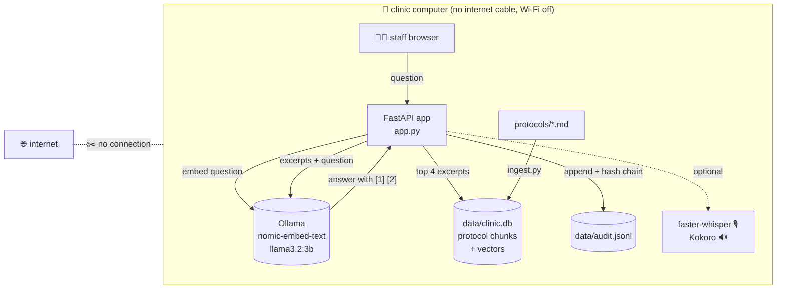
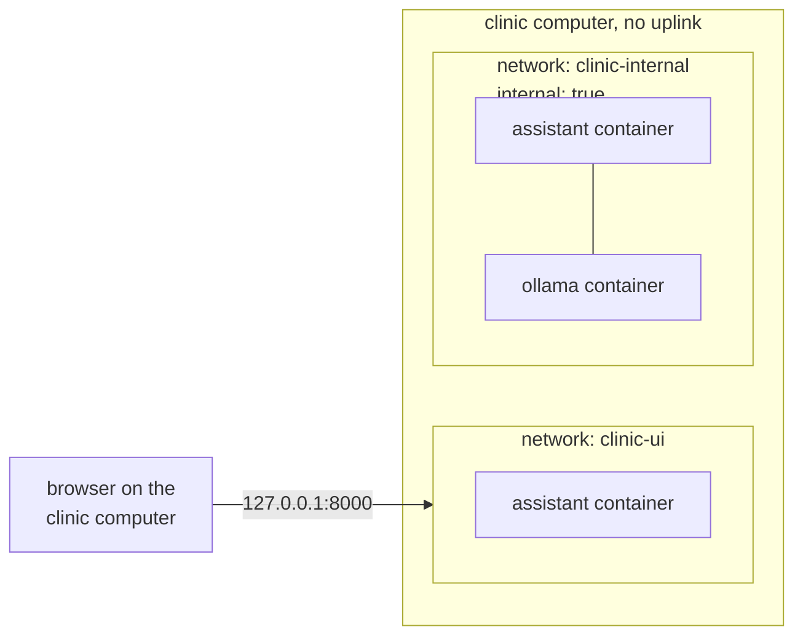

# 16 · Capstone: an offline assistant for a clinic with no internet

**What you'll build:** a complete, **air-gapped** assistant for a small rural clinic. Staff open a web page on the clinic computer, type or **speak** a question ("How do I prepare ORS?"), and get a short answer with numbered citations from the clinic's own written protocols, read aloud if they want. A local LLM and local embeddings (Ollama), private RAG over the protocols, a **tamper-evident audit log**, a "no network" checklist that tests itself, automated tests, and a Docker Compose deployment you can carry to the clinic on a USB drive.
**Like you're 5:** the clinic is on an island with no bridge to the internet. So we pack a little library (the protocols), a librarian who finds the right page (embeddings), a helper who reads it and explains (the LLM), and a notebook where every question is written in pen (the audit log) into one box, and carry the box across by boat.
**Time:** ~4 h · **Builds on:** the whole course, especially [07 · Local embeddings and private RAG](../../part-2-build-with-open-models/07-local-embeddings-and-private-rag), [10 · A fully local voice agent](../../part-2-build-with-open-models/10-a-fully-local-voice-agent), [13 · Small devices](../../part-3-browser-and-edge/13-phones-and-small-devices) · **Needs:** Ollama with `llama3.2:3b` (~2 GB) and `nomic-embed-text` (~270 MB), 8 GB of RAM; Docker for the deployment part; voice is optional

> ⚠️ **The protocols in this lesson are fictional.** They were written for a programming course, for a made-up "Riverside Community Clinic". They are **not medical advice** and must not be used for real patients. A real clinical tool needs clinicians to write and approve the content, testing with the people who will use it, and the approvals your country requires.



## Why this matters
Many places that most need help have the least connectivity: rural clinics, ships, mines, disaster zones, military and government sites, factories with strict security, hospitals that forbid patient data leaving the building. Delivering AI there is a classic **forward-deployed engineering** job: pick models that fit the hardware, make everything work without the internet, prove it with a checklist, keep a trustworthy record of what the system said, and hand over something the local team can run. This capstone puts every skill from this course into one deployable product.

## What you'll learn
- **Air-gapped deployment**: a system that never needs the internet after installation; everything (models, images, code, documents) is prepared in advance and carried in.
- **Grounded answers with citations**: the LLM may only use retrieved protocol excerpts, must cite them, and must say "not covered" instead of guessing (no invented doses).
- **Tamper-evident audit log**: each record contains the hash of the previous one, so editing or deleting history is detectable.
- **Defence in depth for "no network"**: the machine has no uplink, Docker puts the model on an internal-only network, libraries are told to stay offline, and a script checks it all.
- **Shipping it**: Docker Compose, named volumes, a non-root container user, `docker save`/`docker load` for carrying images on a USB drive, tests that run without any model.

## Before you start
1. Activate your course venv (see the [course README](../../README.md)) and install the app's packages:
   ```bash
   pip install -r requirements.txt
   ```
   `fastapi` + `uvicorn` (web app), `python-multipart` (file uploads for voice), `httpx` (talks to Ollama), `numpy` (vector maths), `pydantic` (checks requests), `pytest` (tests). Exact versions are pinned in `requirements.txt`, so the clinic gets exactly what you tested.
2. Download the two models while you're online (once):
   ```bash
   ollama pull llama3.2:3b
   ollama pull nomic-embed-text
   ```
   `nomic-embed-text` turns text into 768 numbers (lessons 02 and 07); `llama3.2:3b` writes the answers.
3. **Optional voice** (speak a question, hear the answer):
   ```bash
   pip install -r requirements-voice.txt
   ```
   This adds faster-whisper (ears) and Kokoro (mouth), as in lesson 10. Kokoro's files are read from `voice-ai-from-zero/models/` (set `KOKORO_DIR` to use another folder). Whisper's `base` model downloads once the first time you speak, so **use voice once while still online**. Without these packages the app still works; the voice buttons just say "not set up".
4. No API key. After step 2 (and 3), you can switch the internet off.

## Run it
All commands start from the course folder (`open-source-and-on-device-ai`).

1. Go into the lesson folder:
   ```bash
   cd part-4-serving-and-tuning/16-capstone-offline-assistant-for-a-clinic-with-no-internet
   ```
2. Build the search index from the protocols:
   ```bash
   python ingest.py
   ```
3. Run the tests (they use a fake Ollama inside the test, so they work even without models):
   ```bash
   pytest -q
   ```

   | Piece | Meaning |
   |-------|---------|
   | `pytest` | Python's test runner: finds files named `test_*.py` and runs every function named `test_*` |
   | `-q` | **q**uiet: one dot per passing test, then a summary |

4. Start the web app:
   ```bash
   uvicorn app:app --port 8000
   ```

   | Piece | Meaning |
   |-------|---------|
   | `uvicorn` | the web server that runs FastAPI apps |
   | `app:app` | "in the file `app.py`, use the object called `app`" |
   | `--port 8000` | listen on port 8000 (add `--host 0.0.0.0` to let other devices on the clinic Wi-Fi connect) |

5. Open http://localhost:8000. Type a staff ID (e.g. `nurse-amina`), ask "How do I prepare ORS?", press **Ask**. Open **Protocol excerpts used** to see what the answer is based on. Try **🔊 Read answer aloud** and **🎙️ Speak** if you installed voice.
6. Try a question the protocols don't cover ("What is the dose of amoxicillin for adults?"). The assistant should say the protocols don't cover it.
7. In a second terminal (same folder, venv active), check the audit log:
   ```bash
   python audit.py show 5
   python audit.py verify
   ```
8. Run the "no network" checklist:
   ```bash
   python check_offline.py
   ```
   While your laptop is online, the first lines are ❌ on purpose. Switch Wi-Fi off and run it again (Mac/Linux: `HF_HUB_OFFLINE=1 python check_offline.py`; Windows PowerShell: `$env:HF_HUB_OFFLINE="1"; python check_offline.py`).

### What you should see
*The ingest, test, audit and checklist outputs below are real (tested with a stand-in for Ollama, because Ollama and Hugging Face weren't available where this course was written). The assistant's wording is an example.*

`python ingest.py`:
```
📄 Reading protocols from .../protocols
   01-fever-in-children.md: 4 chunks
   02-dehydration-and-ors.md: 4 chunks
   03-wound-care.md: 4 chunks
   04-minor-burns.md: 4 chunks
   05-danger-signs-and-referral.md: 3 chunks
   06-vaccine-fridge-cold-chain.md: 4 chunks
✅ Embedded 23 chunks with nomic-embed-text into .../data/clinic.db
```
`pytest -q`:
```
......                                                                   [100%]
6 passed in 1.29s
```
The web page after asking "How do I prepare ORS?" (example answer):
```
1. Wash your hands with soap [1].
2. Pour exactly 1 litre of clean, boiled and cooled water into the clinic's marked jug [1].
3. Empty one whole ORS sachet into the water and stir until it dissolves [1].
4. Label the jug with the time; throw away any ORS left after 24 hours [1].

▸ Protocol excerpts used
Logged as audit record 0524fc56f048 · model llama3.2:3b
```
`python audit.py show 5` and `verify`:
```
2026-10-28T10:32:20+00:00  nurse-amina answer   How do I prepare ORS?
✅ All 1 records are intact.
```
`python check_offline.py` on a laptop that is still online:
```
1. The internet must be OFF
❌ CAN reach 1.1.1.1: this machine is online
❌ CAN reach 8.8.8.8: this machine is online
✅ cannot reach huggingface.co
✅ cannot reach ollama.com

2. Software must not try to download anything
✅ HF_HUB_OFFLINE=1 (Hugging Face libraries stay offline)

3. Everything the assistant needs must be on this machine
✅ Ollama answers at http://localhost:11434
✅ chat model llama3.2:3b is downloaded
✅ embedding model nomic-embed-text is downloaded
✅ search index exists (.../data/clinic.db)
✅ audit log: All 1 records are intact.

🔴 Not ready: fix the ❌ lines above (8/10 checks passed)
```
With Wi-Fi off and the cable unplugged, all 10 lines are ✅ and it says `🟢 Ready for offline use`.

## How it works

### `protocols/` (the knowledge)
Six short Markdown files, each a fictional clinic protocol with `## ` sections and a "FICTIONAL TRAINING SAMPLE" disclaimer. They deliberately **never contain doses**; they point to "the clinic dosing chart". That's a design choice you'll see again in the prompt: an AI should not be the source of numbers that can hurt someone.

### `clinic_rag.py` (the brain)
1. **Settings from environment variables**: `OLLAMA_URL`, `CHAT_MODEL`, `EMBED_MODEL`, `PROTOCOLS_DIR`, `DATA_DIR`. The same code runs on your laptop and in Docker; only the variables change.
2. `ollama = httpx.Client(base_url=OLLAMA_URL, timeout=180)` is one reusable connection. `call_ollama()` turns connection problems and Ollama errors into an `OllamaError` with a sentence a person can act on.
3. **`chunk(text)`** cuts each protocol at its `## ` headings (one section ≈ one idea), splits very long sections at blank lines, and puts the protocol title and section name in front of every chunk ("Diarrhoea and dehydration... Section: Preparing oral rehydration solution (ORS)."), so a chunk still makes sense on its own. The disclaimer before the first section isn't indexed, so it can't crowd out real content in search results.
4. **`embed(texts, kind)`** calls Ollama's `/api/embed`. `nomic-embed-text` was trained with **task prefixes**: `search_document: ` for stored text and `search_query: ` for questions (as in lesson 07). Vectors are scaled to length 1, so **cosine similarity** is a single dot product.
5. **`build_index()`** stores `(file, heading, text, vector)` rows in SQLite (`data/clinic.db`). One small file, no database server: ideal for a clinic computer.
6. **`search()`** computes `matrix @ question_vector` (one similarity score per chunk) and takes the top 4.
7. **`answer()`** sends the system rules plus the numbered excerpts and the question to `/api/chat` with `temperature 0.1`. The **system prompt** is the safety layer: use only the excerpts, cite `[n]`, say the exact "not covered" sentence when the excerpts don't answer, never invent doses, put urgent referral first when a danger sign is mentioned, and use short numbered steps.

### `audit.py` (the notebook in pen)
Every answer (and every error) becomes one JSON line in `data/audit.jsonl`:
```json
{"time": "2026-10-28T10:32:20+00:00", "event": "answer", "staff_id": "nurse-amina",
 "question": "How do I prepare ORS?", "answer": "1. Wash your hands...", "model": "llama3.2:3b",
 "sources": ["02-dehydration-and-ors.md#Preparing oral rehydration solution (ORS)"],
 "prev_hash": "0000...0000", "hash": "0524fc56f048..."}
```
- **SHA-256** turns any text into a 64-character fingerprint; change one letter and the fingerprint changes completely.
- Each record's `hash` covers all its fields *including* `prev_hash`, the previous record's fingerprint. So records form a **chain**:
  ```
  [record 1 | prev 0000 | hash A] ← [record 2 | prev A | hash B] ← [record 3 | prev B | hash C]
  ```
  Edit record 2 and its hash no longer matches its content; delete record 2 and record 3's `prev_hash` points at nothing. `verify()` walks the chain and names the first broken line.
- `_lock` makes sure two requests arriving at the same moment don't write half-lines into each other.
- Limits (be honest with customers): someone with full access could rewrite the *whole* file and recompute every hash. Real systems also copy the latest hash somewhere else every day (a printed log sheet, a second machine, a write-once USB drive), so a rewrite would show.

### `app.py` (the web app)
1. `Question` is a Pydantic model: the question must be 3–500 characters; `staff_id` 1–20 characters of letters, digits, `-` or `_` (a **regular expression** `^[A-Za-z0-9_-]+$`). Anything else gets a `422` error before our code runs, which keeps junk and HTML out of the log.
2. `index()` loads the search index once and keeps it in memory (`@lru_cache`). Restart the app after re-running `ingest.py`.
3. `GET /` serves the page; `GET /api/health` reports `index`, `audit_log_intact`, `ollama`, `chat_model`, `embed_model` and an overall `ok` (handy for monitoring).
4. `POST /api/ask` answers, writes the audit record, and returns the answer, the sources and the first 12 characters of the record's hash as an `audit_id` the user can quote. If Ollama is down, it logs an `error` record and returns `503` with the reason.
5. **Optional voice**: `ears()` and `mouth()` import faster-whisper and Kokoro *only when first used*. `/api/transcribe` saves the browser's recording to a temporary file, transcribes it, and deletes the file. `/api/speak` returns a WAV file. If the packages or model files are missing, both return `501 Not Implemented` with a clear message, and the rest of the app keeps working.

### `static/index.html` (the page)
Plain HTML and JavaScript, no external libraries or fonts (nothing to download). It shows a permanent "fictional, not medical advice, don't type patient names" banner; puts answers on the page with `textContent` (never `innerHTML`); records speech with the browser's `MediaRecorder`; and remembers the staff ID in `localStorage` on that device only.

### `check_offline.py` (the checklist that tests itself)
It tries to open network connections to public addresses (`socket.create_connection(("1.1.1.1", 443), timeout=3)`): on an air-gapped machine these **must fail**. Then it checks `HF_HUB_OFFLINE=1`, that Ollama answers locally with both models, that the index exists, and that the audit chain is intact.

### `test_clinic.py` (tests without any model)
`httpx.MockTransport(fake_ollama)` replaces the network: every request the code sends to "Ollama" is answered by the `fake_ollama` function in the test (embeddings made from keyword counts, a canned chat answer). `monkeypatch` points the data folder at a temporary directory. The six tests check chunking, that search finds the right protocol, the full ask → answer → audit path, input validation, tamper detection, and the health report. A clinic deployment must be testable on any laptop, in CI, without a GPU.

## Deploy it with Docker Compose

### The files
`Dockerfile`, line by line:

| Line | Meaning |
|------|---------|
| `FROM python:3.12-slim` | start from a small official image with Python 3.12 |
| `ENV PYTHONDONTWRITEBYTECODE=1 PYTHONUNBUFFERED=1 HF_HUB_OFFLINE=1` | no `.pyc` files; print logs immediately; Hugging Face libraries never try to download |
| `WORKDIR /app` | "cd" into `/app` for all following lines (created if missing) |
| `COPY requirements.txt .` then `RUN pip install --no-cache-dir -r requirements.txt` | install packages first, so this slow step is cached until `requirements.txt` changes; `--no-cache-dir` keeps the image smaller |
| `COPY clinic_rag.py ... ./` and `COPY static/ static/` | copy the app code into the image |
| `RUN useradd --create-home clinic && mkdir -p /app/data && chown clinic /app/data` | make a normal user `clinic` and give it the data folder |
| `USER clinic` | run everything after this as `clinic`, not `root`: if the app were ever hacked, the attacker has fewer powers |
| `EXPOSE 8000` | documents that the app listens on port 8000 |
| `CMD ["uvicorn", "app:app", "--host", "0.0.0.0", "--port", "8000"]` | the command the container runs; `0.0.0.0` = accept connections from outside the container |

`docker-compose.yml`, key by key:

| Key | Meaning |
|-----|---------|
| `services:` | the containers that make up the app: `ollama` and `assistant` |
| `image: ollama/ollama:0.35.1` | Ollama's official image, pinned to an exact version |
| `volumes: - ./ollama-data:/root/.ollama` | a **bind mount**: the folder `ollama-data` next to the compose file appears inside the container where Ollama keeps models. You fill it before going offline |
| `environment: - OLLAMA_KEEP_ALIVE=24h` | keep the model loaded all day, so nobody waits for loading |
| `networks: [clinic-internal]` | Ollama joins *only* the internal network |
| `restart: unless-stopped` | start again automatically after a crash or a reboot, unless you stopped it on purpose |
| `build: .` + `image: clinic-assistant:1.0` | build the app from this folder's `Dockerfile` and name the image, so you can `docker save` it |
| `OLLAMA_URL=http://ollama:11434` | inside a compose network, each service is reachable by its **service name** |
| `./protocols:/app/protocols:ro` | the protocols, mounted **r**ead-**o**nly: the app can't change them |
| `clinic-data:/app/data` | a **named volume** managed by Docker for the index and audit log; it survives restarts and upgrades, and it takes the folder owner (`clinic`) from the image |
| `ports: - "127.0.0.1:8000:8000"` | publish the app on this computer only (`host-address:host-port:container-port`). For tablets on the clinic's own offline Wi-Fi, use `"8000:8000"` |
| `depends_on: [ollama]` | start `ollama` before `assistant` |
| `clinic-internal: internal: true` | a network with **no route to the outside world** |
| `clinic-ui: {}` | a normal network. Docker can only publish ports from normal networks, so the app also joins this one. The model container doesn't |


(The assistant container is in both networks; the ollama container only in the internal one.)

### Preparing the air-gapped machine
**A. On a computer with internet** (in the lesson folder):
1. Download the models into `./ollama-data` with a temporary Ollama container:
   ```bash
   docker run -d --name prep -v "$PWD/ollama-data:/root/.ollama" ollama/ollama:0.35.1
   docker exec prep ollama pull llama3.2:3b
   docker exec prep ollama pull nomic-embed-text
   docker rm -f prep
   ```

   | Piece | Meaning |
   |-------|---------|
   | `docker run -d --name prep` | start a container in the background (**d**etached) and call it `prep` |
   | `-v "$PWD/ollama-data:/root/.ollama"` | mount the folder `ollama-data` in the current directory (`$PWD` = **p**rint **w**orking **d**irectory) as Ollama's model store |
   | `docker exec prep ollama pull ...` | run `ollama pull` inside the running `prep` container |
   | `docker rm -f prep` | stop and remove it (**f**orce); the models stay in `./ollama-data` |

2. Build the app image and save both images into one file:
   ```bash
   docker compose build
   docker save -o clinic-images.tar ollama/ollama:0.35.1 clinic-assistant:1.0
   ```
   `docker save -o <file> <images...>` writes images into a `.tar` archive (**o**utput file), about 3–4 GB here.
3. Copy the **whole lesson folder** (including `ollama-data/` and `clinic-images.tar`) onto a USB drive. Check the copy: `du -sh ollama-data` should show ~2.3 GB.

**B. On the clinic computer** (Linux with Docker installed, internet unplugged):
1. Copy the folder from the USB drive, open a terminal in it, and load the images:
   ```bash
   docker load -i clinic-images.tar
   ```
2. Start everything without trying to build or download:
   ```bash
   docker compose up -d --no-build --pull never
   ```

   | Piece | Meaning |
   |-------|---------|
   | `docker compose up` | create and start all services in `docker-compose.yml` |
   | `-d` | in the background |
   | `--no-build` | use the loaded image, don't build |
   | `--pull never` | never try to download images (there's no internet anyway; this makes it fail fast instead of waiting) |

3. Build the index and restart the app so it loads it:
   ```bash
   docker compose exec assistant python ingest.py
   docker compose restart assistant
   ```
4. Run the checklist **inside** the app container and open http://localhost:8000:
   ```bash
   docker compose exec assistant python check_offline.py
   ```
5. Daily: `docker compose exec assistant python audit.py verify`; write the last hash (`docker compose exec assistant tail -n 1 /app/data/audit.jsonl`) on the paper log sheet. Weekly backup: `docker compose cp assistant:/app/data ./backup-$(date +%F)`.

### The "no network" checklist
| # | Check | How |
|---|-------|-----|
| 1 | No physical uplink | network cable to the outside unplugged; Wi-Fi only joins the clinic's own offline router (or is off); mobile hotspot off |
| 2 | Software doesn't phone home | `HF_HUB_OFFLINE=1` set (in the Dockerfile); OS automatic updates switched off (updates come by USB, tested first) |
| 3 | Models are local | `ollama list` (or `check_offline.py`) shows both models; nothing pulls at runtime |
| 4 | Model server isolated | `ollama` container only on `clinic-internal` (`internal: true`), no published ports |
| 5 | App reachable only where intended | port bound to `127.0.0.1`, or to the clinic LAN only; a firewall blocks everything else |
| 6 | Images pinned and carried in | `ollama/ollama:0.35.1`, `clinic-assistant:1.0` loaded with `docker load`; `--pull never` |
| 7 | No patient data in questions | banner on the page, staff training; audit log stored only on this machine, backed up to an encrypted drive |
| 8 | Audit trail trustworthy | `audit.py verify` daily; last hash copied to paper |
| 9 | Automatic proof | `check_offline.py` shows `🟢 Ready for offline use` |
| 10 | Recovery plan | a second USB drive with the same folder and images; written steps to reinstall in 30 minutes |

## If something goes wrong
- **`❌ No index yet. Run python ingest.py first.`** (or a 503 on Ask) → run `python ingest.py` (Docker: `docker compose exec assistant python ingest.py`, then `docker compose restart assistant`).
- **`Ollama says: model "nomic-embed-text" not found`** → pull it while online (`ollama pull nomic-embed-text`). In Docker, models must already be in `./ollama-data` (section A, step 1); the internal network can't download.
- **Answers ignore the excerpts or don't cite** → small models sometimes drift. Keep `temperature` low, try `qwen2.5:3b` (`CHAT_MODEL=qwen2.5:3b`), and test with the questions in Try this 1. Never ship without reading many answers yourself.
- **The 🎙️/🔊 buttons say "not set up on this machine"** → install `requirements-voice.txt`, make sure Kokoro's files exist in `KOKORO_DIR`, and run voice once while online so Whisper's model is cached. In Docker, voice isn't installed by default (keeping the image small).
- **`audit.py verify` reports a broken line** → don't "fix" the file. Keep a copy, compare with your last backup and paper hashes, and report it: that's exactly what the log is for.
- **`docker compose up` tries to download something and hangs** → you forgot `--no-build --pull never`, or an image wasn't loaded: `docker images` must list `ollama/ollama:0.35.1` and `clinic-assistant:1.0`.
- **`PermissionError` writing `/app/data` in Docker** → you changed `clinic-data` to a bind mount like `./data`. Bind-mounted folders keep the host's owner; either keep the named volume or `sudo chown 1000:1000 data` on the host (the `clinic` user's id is usually 1000).

## Try this
1. **Easy:** write an evaluation sheet. Ask these 6 questions and grade each answer (correct? cites the right protocol? refuses when it should?): "How long should I cool a burn?", "What temperature must the vaccine fridge stay between?", "A baby of 6 weeks has a fever. What do I do?", "How do I clean a small cut?", "What's the adult dose of amoxicillin?", "Who won the football world cup?".
   <details><summary>Hint</summary>The first four should cite RCC-04, RCC-06, RCC-05 (danger sign: fever under 2 months, so urgent referral first) and RCC-03. The last two must give the exact "The clinic protocols don't cover this..." sentence. Turn the sheet into a test: a list of (question, expected file, must_refuse) and a script that calls <code>clinic_rag.answer()</code> for each. That's an <strong>eval</strong>, the subject of the forward-deployed course.</details>
2. **Medium:** refuse *before* calling the LLM when nothing relevant is found: if the best similarity score is below a threshold, return the "not covered" sentence directly.
   <details><summary>Solution</summary>

   In `clinic_rag.py`, add `MIN_SCORE = float(os.environ.get("MIN_SCORE", "0.5"))` near the top, and at the start of `answer()`, right after `hits = search(...)`:
   ```python
   if hits[0]["score"] < MIN_SCORE:
       return {"answer": "The clinic protocols don't cover this. Please ask the clinician in charge.",
               "sources": hits, "model": "none (no relevant protocol found)"}
   ```
   Find a good threshold by looking at the scores (shown under "Protocol excerpts used") for good questions versus off-topic ones. It's faster, and the LLM can't be tempted to answer from its own memory.
   </details>
3. **Harder:** add an export for the clinic manager: `python audit.py csv > audit.csv` that writes time, staff ID, event, question, sources and the first 12 characters of each hash, refusing to export if the chain is broken.
   <details><summary>Hint</summary>Add an <code>elif command == "csv":</code> branch. Call <code>verify()</code> first and <code>sys.exit</code> if it fails. Then use <code>csv.writer(sys.stdout)</code>, write a header row, and one row per JSON line (join the <code>sources</code> list with <code>"; "</code>). Bonus: use your fine-tuned model from lesson 15 as <code>CHAT_MODEL</code> and compare answers on your evaluation sheet.</details>

## Check yourself
1. Name three separate layers that keep this system offline, and why one layer isn't enough.
2. How does the audit log detect that someone deleted a record from the middle, and what can it *not* detect on its own?
3. Why do the protocols and the prompt avoid medicine doses, and what would you need before a real clinic used a tool like this?
4. Why are the tests able to run on a laptop with no Ollama and no GPU, and why does that matter for a deployment like this?

<details><summary>Answers</summary>

1. Any three of: no physical uplink (cable/Wi-Fi), `HF_HUB_OFFLINE=1` and pinned, pre-loaded images (`--pull never`), the model container on an `internal: true` network, the port bound to localhost or the clinic LAN only, and `check_offline.py` proving it. One layer can fail silently (someone plugs in a cable, a library tries a download); several layers plus an automatic check catch it.
2. Each record stores the previous record's hash; removing one breaks the next record's `prev_hash` link, and editing one changes its own hash. It can't detect someone rewriting the *entire* chain and recomputing every hash, which is why the latest hash is also copied somewhere else (paper, another machine).
3. A wrong number from an AI can directly harm a patient, and small models can invent numbers. Doses stay on the approved chart, and the AI only points to it. A real tool would need clinicians to write and sign off the content, evaluation with real staff and questions, clear accountability, data-protection review, and the medical-device or health-authority approvals required locally.
4. The tests replace the network with `httpx.MockTransport` and use a temporary folder, so they check the program's logic (chunking, search, audit, validation, health) without any model. You can run them on every change, in CI, before carrying a new version to a place where you can't easily fix mistakes.
</details>

## Learn more (optional)
**Read the official docs**
- Ollama (API, Docker image, FAQ on offline use): https://github.com/ollama/ollama/tree/main/docs
- Ollama Docker guide: https://github.com/ollama/ollama/blob/main/docs/docker.mdx
- FastAPI: https://fastapi.tiangolo.com
- Docker Compose file reference (networks, `internal`, volumes): https://docs.docker.com/reference/compose-file/
- `docker save` / `docker load`: https://docs.docker.com/reference/cli/docker/image/save/ and https://docs.docker.com/reference/cli/docker/image/load/
- Hugging Face offline mode (`HF_HUB_OFFLINE`): https://huggingface.co/docs/huggingface_hub/package_reference/environment_variables
- Python `hashlib` (SHA-256): https://docs.python.org/3/library/hashlib.html
- WHO guidance on ethics and governance of AI for health: https://www.who.int/publications/i/item/9789240029200

**Watch**
- YouTube search: [local RAG with Ollama fully offline](https://www.youtube.com/results?search_query=local+rag+ollama+fully+offline)
- YouTube search: [air-gapped LLM deployment](https://www.youtube.com/results?search_query=air+gapped+llm+deployment)
- YouTube search: [TechWorld with Nana Docker Compose tutorial](https://www.youtube.com/results?search_query=techworld+with+nana+docker+compose)
- YouTube search: [hash chain tamper evident log explained](https://www.youtube.com/results?search_query=hash+chain+tamper+evident+log+explained)

## Next
🎉 You've finished **Open-Source and On-Device AI**: you can run, choose, serve, shrink, fine-tune and ship open models, from a browser tab to an air-gapped clinic.

→ Continue with the [Forward Deployed AI Engineer](../../../forward-deployed-ai-engineer) course, where you'll take systems like this one to real customers: discovery, design docs, evals, agents, and deployment inside their networks.
