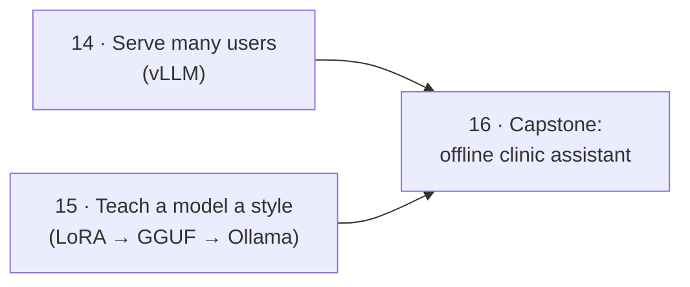

# Part 4 · Serving and tuning

The last part goes in two directions. **Up**: serve one model to many people at once with vLLM. **Inward**: change a model's behaviour with LoRA fine-tuning and package the result as a GGUF file for Ollama. Then you put the whole course together in a capstone: an assistant that works in a clinic with **no internet at all**.

| # | Lesson | What you'll have | Time |
|---|--------|------------------|------|
| 14 | [High-throughput serving with vLLM](14-high-throughput-serving-with-vllm) | a vLLM server with every `vllm serve` flag explained, and a load test that compares it with Ollama under 16 users | 2 h |
| 15 | [Fine-tune a small model with LoRA and export to GGUF](15-fine-tune-a-small-model-with-lora-and-export-to-gguf) | "Sprout", a Qwen2.5-0.5B taught a new style with LoRA, merged, converted to GGUF, quantized and running in Ollama | 2.5 h |
| 16 | [Capstone: offline assistant for a clinic with no internet](16-capstone-offline-assistant-for-a-clinic-with-no-internet) | an air-gapped RAG assistant with cited answers, optional voice, a tamper-evident audit log, tests, a "no network" checklist and a Docker Compose deployment | 4 h |

**Total: about 1–2 weeks at 1 hour a day.**



## Install once (in your activated venv)
Each lesson repeats its own line:
```bash
pip install openai                                              # 14: client and load test
pip install torch transformers datasets peft trl accelerate     # 15: fine-tuning
pip install -r 16-capstone-offline-assistant-for-a-clinic-with-no-internet/requirements.txt   # 16 (run from this folder)
```
- **Linux without an NVIDIA GPU:** install the CPU-only PyTorch first: `pip install torch --index-url https://download.pytorch.org/whl/cpu`.
- **vLLM itself** goes into its **own** venv on a Linux machine with an NVIDIA GPU (`uv pip install vllm==0.31.0 --torch-backend=auto`), because it pins its own PyTorch version. Lesson 14 shows how, plus Docker, CPU and free cloud-GPU options.
- Lesson 16's optional voice: `pip install -r 16-capstone-offline-assistant-for-a-clinic-with-no-internet/requirements-voice.txt`.

## What else you need
| What | Lessons | Notes |
|------|---------|-------|
| Linux/WSL2 + NVIDIA GPU (8 GB+) | 14 (vLLM part) | or Docker with the NVIDIA Container Toolkit, or a free Colab/Kaggle GPU; the load test also runs against Ollama alone |
| Ollama with `qwen2.5:1.5b` | 14 | for the comparison (`ollama pull qwen2.5:1.5b`) |
| llama.cpp source (`git clone --branch b11804 ...`) and `llama-quantize` | 15 | the converter script and the quantizer, same build as [lesson 03](../part-1-run-models-locally/03-llama-cpp-and-gguf) |
| ~6 GB free disk, 8 GB RAM | 15 | CPU training takes 20–60 min; a free Colab GPU ~2 min |
| Ollama with `llama3.2:3b` and `nomic-embed-text` | 16 | pulled *before* going offline |
| Docker with Compose | 16 (deployment part) | the app also runs without Docker |

## After this part you can
- Serve an open model to many users with vLLM, choose its flags, and prove the gain with a load test (throughput, p95 latency, time to first token).
- Explain continuous batching and PagedAttention to a customer in plain words.
- Fine-tune a small model with LoRA, judge whether it worked, and ship it as a quantized GGUF in Ollama.
- Design, test, document and deploy an air-gapped AI assistant with grounded answers and a trustworthy audit trail.

Start here → [14 · High-throughput serving with vLLM](14-high-throughput-serving-with-vllm)

**After this part:** you've finished the course. Continue with [Forward Deployed AI Engineer](../../forward-deployed-ai-engineer).
